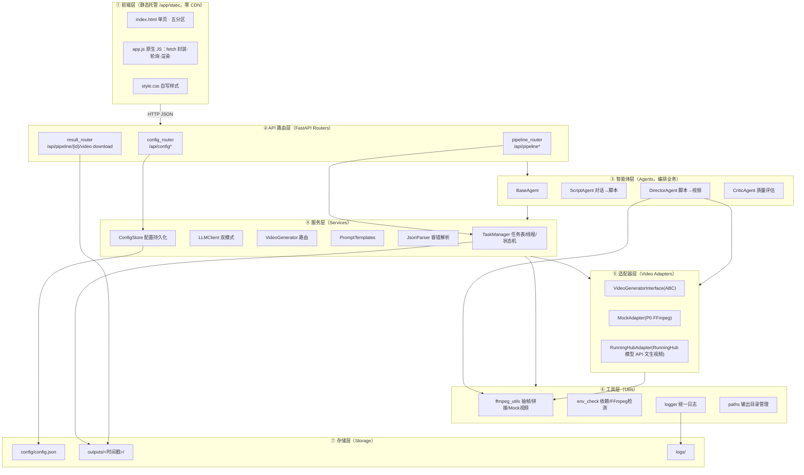
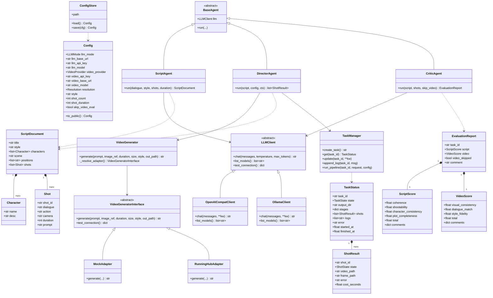

# StoryForge 系统架构设计 + 任务分解

> 文档版本：v1.0
> 撰写人：高见远（架构师）
> 日期：2026-02
> 状态：已评审，可进入实现
> 设计依据：`docs/PRD.md`（v1.1）§3.1–§3.9、§4.1
> 项目根目录：`E:\ai\storyforge`

---

## 〇、设计总览（一页速读）

| 维度 | 结论 |
| --- | --- |
| 交付形态 | 本地单机 Web 应用，双击 `start.bat` 启动，自动开浏览器 |
| 前端 | **原生 HTML + 自写 CSS + 原生 JS，零外部 CDN 依赖**（无任何外网资源引用） |
| 后端 | Python 3.13 + FastAPI + Uvicorn，单进程，端口 8000（占用自动 +1） |
| 智能体 | ScriptAgent（对话→脚本）、DirectorAgent（脚本→视频）、CriticAgent（质量评估） |
| LLM 层 | `LLMClient` 统一封装，双模式（OpenAI 兼容 / Ollama），`chat(messages, **kw) -> str` |
| 视频层 | `VideoGeneratorInterface.generate(...) -> video_path`，适配器路由：Mock(P0)/RunningHub(模型 API) |
| 工具 | 直接调用 **FFmpeg 命令行**（不引入 moviepy）：Mock 占位视频 / 抽末帧 / concat 拼接 |
| 异步模型 | 后台线程执行长流水线 + 内存任务表 + 前端轮询 `/status` |
| 存储 | 配置 `config/config.json`（明文，返回脱敏）；产物 `outputs/<时间戳>/`；日志 `logs/` |
| 统一响应 | `{ok, data, error}`，UTF-8，Windows 中文路径加引号 |

---

## 一、总体架构（分层图）

### 1.1 分层架构图（Mermaid）



### 1.2 分层职责说明

| 层 | 职责 | 关键约束 |
| --- | --- | --- |
| ① 前端层 | 五分区单页交互、轮询进度、渲染脚本/视频/报告 | **零外网资源**；图标用 Unicode/内联 SVG；无构建链 |
| ② API 路由层 | 暴露 REST 端点，参数校验（Pydantic），统一响应包装 | 全部返回 `{ok,data,error}`；不写业务逻辑 |
| ③ 智能体层 | 编排三步流水线，管理阶段状态与中间产物 | 不感知 LLM/视频具体实现，只依赖抽象接口 |
| ④ 服务层 | LLM 双模式、视频路由、任务管理、配置、解析、提示词 | 长任务运行在后台线程，状态写入内存任务表 |
| ⑤ 适配器层 | 屏蔽不同视频 API 差异 | 输出格式统一 `mp4/H.264`，与 Mock 完全一致 |
| ⑥ 工具层 | FFmpeg 封装、环境自检、日志、路径 | FFmpeg 全部走命令行并加引号；UTF-8 |
| ⑦ 存储层 | 配置、产物、日志落盘 | 每次任务独立时间戳目录 |

---

## 二、完整文件清单

> 路径均相对 `E:\ai\storyforge`。标注 `[新建]` 为需创建，`[已存在]` 为已有。

### 2.1 根目录与文档

| # | 相对路径 | 职责 |
| --- | --- | --- |
| 1 | `start.bat` [新建] | 一键启动：检测 Python/依赖/FFmpeg → 建/用 venv → 启动 Uvicorn → 自动开浏览器 |
| 2 | `requirements.txt` [新建] | Python 依赖声明（见 §6） |
| 3 | `README.md` [新建] | 项目简介、快速开始、目录说明 |
| 4 | `docs/PRD.md` [已存在] | 产品需求文档 v1.1 |
| 5 | `docs/ARCHITECTURE.md` [新建] | 本文档：架构设计 + 任务分解 |
| 6 | `docs/使用说明.md` [新建] | 面向非专业用户的中文说明书（安装/启动/配置/跑通/常见问题） |
| 7 | `docs/sequence-diagram.mermaid` [新建] | 完整流水线时序图（本文 §4 抽取） |
| 8 | `docs/class-diagram.mermaid` [新建] | 数据结构与接口类图（本文 §3 抽取） |

### 2.2 后端 Python 包 `app/`

| # | 相对路径 | 职责 |
| --- | --- | --- |
| 9 | `app/__init__.py` [新建] | 包标识，暴露版本号 |
| 10 | `app/main.py` [新建] | FastAPI 应用入口：挂载路由、静态目录、启动事件（环境自检 + Ollama 探测）、端口自动 +1 |
| 11 | `app/deps.py` [新建] | 依赖注入：单例 `ConfigStore` / `TaskManager` / `LLMClient` 工厂 |

#### 路由 `app/routers/`

| # | 相对路径 | 职责 |
| --- | --- | --- |
| 12 | `app/routers/__init__.py` [新建] | 汇总导出各 router |
| 13 | `app/routers/config_router.py` [新建] | `/api/config` 读写、`/test-llm`、`/test-video` |
| 14 | `app/routers/pipeline_router.py` [新建] | `/api/pipeline/run`、`/status`、`/script`、`/report`、`/retry-shot` |
| 15 | `app/routers/result_router.py` [新建] | `/api/pipeline/{id}/video/{name}`、`/download`、`/frames/{name}` |

#### 智能体 `app/agents/`

| # | 相对路径 | 职责 |
| --- | --- | --- |
| 16 | `app/agents/__init__.py` [新建] | 包导出 |
| 17 | `app/agents/base_agent.py` [新建] | `BaseAgent`：持有 `LLMClient`，提供日志与阶段状态回调 |
| 18 | `app/agents/script_agent.py` [新建] | `ScriptAgent.run(dialogue, style, shots, duration) -> ScriptDocument` |
| 19 | `app/agents/director_agent.py` [新建] | `DirectorAgent.run(script, config, ctx) -> list[ShotResult]`：拆镜、逐镜生成、抽帧、拼接 |
| 20 | `app/agents/critic_agent.py` [新建] | `CriticAgent.run(script, shots, skip_video) -> EvaluationReport` |

#### 服务 `app/services/`

| # | 相对路径 | 职责 |
| --- | --- | --- |
| 21 | `app/services/__init__.py` [新建] | 包导出 |
| 22 | `app/services/config_store.py` [新建] | `ConfigStore`：读写 `config/config.json`，api_key 脱敏/回填 |
| 23 | `app/services/llm_client.py` [新建] | `LLMClient` 双模式：`chat()`、`list_models()`、`test_connection()` |
| 24 | `app/services/video_generator.py` [新建] | `VideoGenerator`：按配置路由到适配器，统一入口 `generate()` |
| 25 | `app/services/task_manager.py` [新建] | `TaskManager`：内存任务表、后台线程、状态机、逐镜头状态、日志缓冲 |
| 26 | `app/services/prompt_templates.py` [新建] | 各智能体提示词模板（Script/Director/Critic）与 JSON 强约束 |
| 27 | `app/services/json_parser.py` [新建] | `parse_json_lenient()`：提取代码块 + 最大括号匹配 + 修复 + 重试 |

#### 数据模型 `app/models/`

| # | 相对路径 | 职责 |
| --- | --- | --- |
| 28 | `app/models/__init__.py` [新建] | 包导出 |
| 29 | `app/models/schemas.py` [新建] | 全部 Pydantic 模型：Config/ScriptDocument/Shot/TaskStatus/EvaluationReport 等 |
| 30 | `app/models/enums.py` [新建] | 枚举：LLMMode、VideoProvider、Resolution、TaskState、ShotState |

#### 视频适配器 `app/services/adapters/`

| # | 相对路径 | 职责 |
| --- | --- | --- |
| 31 | `app/services/adapters/__init__.py` [新建] | 适配器注册表 `ADAPTER_REGISTRY` |
| 32 | `app/services/adapters/base.py` [新建] | `VideoGeneratorInterface` 抽象基类（ABC） |
| 33 | `app/services/adapters/mock_adapter.py` [新建] | `MockAdapter`：调用 FFmpeg 生成渐变色块+文字+编号+进度条占位视频（P0） |
| 34 | `app/services/adapters/runninghub_adapter.py` [新建] | `RunningHubAdapter`：RunningHub 模型 API（文生视频；提交 → 轮询 → 下载） |

#### 工具 `app/utils/`

| # | 相对路径 | 职责 |
| --- | --- | --- |
| 37 | `app/utils/__init__.py` [新建] | 包导出 |
| 38 | `app/utils/ffmpeg_utils.py` [新建] | `probe_ffmpeg()`、`make_mock_video()`、`extract_last_frame()`、`concat_videos()`、`probe_duration()` |
| 39 | `app/utils/env_check.py` [新建] | 检测 Python 版本 / 依赖可用性 / FFmpeg 可用性，返回中文诊断 |
| 40 | `app/utils/logger.py` [新建] | `get_logger()`：控制台 + `logs/app.log`，统一格式 |
| 41 | `app/utils/paths.py` [新建] | `Paths`：项目根、config、outputs、logs、任务目录创建、安全路径校验 |
| 42 | `app/utils/responses.py` [新建] | `ok()` / `fail()` 统一响应包装 + 错误码常量 |

#### 前端静态资源 `app/static/`

| # | 相对路径 | 职责 |
| --- | --- | --- |
| 43 | `app/static/index.html` [新建] | 单页应用骨架：五分区 + 帮助弹窗 + 内联 SVG 图标，**零外网引用** |
| 44 | `app/static/app.js` [新建] | 原生 JS：配置读写、连接测试、启动流水线、轮询 `/status`、渲染进度/预览/报告 |
| 45 | `app/static/style.css` [新建] | 全部自写样式（五分区布局、进度点、进度条、卡片、弹窗） |

### 2.3 运行时目录（由程序创建）

| # | 相对路径 | 职责 |
| --- | --- | --- |
| 46 | `config/config.json` [运行时生成] | 用户配置持久化（明文 api_key） |
| 47 | `outputs/<时间戳>/` [运行时生成] | 单次任务产物根目录 |
| 48 | `outputs/<时间戳>/script.json` | 脚本契约产物 |
| 49 | `outputs/<时间戳>/shots/shot_00N.mp4` | 逐镜头视频 |
| 50 | `outputs/<时间戳>/frames/frame_00N.jpg` | 末帧参考图 |
| 51 | `outputs/<时间戳>/final_video.mp4` | 拼接成片 |
| 52 | `outputs/<时间戳>/evaluation_report.json` | 评估报告 |
| 53 | `logs/app.log` [运行时生成] | 应用日志 |

**文件总数**：需创建 45 个源文件（含 8 个包 `__init__.py`），运行时另有 7 类产物路径。

---

## 三、数据结构与接口设计

### 3.1 类图（Mermaid，同时输出到 `docs/class-diagram.mermaid`）



### 3.2 Pydantic 模型定义（`app/models/schemas.py`）

> 所有模型 `model_config = ConfigDict(extra="ignore")`，字段名与 §3.7 契约及 API 响应对齐。

#### 3.2.1 枚举（`app/models/enums.py`）

```python
class LLMMode(str, Enum):
    OPENAI = "openai"      # 模式A：OpenAI 兼容
    OLLAMA = "ollama"      # 模式B：本地 Ollama

class VideoProvider(str, Enum):
    MOCK = "mock"              # P0 必装：FFmpeg 占位视频
    RUNNINGHUB = "runninghub"  # RunningHub 模型 API（文生视频）

class Resolution(str, Enum):
    P720 = "720p"          # 1280x720
    P1080 = "1080p"        # 1920x1080

class TaskState(str, Enum):
    PENDING = "pending"
    RUNNING = "running"
    SUCCESS = "success"
    FAILED = "failed"

class ShotState(str, Enum):
    WAITING = "waiting"      # 等待
    RUNNING = "running"      # 生成中
    SUCCESS = "success"      # 完成
    FAILED = "failed"        # 失败
```

#### 3.2.2 配置模型 `Config`

| 字段 | 类型 | 默认 | 说明 |
| --- | --- | --- | --- |
| `llm_mode` | `LLMMode` | `ollama` | 默认零成本可跑通 |
| `llm_base_url` | `str` | `http://localhost:11434` | Ollama 默认；切 OpenAI 时建议 `https://api.deepseek.com/v1` |
| `llm_api_key` | `str` | `""` | Ollama 模式忽略 |
| `llm_model` | `str` | `qwen2.5:14b` | — |
| `video_provider` | `VideoProvider` | `mock` | 默认 Mock |
| `video_api_key` | `str` | `""` | Mock 模式忽略 |
| `video_base_url` | `str` | `""` | 真实适配器用 |
| `video_model` | `str` | `""` | 真实适配器用 |
| `resolution` | `Resolution` | `720p` | 仅 720p/1080p |
| `style` | `str` | `realistic` | realistic/anime/animation |
| `shot_count` | `int` | `4` | 约束 2–8 |
| `shot_duration` | `int` | `4` | 约束 2–10（秒） |
| `skip_video_eval` | `bool` | `false` | Mock 视频时可选跳过视频评估 |

方法：
```python
def to_public(self) -> "Config":  # 返回 api_key 脱敏后的副本（sk-****abcd）
```

#### 3.2.3 脚本契约（对齐 PRD §3.7）

```python
class Character(BaseModel):
    name: str
    desc: str

class Shot(BaseModel):
    shot_id: str            # "shot_001"
    dialogue: str           # 对白
    action: str             # 动作/画面
    camera: str             # 运镜（如"中景，缓慢推进"）
    duration: int           # 秒
    prompt: str             # 面向视频模型的英文提示词

class ScriptDocument(BaseModel):
    title: str
    style: str
    characters: list[Character] = []
    scene: str = ""
    positions: list[str] = []
    shots: list[Shot] = []
```

#### 3.2.4 任务与镜头状态

```python
class ShotResult(BaseModel):
    shot_id: str
    state: ShotState = ShotState.WAITING
    video_path: str | None = None      # 相对 outputs 的路径
    frame_path: str | None = None
    error: str | None = None
    cost_seconds: float = 0.0

class StageStatus(BaseModel):
    name: str                          # "script"/"director"/"concat"/"critic"
    state: TaskState = TaskState.PENDING
    detail: str = ""                   # 如 "shot_003/006"
    elapsed: float = 0.0

class TaskStatus(BaseModel):
    task_id: str
    state: TaskState = TaskState.PENDING
    output_dir: str = ""               # 相对路径 outputs/<ts>
    stages: dict[str, StageStatus] = {}   # 四阶段
    shots: list[ShotResult] = []
    logs: list[str] = []
    error: str | None = None
    started_at: float = 0.0
    finished_at: float = 0.0
```

#### 3.2.5 评估报告（对齐 Q7：脚本 4 维 + 视频 3 维，1–10）

```python
class ScriptScore(BaseModel):
    coherence: float            # 连贯性
    shootability: float         # 可拍性
    character_consistency: float# 角色一致性
    plot_completeness: float    # 剧情完整度
    total: float                # = 四维均值
    comments: dict[str, str] = {}   # 维度 -> 一句评语

class VideoScore(BaseModel):
    visual_consistency: float   # 画面一致性
    dialogue_match: float       # 对白匹配
    style_fidelity: float       # 风格符合度
    total: float
    comments: dict[str, str] = {}

class EvaluationReport(BaseModel):
    task_id: str
    script: ScriptScore
    video: VideoScore | None = None
    video_skipped: bool = False     # 勾选"跳过视频评估"时为 true
    comment: str = ""               # 总评语
```

#### 3.2.6 请求模型

```python
class PipelineRunRequest(BaseModel):
    dialogue: str = Field(min_length=1)
    style: str = "realistic"
    shot_count: int = Field(default=4, ge=2, le=8)
    shot_duration: int = Field(default=4, ge=2, le=10)
    resolution: Resolution = Resolution.P720
    skip_video_eval: bool = False

class RetryShotRequest(BaseModel):
    shot_id: str
```

### 3.3 API 端点设计（细化 PRD §3.6）

**统一响应包装**：所有 JSON 响应为 `{ "ok": bool, "data": any, "error": str|null }`。

| # | 方法 | 路径 | 请求体 | 响应 `data` | 说明 |
| --- | --- | --- | --- | --- | --- |
| 1 | GET | `/api/health` | — | `{status, port, ffmpeg, python}` | 启动自检结果 |
| 2 | GET | `/api/config` | — | `Config`（api_key 脱敏） | 读取配置 |
| 3 | POST | `/api/config` | `Config` | `Config`（脱敏） | 保存配置；若 api_key 为脱敏值则保留原值 |
| 4 | POST | `/api/config/test-llm` | `Config` | `{ok: bool, models: [str], latency_ms, message}` | 测试 LLM；Ollama 走 `/api/tags`，OpenAI 走 `/v1/models` |
| 5 | POST | `/api/config/test-video` | `Config` | `{ok, provider, message}` | Mock 恒成功；真实适配器探测 |
| 6 | GET | `/api/config/ollama-models` | — | `{detected: bool, models: [str], base_url}` | 启动/手动探测本地 Ollama |
| 7 | POST | `/api/pipeline/run` | `PipelineRunRequest` | `{task_id, output_dir}` | 创建任务并**立即返回**，后台线程执行 |
| 8 | GET | `/api/pipeline/{task_id}/status` | — | `TaskStatus` | 前端**轮询**（1s 间隔） |
| 9 | GET | `/api/pipeline/{task_id}/script` | — | `ScriptDocument` | 脚本 JSON |
| 10 | GET | `/api/pipeline/{task_id}/report` | — | `EvaluationReport` | 评估报告 |
| 11 | POST | `/api/pipeline/{task_id}/retry-shot` | `RetryShotRequest` | `{task_id, shot_id, state}` | 重试单镜头（不阻断全流程） |
| 12 | GET | `/api/pipeline/{task_id}/video/{name}` | — | 视频流（`FileResponse`） | `name` ∈ `final_video.mp4` / `shots/shot_00N.mp4` |
| 13 | GET | `/api/pipeline/{task_id}/frames/{name}` | — | 图片流 | 末帧参考图预览 |
| 14 | GET | `/api/pipeline/{task_id}/download` | — | 附件流 | `Content-Disposition: attachment; filename="final_video.mp4"` |
| 15 | GET | `/api/pipeline/{task_id}/download-artifact?name=` | — | 附件流 | 下载脚本/报告/提示词 JSON（P1-5） |

> **静态页**：`GET /` → `app/static/index.html`；`/static/*` → 静态资源。前端零外网引用。

### 3.4 `LLMClient` 抽象与实现签名

```python
# app/services/llm_client.py
class LLMClient(ABC):
    @abstractmethod
    def chat(self, messages: list[dict], *, temperature: float = 0.7,
             max_tokens: int | None = None, timeout: float = 60.0) -> str: ...

    @abstractmethod
    def list_models(self) -> list[str]: ...

    @abstractmethod
    def test_connection(self) -> dict:  # {"ok": bool, "models": [...], "latency_ms": int, "message": str}
        ...


class OpenAICompatClient(LLMClient):
    """模式A：openai SDK，base_url + api_key + model。"""
    def __init__(self, base_url: str, api_key: str, model: str): ...
    # chat -> client.chat.completions.create(model, messages, temperature)
    # list_models -> client.models.list()
    # test_connection -> 试跑一次极短请求，记录 latency


class OllamaClient(LLMClient):
    """模式B：base_url 默认 http://localhost:11434。
    - 对话走 OpenAI 兼容端点 <base_url>/v1/chat/completions（用 openai SDK 指向 /v1）
    - 模型列表走 <base_url>/api/tags（httpx 直接请求）
    - 无需 api_key（占位 "ollama"）"""
    def __init__(self, base_url: str, model: str): ...
    def list_models(self) -> list[str]:
        # GET {base_url}/api/tags -> data.models[].name


def build_llm_client(cfg: Config) -> LLMClient:
    """工厂：按 cfg.llm_mode 返回具体实现。"""
```

### 3.5 `VideoGeneratorInterface` 抽象与实现签名

```python
# app/services/adapters/base.py
class VideoGeneratorInterface(ABC):
    name: VideoProvider

    @abstractmethod
    def generate(self, prompt: str, image_ref: str | None, duration: int,
                 size: str, style: str, out_path: str) -> str:
        """生成单个镜头，返回落盘后的视频绝对路径。输出必须为 mp4/H.264。"""

    @abstractmethod
    def test_connection(self) -> dict:
        """返回 {"ok": bool, "message": str}。Mock 恒 ok。"""


# app/services/video_generator.py
class VideoGenerator:
    """业务层唯一入口：按 cfg.video_provider 路由到适配器。"""
    def __init__(self, cfg: Config): ...
    def _resolve_adapter(self) -> VideoGeneratorInterface: ...
    def generate(self, prompt, image_ref, duration, size, style, out_path) -> str: ...
    def test_connection(self) -> dict: ...
```

适配器实现要点：

| 适配器 | 实现方式 | 优先级 |
| --- | --- | --- |
| `MockAdapter` | 调用 `ffmpeg_utils.make_mock_video()`：`lavfi` 渐变背景 + `drawtext` 镜头编号/场景/对白 + `drawbox` 底部进度条；1280x720/24fps | P0 |
| `RunningHubAdapter` | RunningHub 模型 API（文生视频）：`POST {base}{endpoint}` 提交 → `POST {base}/openapi/v2/query` 轮询 → 下载 `results[0].url` → 落盘为 mp4 | P0（真实可选） |

### 3.6 `TaskManager` 关键方法

```python
class TaskManager:
    _tasks: dict[str, TaskStatus]          # 内存任务表
    _lock: threading.Lock

    def create_task(self, output_dir: str) -> str: ...
    def get(self, task_id: str) -> TaskStatus | None: ...
    def update_stage(self, task_id, stage: str, state: TaskState, detail="", elapsed=None): ...
    def update_shot(self, task_id, shot: ShotResult): ...
    def append_log(self, task_id: str, msg: str): ...
    def run_pipeline(self, task_id: str, req: PipelineRunRequest, cfg: Config) -> None:
        """在后台线程中执行：script → director → concat → critic，全程更新状态机。"""
```

---

## 四、程序调用流程（时序图）

### 4.1 完整流水线时序图（Mermaid，同时输出到 `docs/sequence-diagram.mermaid`）

```mermaid
sequenceDiagram
    autonumber
    participant U as 用户(浏览器)
    participant API as FastAPI 路由
    participant TM as TaskManager
    participant BG as 后台线程
    participant SA as ScriptAgent
    participant LLM as LLMClient
    participant DA as DirectorAgent
    participant VG as VideoGenerator
    participant FF as ffmpeg_utils
    participant CA as CriticAgent
    participant FS as 磁盘(outputs/logs)

    Note over U,FS: 【启动阶段】
    U->>API: GET / (index.html)
    API-->>U: 静态页（零 CDN）
    U->>API: GET /api/health
    API->>FF: probe_ffmpeg()
    API-->>U: {status, ffmpeg:true, port}
    U->>API: GET /api/config/ollama-models
    API->>LLM: OllamaClient.list_models() (/api/tags)
    API-->>U: {detected, models}

    Note over U,FS: 【配置阶段】
    U->>API: POST /api/config (Config)
    API->>FS: 写 config/config.json
    U->>API: POST /api/config/test-llm
    API->>LLM: test_connection()
    LLM-->>API: {ok, models, latency_ms}
    API-->>U: 结果 + 状态灯

    Note over U,FS: 【生成阶段：长任务异步】
    U->>API: POST /api/pipeline/run (PipelineRunRequest)
    API->>TM: create_task() -> task_id
    TM->>FS: 建 outputs/<ts>/ 目录
    API->>BG: threading.Thread(run_pipeline).start()
    API-->>U: {task_id, output_dir}  立即返回
    loop 每 1s 轮询
        U->>API: GET /api/pipeline/{id}/status
        API->>TM: get(task_id)
        API-->>U: TaskStatus(阶段+镜头+日志)
    end

    Note over BG,FS: —— 阶段1 ScriptAgent ——
    BG->>TM: update_stage(script, RUNNING)
    BG->>SA: run(dialogue, style, shots, duration)
    SA->>LLM: chat(messages) 强约束 JSON
    LLM-->>SA: 原始文本
    SA->>SA: parse_json_lenient() 容错解析(+重试)
    SA-->>BG: ScriptDocument
    BG->>FS: 写 script.json
    BG->>TM: update_stage(script, SUCCESS)

    Note over BG,FS: —— 阶段2 DirectorAgent ——
    BG->>TM: update_stage(director, RUNNING)
    loop 每个 shot_00N
        BG->>DA: 生成镜头N(prompt, image_ref=上一帧)
        DA->>VG: generate(prompt, image_ref, duration, size, style, out)
        VG->>VG: _resolve_adapter() 按 provider
        VG->>FF: make_mock_video() / 真实API
        FF-->>VG: shot_00N.mp4
        VG-->>DA: video_path
        DA->>FF: extract_last_frame(shot_00N.mp4) -> frames/frame_00N.jpg
        DA->>TM: update_shot(shot_00N, SUCCESS)
    end
    Note over DA: 单镜头失败 -> update_shot(FAILED)，不阻断后续
    BG->>TM: update_stage(director, SUCCESS)

    Note over BG,FS: —— 阶段3 FFmpeg 拼接 ——
    BG->>TM: update_stage(concat, RUNNING)
    BG->>FF: concat_videos(shots) -> final_video.mp4
    FF-->>BG: final_video.mp4
    BG->>TM: update_stage(concat, SUCCESS)

    Note over BG,FS: —— 阶段4 CriticAgent ——
    BG->>TM: update_stage(critic, RUNNING)
    BG->>CA: run(script, shots, skip_video)
    CA->>LLM: chat(脚本评估提示词)
    LLM-->>CA: 4 维分数
    alt 未跳过视频评估
        CA->>LLM: chat(视频一致性提示词)
        LLM-->>CA: 3 维分数
    else 勾选跳过
        CA->>CA: video_skipped = true
    end
    CA-->>BG: EvaluationReport
    BG->>FS: 写 evaluation_report.json
    BG->>TM: update_stage(critic, SUCCESS); state=SUCCESS

    Note over U,FS: 【结果阶段】
    U->>API: GET /api/pipeline/{id}/video/final_video.mp4
    API->>FS: FileResponse
    API-->>U: 视频流（内嵌播放器）
    U->>API: GET /api/pipeline/{id}/report
    API-->>U: EvaluationReport
    U->>API: GET /api/pipeline/{id}/download
    API-->>U: final_video.mp4（附件）
```

### 4.2 长任务异步方案说明

- **后台线程**：`/api/pipeline/run` 只创建任务、建目录、启动 `threading.Thread(target=TaskManager.run_pipeline, daemon=True)`，立即返回 `task_id`，避免 HTTP 请求超时。
- **内存任务表**：`TaskManager._tasks: dict[str, TaskStatus]`，用 `threading.Lock` 保护读写。单机单进程场景足够；进程重启后任务表清空（可接受，P2 再做持久化）。
- **前端轮询**：前端 `setTimeout` 每 **1000ms** 请求 `/status`，根据 `state ∈ {running, success, failed}` 决定继续或停止；`shots[]` 逐镜头刷新状态点。
- **状态机**：任务级 `pending → running → success|failed`；镜头级 `waiting → running → success|failed`；阶段级 `pending → running → success|failed`。
- **容错**：单镜头失败不抛出中断，记录 `ShotResult.error` 后继续；全部镜头失败则任务置 `failed`。`retry-shot` 可对失败镜头单独重跑。
- （可选演进）SSE `/status/stream` 作为轮询替代，默认不启用，`sse-starlette` 仅在启用时引入。

---

## 五、有序任务列表（供工程师批量实现）

> 分组原则：按**实现顺序 + 功能模块**分组，每个任务自包含、可一次性批量写完。共 **6 个任务**。
> 依赖关系尽量线性收敛：多数任务仅依赖 T01。

| 任务 | 名称 | 源文件 | 依赖 | 优先级 |
| --- | --- | --- | --- | --- |
| **T01** | 项目基础设施与配置/LLM 层 | `start.bat`、`requirements.txt`、`README.md`、`app/__init__.py`、`app/main.py`、`app/deps.py`、`app/models/__init__.py`、`app/models/enums.py`、`app/models/schemas.py`、`app/utils/__init__.py`、`app/utils/paths.py`、`app/utils/logger.py`、`app/utils/env_check.py`、`app/utils/responses.py`、`app/services/__init__.py`、`app/services/config_store.py`、`app/services/llm_client.py`、`app/routers/__init__.py`、`app/routers/config_router.py` | — | P0 |
| **T02** | 视频适配器层 + FFmpeg 工具 | `app/utils/ffmpeg_utils.py`、`app/services/adapters/__init__.py`、`app/services/adapters/base.py`、`app/services/adapters/mock_adapter.py`、`app/services/adapters/runninghub_adapter.py`、`app/services/video_generator.py` | T01 | P0 |
| **T03** | 三智能体 + 任务管理 + 流水线路由 | `app/agents/__init__.py`、`app/agents/base_agent.py`、`app/agents/script_agent.py`、`app/agents/director_agent.py`、`app/agents/critic_agent.py`、`app/services/prompt_templates.py`、`app/services/json_parser.py`、`app/services/task_manager.py`、`app/routers/pipeline_router.py`、`app/routers/result_router.py` | T01, T02 | P0 |
| **T04** | 前端单页应用（零 CDN） | `app/static/index.html`、`app/static/style.css`、`app/static/app.js` | T01 | P0 |
| **T05** | 使用说明 + 帮助弹窗 + start.bat 完善 | `docs/使用说明.md`、`README.md`（完善）、`app/static/index.html`（帮助弹窗集成）、`start.bat`（完善） | T01, T04 | P0 |
| **T06** | 端到端联调 + 真机 Mock 全流程验证 | 全项目（联调修复）、`docs/sequence-diagram.mermaid`、`docs/class-diagram.mermaid` | T01–T05 | P0 |

### 各任务验收要点

**T01 项目基础设施与配置/LLM 层**
- `uvicorn app.main:app` 可启动，端口 8000，被占用自动 +1 并打印实际地址。
- `GET /api/health` 返回 `{ok, data:{status, port, ffmpeg, python}}`；FFmpeg 缺失时 `ffmpeg:false` 且带中文提示。
- `GET/POST /api/config` 读写 `config/config.json`；`GET` 返回 api_key 为 `sk-****abcd`；`POST` 传脱敏值时不覆盖原值。
- `POST /api/config/test-llm`：Ollama 模式调 `/api/tags` 列出模型；OpenAI 模式调 `/v1/models`；错误返回明确中文原因。
- `GET /api/config/ollama-models`：探测 11434 端口，失败不阻塞启动。
- 所有响应为 `{ok,data,error}`；所有文件 UTF-8。

**T02 视频适配器层 + FFmpeg 工具**
- `MockAdapter.generate()` 产出 1280x720/24fps/mp4(H.264) 占位视频：渐变背景 + 镜头编号（`SHOT N/M`）+ 场景 + 对白 + 底部进度条。
- `extract_last_frame()` 从视频抽取末帧 jpg；`concat_videos()` 拼接 `final_video.mp4`，时长 ≈ Σ镜头时长（误差 ≤0.5s）。
- `VideoGenerator` 按 `provider` 正确路由；Mock / RunningHub 适配器接口完整、`test_connection` 可调用。
- 所有 FFmpeg 命令路径**加引号**，中文路径不报错。

**T03 三智能体 + 任务管理 + 流水线路由**
- `POST /api/pipeline/run` 立即返回 `task_id`；后台线程执行；`GET /status` 轮询可见四阶段与逐镜头状态 + 日志。
- `ScriptAgent` 输出通过 `parse_json_lenient()` 得到的合法 `ScriptDocument`（含重试），落盘 `script.json`。
- `DirectorAgent` 逐镜头生成，镜头 N 使用镜头 N-1 末帧为 `image_ref`；单镜头失败不阻断。
- `CriticAgent` 真调用 LLM 出 4+3 维度分（1–10）；`skip_video_eval=true` 时 `video_skipped=true`。
- `POST /retry-shot` 可单独重跑失败镜头；`GET /script`、`GET /report` 正常返回。

**T04 前端单页应用（零 CDN）**
- `index.html` **无任何** `<script src="http...">`/外链字体/CDN 图标；图标用 Unicode/内联 SVG。
- 五分区齐全：配置 / 输入 / 进度 / 预览 / 评估；样式全在 `style.css`。
- 配置区模式切换联动（Ollama 隐藏 api_key；Mock 置灰视频 api_key）；「测试连接」显示状态灯。
- 输入区 ≥2 示例对话一键填充；镜头数 2–8、时长 2–10s 下拉限制，越界拦截；空输入校验提示。
- 点「开始生成」后每 1s 轮询 `/status`，阶段进度点 + 逐镜头状态 + 实时日志更新；完成后预览区播放成片并可下载。

**T05 使用说明 + 帮助弹窗 + start.bat 完善**
- `docs/使用说明.md` 覆盖：安装 / 启动 / 配置 / 跑通 / 常见问题 五章，面向非专业用户。
- 页面右上角「帮助」按钮打开弹窗（文档精简版）。
- `start.bat`：检测 Python → 建/用项目内 `.venv` → `pip install -r requirements.txt` → 检测 FFmpeg → 启动服务 → 自动开浏览器；每步有中文提示与失败指引。

**T06 端到端联调 + 真机 Mock 全流程验证**
- 在 `E:\ai\storyforge` 本机跑通：启动 →（Ollama 或任意 LLM）生成脚本 → Mock 出 N 镜头 → 抽帧 → 拼接 → 预览 → 下载 → 评估报告，**全程零付费 Key**。
- 断网 / Key 错误 / FFmpeg 缺失三种异常均给出中文提示且不崩溃。
- 导出 `docs/sequence-diagram.mermaid` 与 `docs/class-diagram.mermaid`；留存产物作为验收证据（对齐 PRD §4.1 A1–A15、§3.8.1 Q12）。

---

## 六、依赖包列表（`requirements.txt` 精确内容）

```txt
# StoryForge 运行依赖 —— Python 3.13
fastapi>=0.115,<0.116
uvicorn[standard]>=0.32,<0.33
pydantic>=2.9,<3.0
httpx>=0.27,<0.29
openai>=1.51,<2.0
python-multipart>=0.0.9
# 说明：
# - 不引入 moviepy（改用 ffmpeg 命令行，更稳定、无重依赖）
# - 不引入 sse-starlette（默认走轮询；如需 SSE 再单独添加 sse-starlette>=2.1）
# - 不引入 jinja2（前端为纯静态 HTML，无需模板引擎）
```

| 包 | 版本约束 | 用途 |
| --- | --- | --- |
| `fastapi` | `>=0.115,<0.116` | Web 框架、Pydantic 校验、`FileResponse` |
| `uvicorn[standard]` | `>=0.32,<0.33` | ASGI 服务器（含 watchfiles/websockets 等标准扩展） |
| `pydantic` | `>=2.9,<3.0` | 数据模型与校验 |
| `httpx` | `>=0.27,<0.29` | Ollama `/api/tags` 探测、真实视频 API 请求 |
| `openai` | `>=1.51,<2.0` | OpenAI 兼容客户端（模式A + Ollama `/v1` 兼容端点） |
| `python-multipart` | `>=0.0.9` | 表单/文件上传（P2 批量上传预留） |

**明确不引入**：`moviepy`（改用 `ffmpeg` 命令行）、`jinja2`（纯静态前端）、`sse-starlette`（默认轮询）。

---

## 七、跨文件共享约定

### 7.1 统一 API 响应格式

```json
{ "ok": true,  "data": { },      "error": null }
{ "ok": false, "data": null,     "error": "中文可读错误信息" }
```

- `app/utils/responses.py` 提供 `ok(data)` / `fail(error, code=None)`。
- 异常统一由 `main.py` 的 exception handler 兜底为 `{ok:false, error: ...}`，**不泄漏 traceback 到前端**。

### 7.2 错误码规范

| 前缀 | 含义 | 示例 |
| --- | --- | --- |
| `CFG_*` | 配置相关 | `CFG_INVALID`（参数非法）、`CFG_SAVE_FAILED` |
| `LLM_*` | LLM 相关 | `LLM_UNAUTHORIZED`（Key 错误）、`LLM_MODEL_NOT_FOUND`、`LLM_UNREACHABLE`、`LLM_BAD_JSON` |
| `VID_*` | 视频相关 | `VID_ADAPTER_MISSING`、`VID_API_ERROR`、`VID_GENERATE_FAILED` |
| `FFM_*` | FFmpeg 相关 | `FFM_NOT_FOUND`、`FFM_EXEC_FAILED`、`FFM_CONCAT_FAILED` |
| `TASK_*` | 任务相关 | `TASK_NOT_FOUND`、`TASK_BUSY`、`TASK_FAILED` |

（错误码放入 `error` 字段前缀，如 `error: "LLM_UNREACHABLE: 无法连接 localhost:11434，请确认 Ollama 已启动"`。）

### 7.3 日志格式

```
[2026-02-10 15:30:12] [INFO ] [pipeline:abc123] ScriptAgent 完成，共 4 个镜头 (3.2s)
[2026-02-10 15:30:34] [ERROR] [video:abc123] shot_003 生成失败: FFM_EXEC_FAILED
```

- 格式：`[时间] [级别] [模块:task_id] 消息`。
- 输出到控制台 + `logs/app.log`（`app/utils/logger.py` 的 `get_logger()`）。
- 同一格式的日志行同时追加到 `TaskStatus.logs`（供前端「实时日志」区）。

### 7.4 路径与编码规范

- 所有文件读写、`open()`、FFmpeg 子进程均显式 `encoding="utf-8"`（子进程参数用 `list` 形式，避免 shell 转义）。
- **Windows 中文路径处理**：FFmpeg 命令行通过 `subprocess.run([...])` 传参（不经 shell），路径由 Python 用 `os.path`/`pathlib` 拼接；如需拼接 filter 字符串，路径**统一加单引号**并转义。
- 对外返回的路径一律为**相对 `outputs/` 的相对路径**（正斜杠），前端拼 `/api/pipeline/{id}/video/...` 访问；**禁止**将 `E:\` 绝对路径暴露给前端。
- 输出目录命名：`outputs/YYYYMMDD_HHMMSS/`（本地时间）。
- 安全校验：`result_router` 对 `name` 参数做路径穿越校验（拒绝 `..`），只允许访问任务目录内文件。

### 7.5 异步任务状态机

```
任务级： pending ──▶ running ──▶ success
                        └──────▶ failed
镜头级： waiting ──▶ running ──▶ success
                        └──────▶ failed ──(retry)──▶ running ……
阶段级： pending ──▶ running ──▶ success|failed
        （阶段： script / director / concat / critic）
```

- 终态：`success` / `failed`（终止轮询）。
- 单镜头 `failed` **不改变**任务级状态，任务继续；仅当全部镜头失败时任务级才 `failed`。

---

## 八、关键技术风险与对策

| # | 风险 | 对策 |
| --- | --- | --- |
| R1 | **LLM 输出 JSON 不稳定**（不同模型带解释文字/Markdown/截断） | ①提示词强约束：`只输出 JSON，不要任何解释`，并给出 schema；②`parse_json_lenient()` 三级容错：**提取 ```json 代码块 → 最大括号匹配 `{...}` → 去除尾随逗号/单引号修复**；③解析失败自动**重试**（最多 2 次，重试时追加"上次输出不是合法 JSON，请只输出纯 JSON"）；④仍失败返回 `LLM_BAD_JSON` 中文错误，允许用户手动重试/编辑脚本（P1-4） |
| R2 | **FFmpeg 未安装 / 未入 PATH** | ①启动时 `probe_ffmpeg()` 执行 `ffmpeg -version`；②缺失则 `/api/health` 返回 `ffmpeg:false`，页面顶部横幅中文提示 + 安装指引（含下载链接），Mock 出片相关按钮禁用；③`start.bat` 启动前同样检测 |
| R3 | **Windows 中文路径/编码问题** | 统一 UTF-8；FFmpeg 走 `subprocess.run(list)` 不经 shell；filter 中路径加引号转义；避免 `shell=True` |
| R4 | **Ollama 未启动 / 端口不通** | 启动时探测 11434 不阻塞；`test-connection` 明确提示"未检测到 Ollama，请启动 ollama serve 或手动填写 Base URL" |
| R5 | **端口 8000 被占用** | 启动时端口探测循环 +1（8000→8001…），实际端口写入日志与页面顶部地址栏；`start.bat` 打开的 URL 与实际监听一致 |
| R6 | **长任务 HTTP 超时 / 前端卡死** | 后台线程 + 内存任务表 + 前端 1s 轮询；`/run` 立即返回 |
| R7 | **单镜头生成失败拖垮整条流水线** | 逐镜头 try/except，失败记入 `ShotResult.error` 后继续；提供 `retry-shot` |
| R8 | **真实视频 API 计费/限流** | 默认 Mock；切真实适配器时前端二次确认并提示预计消耗（PRD §3.9） |
| R9 | **Mock 与真实适配器输出格式不一致导致拼接失败** | 强制所有适配器输出 `mp4/H.264`；`concat_videos()` 统一用 concat demuxer，Mock 与真实无差异化代码 |
| R10 | **api_key 明文落盘风险** | 本地单机应用，风险接受（Q10）；`GET /api/config` 脱敏；保存时脱敏值不覆盖原值 |

---

## 九、待明确事项（Open Questions）

| # | 事项 | 现状/默认处理 |
| --- | --- | --- |
| O1 | RunningHub 模型 API 的时长枚举仅 `4`/`6`/`8`、且参考图不被接受 | 时长**就近钳制**到合法值并记 warn；参考图**忽略并记 warn**（模型 API 为文生视频）；如需视觉连续性改用 AI 应用/工作流 API |
| O2 | 是否需要 SSE 替代轮询 | 默认轮询（1s）；`sse-starlette` 预留，按需启用 |
| O3 | 多模态视频评估（P2-5）接入哪个模型 | 本期不做；`CriticAgent` 已预留 `skip_video_eval` 与视频评分结构 |
| O4 | 任务持久化（重启后恢复任务表） | 本期内存任务表；P2 再落盘 |
| O5 | 是否需要 `frame_001.jpg`（首帧）之外的更多关键帧 | 本期仅末帧（视觉连续性所需） |
| O6 | 1080p Mock 生成耗时 | 默认 720p；1080p 已支持但提示耗时更长 |

---

## 十、附录：关键设计决策索引

| 决策点 | 结论 | 依据 |
| --- | --- | --- |
| 前端技术 | 原生 HTML/CSS/JS，零 CDN | PRD §3.8.1 Q1 |
| 默认端口 | 8000，占用 +1 | Q2 |
| Mock 画面 | 渐变 + 文字 + 编号 + 进度条 | Q3 |
| 默认参数 | 4s × 4 镜头，720p | Q4、Q5 |
| Ollama 探测 | 启动探测 11434，列 `/api/tags` | Q6 |
| 评估维度 | 脚本 4 维 + 视频 3 维，1–10 分 | Q7 |
| 评估调用 | 真调用 LLM，Mock 可跳过视频评估 | Q8 |
| 音轨 | 默认静音 | Q9 |
| api_key | 明文存 config.json，接口脱敏 | Q10 |
| 使用说明 | `docs/使用说明.md` + 页面帮助弹窗 | Q11 |
| 真机验证 | 必须本机跑通 Mock 全流程 | Q12 |
| FFmpeg | 命令行直调，不用 moviepy | 架构决策（更稳） |
| 异步 | 后台线程 + 内存任务表 + 轮询 | 架构决策 |

---

**文档结束** —— 架构设计（Part A：§一–§四）与任务分解（Part B：§五–§九）完备，可交付工程师批量实现。
