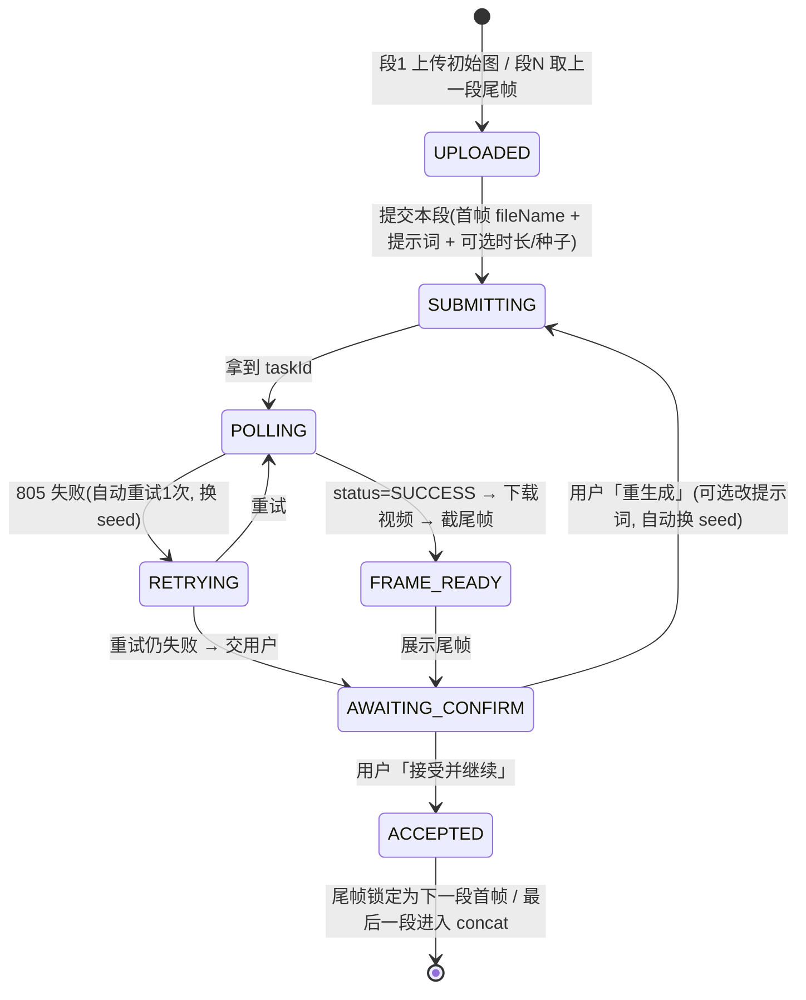

# 增量 PRD：RunningHub 工作流 i2v + 串行首帧链

> 文档类型：**增量 PRD**（只描述本次变更，不重复旧功能）
> 项目：StoryForge（Python 3.13 + FastAPI + 原生 HTML/CSS/JS，零 CDN）
> 版本：v0.4 增量　|　语言：简体中文　|　作者：许清楚（PM）
> 事实来源：`docs/RunningHub工作流API接入方案.md`（接口契约 / 错误码 / 已确认工作流，直接引用）
> 前置决策：用户已拍板「整体推翻自建图像生成」，team-lead 已裁决技术选型，本 PRD 直接采纳、不再提问。

---

## 1. 目标与背景

**背景（一段话）**：Phase 2 的本地图像服务（SD1.5 + IP-Adapter + 引擎切换）验证了「首帧锁一致性」的方向，但服务器 GPU 与 LLM 互斥、逐镜首帧与定妆照的「身份锁」受 Pascal 算力限制，维护成本高、体验重。用户决定**整体推翻自建图像生成**，视频生成统一收敛到 **RunningHub 工作流 API 的图生视频（i2v）**：第 1 段首帧由用户手动上传，第 N 段首帧 = 第 N-1 段尾帧（FFmpeg 截尾帧），**严格串行、绝不并发**，每段生成后展示尾帧供用户「接受并继续 / 重生成本段」。

**目标（3 条）**
1. **一致性升级**：用「串行首帧链」取代提示词近似 + 自建出图，让相邻镜头画面真正连续。
2. **体验可控**：逐段确认，用户对每段结果有「接受 / 重生成」决策权，废片不再静默进成片。
3. **架构做减法**：删除自建图像生成与引擎切换全部组件，代码与配置收敛到单一工作流 i2v 路径。

---

## 2. 范围：删除清单 / 新增清单

### 2.1 删除清单（精确到文件/组件）
| 对象 | 说明 |
|---|---|
| `app/services/image_generator.py`（`ImageGenerator`） | 自建图像生成入口，整体删除 |
| `app/services/engine_switch.py`（`EngineSwitcher`） | LLM↔图像引擎 ssh 切换编排，整体删除（不再切卡） |
| `app/services/adapters/image_base.py` / `image_mock_adapter.py` / `image_local_adapter.py` / `image_runninghub_adapter.py` | 三个图像适配器 + 抽象基类，整体删除 |
| `IMAGE_ADAPTER_REGISTRY`（`adapters/__init__.py`）与 `ImageProvider` 枚举（`enums.py`） | 删除图像路由轴 |
| `Config` 中 Phase 2 字段：`image_provider` / `image_endpoint` / `image_api_key` / `ip_scale` / `ip_face` / `image_seed` / `shot_first_frame` / `auto_engine_switch` / `image_switch_start_cmd` / `image_switch_stop_cmd` | 删除，旧 JSON 由 `config_store` 迁移忽略 |
| `DirectorAgent` 首帧降级阶梯 L1–L4：`_ensure_headshots` / `_ensure_scene_anchor` / `_ensure_first_frame` / 定妆照 / 场景锚图 / 逐镜首帧逻辑 | 改为「串行首帧链」新逻辑 |
| `prompt_templates.build_anchor_prompt`（及其调用） | 锚图提示词不再需要 |
| `config_router` 中图像相关探测/配置出口（如有） | 删除图像探活逻辑 |
| 前端「图像生成」配置组（`index.html` / `app.js`） | 改为「工作流 i2v」配置 |
| `deploy/image_server/`（`server.py` / `start.sh` / `stop.sh` / `selftest.py` / `README.md`） | 部署件删除 |
| 服务器 `/workspace/imgserver` + IP-Adapter 权重（≈2.7G） | 远程删除（保留 SD1.5 基础模型） |
| `tests/test_image_service.py` 及 E2E 中图像服务/引擎切换断言 | 删除/改写 |
| `docs/增量PRD-本地图像服务接入.md` 等 Phase 2 文档 | 归档（不删除历史） |

### 2.2 新增清单
| 对象 | 说明 |
|---|---|
| `RunningHub` 工作流 i2v 适配逻辑 | 复用 `RunningHubAdapter` 的上传/轮询/下载骨架，新增 `nodeInfoList` 组装与 `run/workflow/{id}` 提交 |
| 串行首帧链编排器（建议 `app/services/first_frame_chain.py`） | 链状态 + 逐段确认状态机 + 全局单任务锁 |
| FFmpeg **PNG** 尾帧提取（`ffmpeg_utils` 增补） | 截最后一帧输出 PNG（现仅 jpg） |
| 新配置字段 `rh_*`（见 §5） | 工作流 ID / 节点参数 / 实例类型 / 保留时长 |
| 新后端 API（见 §4.1） | 上传初始图 / 提交单段 / 查询单段 / 接受 / 重生成 |
| 前端逐段确认 UI（见 §4.2） | 逐段卡片 / 尾帧预览 / 接受重生成 / 进度 / 动态特效 |

---

## 3. 核心流程：串行首帧链 + 逐段确认状态机

### 3.1 串行首帧链（数据流）
```
初始图(用户上传) → 段1: 首帧=初始图 → 生成视频 → FFmpeg 截尾帧(PNG)
                                           ↓ 用户「接受并继续」
         段2: 首帧=段1尾帧 → 生成视频 → 截尾帧
                                           ↓ …
         段N: 首帧=段N-1尾帧 → 生成视频 → 截尾帧 → 全部接受 → concat
```
- **严格串行**：上一段「SUCCESS 且尾帧提取成功」且用户「接受」后，才提交下一段；应用层全局单任务锁保证同一时刻仅 1 个 RunningHub 提交在飞（防 421）。
- 首帧来源：段 1 = 用户上传；段 N = 段 N-1 尾帧（**不重新上传尾帧时复用已上传 `fileName` 需注意 24h 有效期，实现层以重新上传为准**）。

### 3.2 逐段确认状态机（单段视角）

- **断点续跑**：每段结果（视频相对路径、尾帧相对路径、首帧来源、`taskId`、`seed`）持久化到任务目录（建议 `outputs/<ts>/chain.json`），刷新/中断后可恢复当前段与进度。

---

## 4. 功能需求

### 4.1 后端 API（建议端点，命名由架构师定，语义必须覆盖）
| 端点 | 方法 | 语义 |
|---|---|---|
| `POST /api/pipeline/{task_id}/chain/start` | multipart | 上传**初始图**（第 1 段首帧），初始化串行链，落盘 `frames/initial_frame.png`，返回段列表 |
| `GET /api/pipeline/{task_id}/chain` | GET | 查询链状态：当前段索引、每段 `state`、视频/尾帧相对路径、错误 |
| `POST /api/pipeline/{task_id}/chain/segments/{index}/submit` | JSON | 提交单段（首帧=上一段尾帧或初始图；可选覆盖提示词/时长/种子），串行锁内异步轮询，返回产物 |
| `GET /api/pipeline/{task_id}/chain/segments/{index}` | GET | 查询单段状态/产物（含尾帧预览 URL） |
| `POST /api/pipeline/{task_id}/chain/segments/{index}/accept` | JSON | **接受本段**，锁定尾帧为下一段首帧并推进；最后一段接受后进入 `concat` |
| `POST /api/pipeline/{task_id}/chain/segments/{index}/regenerate` | JSON | **重生成**（可选新提示词；自动换随机 seed），覆盖本段产物 |
| 全局串行锁（应用层） | — | `asyncio.Lock` / `threading.Lock`，跨任务互斥，仅 1 个 RunningHub 提交在飞 |

**改造 vs 新增（结论：改造 `RunningHubAdapter`，不新增适配器注册表）**
- 复用：`_upload_media`（改取 `data.fileName`）、`_post_json` / `_decode` / `_extract_error` / `_task_status` / `_results_url`、`_poll`（轮询 `/openapi/v2/query`）、`_download`（立即下载 24h 产物）。
- 新增：`run/workflow/{workflowId}` 提交 + `nodeInfoList` 组装（首帧/提示词/时长/种子，节点参数可配置）。
- **统一收敛**：`video_provider=runninghub` 语义**改为「工作流 i2v」**；删除旧模型 API 分支（`DEFAULT_ENDPOINT` / `_submit` / `_submit_i2v` / `generate_image` / `_map_image_resolution` / `_map_ratio` 等）；`mock` 保留零成本路径。

### 4.2 前端交互（零 CDN，动态特效用 CSS 动画 + 内联 SVG/Unicode）
| 组件 | 交互与文案 |
|---|---|
| 初始图上传区 | 拖拽/点击选择一张图（PNG/JPG/WEBP），预览后「开始生成」 |
| 逐段卡片列表 | 每段卡片：序号徽标、首帧缩略图（段1=初始图，段N=上一段尾帧）、状态徽标（排队/生成中/待确认/已接受）、本段视频预览、**尾帧预览** |
| 操作按钮 | 「接受并继续」「重生成本段」（重生成弹窗可改提示词）；生成中按钮禁用并显示进度 |
| 进度 | 段进度条 + 总进度（`3/6 段`）；轮询中显示脉冲动画 |
| 高级感层次 | 卡片分层阴影/留白、当前段高亮描边、尾帧出现时高亮动效；**全部内联，无外链** |

---

## 5. 配置项清单与成本安全边界

### 5.1 新增配置字段（`Config`，全部带默认值 → 旧 JSON 兼容）
| 字段 | 类型 | 默认 | 说明 |
|---|---|---|---|
| `rh_workflow_id` | str | `2084067455902765057` | 工作流 ID（提交端点 `/openapi/v2/run/workflow/{id}`） |
| `rh_instance_type` | str | `default` | `default(24G)` / `plus(48G)` / `ultra(84G)` |
| `rh_retain_seconds` | int | `180` | 10–180，结果保留秒数 |
| `rh_first_frame_node_id` / `…_field_name` | str | `4` / `image` | 首帧图节点 |
| `rh_prompt_node_id` / `…_field_name` | str | `7` / `prompt` | 提示词节点 |
| `rh_duration_node_id` / `…_field_name` | str | `6` / `duration_seconds` | 时长节点（可选覆盖） |
| `rh_seed_node_id` / `…_field_name` | str | `9` / `seed` | 种子节点（可选覆盖） |
| 可选参数（时长/分辨率/seed/negative） | — | — | 透传进 `nodeInfoList` 覆盖默认，不单独落字段则用运行时请求 |

### 5.2 成本与安全边界（沿用铁律）
- **付费字段垃圾值写回安全默认**：`rh_instance_type` 非法 → `default`；`rh_retain_seconds` 越界 → 钳到 10–180；`rh_workflow_id` 空/非法 → 保持默认（复用 `config_store._sanitize_extended_fields` / `_migrate_removed_providers` 机制）。
- **非法 provider 回退**：`video_provider` 非法 → `mock`（复用既有 `_drop_null_video_provider`）。
- **密钥遮罩**：`video_api_key` 经 `mask_secret` 对外脱敏，`merge_secrets` 在收到脱敏值时保留磁盘原值（不新增 `rh_api_key`）。
- **默认安全**：`video_provider` 默认 `mock`（零成本）；切到 `runninghub`（= 工作流 i2v，**按次计费**）需显式选择；`video_api_key` 空 → 提交前明确报「未配置 API Key」而非静默。
- **不动 `config/config.json`**（含用户真实 Key）；对外路径一律任务相对正斜杠。

---

## 6. 验收标准（含 E2E 离线 stub 策略）

> **E2E 离线 stub 策略（铁律）**：RunningHub 工作流**必须 stub**，不真调外网。复用既有 `httpx.MockTransport` / 本地 stub 服务，按「上传 → 提交 → 轮询 → 下载」四步返回脚本化响应（含 805 失败 → 重试 → SUCCESS 路径）；真实 Key 场景仅手工冒烟。

| 编号 | Given | When | Then |
|---|---|---|---|
| AC1 | 已上传初始图并 `chain/start` | 查询链状态 | 段列表存在，段 1 首帧 = 初始图相对路径，全部段 `pending` |
| AC2 | 段 1 提交 | 轮询 | 上传取 `data.fileName`（非 URL）填 `fieldValue`；提交体为 `nodeInfoList` + `instanceType` |
| AC3 | 段 1 SUCCESS 且尾帧提取成功 | 查询单段 | 返回视频相对路径 + 尾帧相对路径（PNG），状态 `awaiting_confirm` |
| AC4 | 段 1 尾帧展示 | 用户点「接受并继续」 | 段 2 首帧 = 段 1 尾帧（重新上传该 PNG），段 2 状态推进，**未发生并发提交** |
| AC5 | 段 N 尾帧不满意 | 用户点「重生成」并改提示词 | 本段重新提交（新 seed），旧产物被覆盖，段计数不变 |
| AC6 | 某段 805 失败 | 自动重试 | **自动重试 1 次**（换 seed）后才进入「待确认」；重试仍失败则带错误原因交用户 |
| AC7 | 全局锁存在 | 并发触发两个任务提交 | 第二个等待，**同一时刻仅 1 个 RunningHub 提交在飞**（无 421） |
| AC8 | 最后一段「接受」 | 观察流水线 | 自动进入 `concat`，产出 `final_video.mp4`；`StageName.ALL` 仍为 5，无新阶段 |
| AC9 | 刷新页面/服务中断 | 重新打开任务 | `chain.json` 恢复当前段索引与各段产物，可续跑不重头 |
| AC10 | 上传初始图 | 检查落盘 | `frames/initial_frame.png` 存在，对外返回**任务相对正斜杠路径**（无 `E:\…`） |
| AC11 | 打开 `app/static/index.html` | 全局检索 | **无任何 `http(s)://` 外链资源**；特效均为 CSS 动画/内联 SVG/Unicode |
| AC12 | 新增代码 | 依赖审计 | **未新增任何 pip 包**（httpx 既有；FFmpeg 命令行子进程；asyncio/time 既有） |
| AC13 | 配置 `rh_instance_type=xxx` 垃圾值 | 保存配置 | 回写 `default`；`video_api_key` 对外脱敏 |
| AC14 | `video_provider` 非法值 | 加载配置 | 回退 `mock`，不崩溃 |
| AC15 | `video_api_key` 为空 | 提交单段 | 明确报错「未配置 RunningHub API Key」，不静默、不降级到 mock |
| AC16 | 自建图像组件 | 全局检索 | `ImageGenerator` / `EngineSwitcher` / `image_*` 适配器 / `IMAGE_ADAPTER_REGISTRY` / `ImageProvider` **已全部移除**，无残留引用 |
| AC17 | `.bat` 文件 | 检查字节 | 纯 ASCII + CRLF（如涉及） |
| AC18 | E2E 测试 | 运行 | 全程走 stub，**不触网**（测试禁代理）；断言覆盖四步流程与 805 重试 |

---

## 7. 失败模式表

| 错误/失败 | 含义 | 处理 |
|---|---|---|
| 412 | TOKEN_INVALID | 前端提示检查 Key（32 位）与会员状态；不重试 |
| 421 | 并发/队列超限 | 靠全局串行锁规避；若仍命中则指数退避重试后交用户 |
| 433 / 434 | 无效 Key / 无效 workflowId | 提示核对 `video_api_key` / `rh_workflow_id`；不重试 |
| 435 | 余额不足 | 提示充值；任务挂起，不自动重试 |
| 803 | nodeInfoList 节点不匹配 | 提示用 `getJsonApiFormat` 核对 nodeId/fieldName；不重试 |
| 805 | 任务失败 | 读 `failedReason.traceback`；**自动重试 1 次（换 seed）**，仍失败交用户重生成 |
| 810 | 工作流未保存/未运行 | 提示在平台「保存并手动运行一次」；不重试 |
| 813 | 排队中 | 继续轮询 |
| 产物 24h 过期 | 下载 URL 失效 | 立即下载并落盘；失败则标记本段失败，交用户重生成 |
| 下载失败 | 网络/URL 失效 | 重试后交用户，段状态 `failed`，可重生成 |
| 尾帧提取失败 | FFmpeg 失败/产物损坏 | 段标记失败；**不进入下一段**（链中断），交用户重生成 |
| 上传失败 | `data.fileName` 缺失 | 明确报错；不提交任务 |

---

## 8. 铁律一致性核对

| 铁律 | 本 PRD 是否满足 |
|---|---|
| 零 CDN | ✅ 前端特效/图标全内联（AC11） |
| 零新增第三方依赖 | ✅ httpx/FFmpeg/asyncio 均既有（AC12） |
| 统一 `{ok, data, error}` 响应 | ✅ 沿用 `app.utils.responses` |
| 对外路径任务相对正斜杠 | ✅（AC10） |
| `StageName.ALL` 恒为 5（story→script→director→concat→critic） | ✅ 串行首帧链是 `director` 阶段内部逻辑，不新增阶段（AC8） |
| `.bat` 纯 ASCII + CRLF | ✅（AC17） |
| 不动 `config/config.json` | ✅ 自动化流程不改写；E2E 临时改写并还原属既有机制 |
| 测试禁代理 | ✅ E2E 全 stub、不触网（AC18） |
| 默认安全 / 非法回退 | ✅（AC13/AC14/AC15） |

---

## 9. 待确认问题

**无。** 技术决策已由 team-lead 全部裁定（接入形态 / 尾帧 PNG / 重生成语义 / 全局串行锁 / 配置字段），用户需求已拍板，本 PRD 全部落纸、不再提问。
