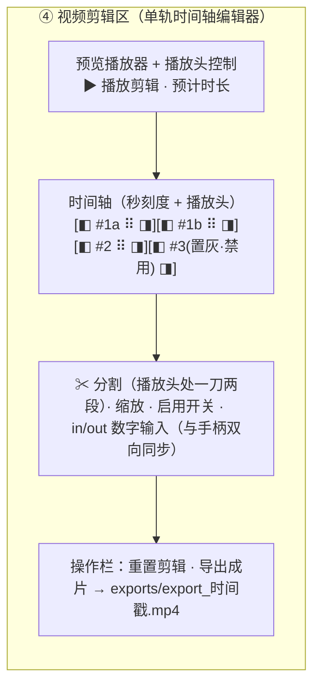

# 增量 PRD：分镜确认区 与 专业剪辑区（第三批）

> 文档类型：**增量 PRD**（只描述本次变更，不重复前两批已交付功能）
> 项目：StoryForge（Python 3.13 + FastAPI + 原生 HTML/CSS/JS，**零 CDN / 零新增依赖**）
> 版本：**v0.5 增量（终版）**　|　语言：简体中文　|　作者：许清楚（PM）
> 本版变更：按 team-lead 拍板，**片段切分（split）升为 P0**（原 v0.4 列为 P1/Out-of-Scope），
> 相应更新 §1.3 / §1.4 / §3.1 / §3.2 / §3.3 / §5(AC25–AC27) / §6，并在 §9 标注三条决策已拍板。
> 基线：①剧情补全 + 视频剪辑区；②剧情编辑重跑 + 剪辑草稿恢复 + 拖拽排序（均已交付）

---

## 1. 背景与目标

### 1.1 用户原话（唯一需求依据）
1. 可视化完整故事情节和一个个分镜提示词，能让用户自己修改，随后再由用户决定是否提交提示词生成视频。
2. 彻底修改视频剪辑区，让他操作和普通剪辑软件差不多。

### 1.2 一句话目标
在 `script` 与 `director` 之间引入一个**人机确认点**（`awaiting_review`），并把 ④ 剪辑区升级为**单轨时间轴编辑器**（拖拽排序 / 手柄裁剪 / **片段切分** / 播放头定位 / 实时预览）。

### 1.3 In-Scope
| 编号 | 变更点 | 影响面 |
|---|---|---|
| C1 | 新增任务状态 `awaiting_review`（**非终态**）与续跑入口 `POST /{task_id}/confirm-script` | enums、task_manager、pipeline_router、schemas |
| C2 | 新增「分镜确认区」UI：可视化完整剧情 + 每个分镜的可编辑提示词，用户确认后才生成视频 | 前端主改造 |
| C3 | ④ 剪辑区升级为**单轨时间轴编辑器**：时间比例尺、拖拽排序、双臂裁剪手柄、**片段切分**、播放头、点击定位 | 前端主改造 |
| C4 | `PipelineRunRequest` 新增 `review` 字段（缺省 `false`，向后兼容） | schemas、路由 |
| C5 | 剪辑区支持**片段切分（split）**：`ClipEdit` 新增**可选** `clip_id`，在播放头处"一刀两段" | schemas、task_manager（归一化）、pipeline_router、前端 |

### 1.4 Out-of-Scope（明确挡掉）
| 编号 | 不做 | 理由 |
|---|---|---|
| N1 | 多轨时间轴、转场、字幕、配乐、变速、调色/滤镜、画中画、关键帧、音频波形 | 需 NLE 级时间轴引擎 + FFmpeg `filter_complex`，与"零新增依赖"冲突，回报低 |
| N2 | 分镜**增删**（v1 只改字段，见 §2.4） | shot_id 与视频文件命名、EDL 强绑定，增删需重排；"改提示词"为核心诉求 |
| N3 | 剧情/分镜的 LLM 多轮对话式改写 | 交互与状态机成本高，v1 用"编辑后重跑"覆盖 |
| N4 | 真实视频厂商适配器完善、重构既有 5 阶段逻辑 | 与本批无关，保持最小改动 |

> 说明：**片段切分（split）已从 Out-of-Scope 移出，升为 P0**（见 §3.1/§3.2/§6）——它是"像剪辑软件"的第一梯队基础操作，缺了它用户会直接判定"不像剪辑软件"。契约冲突已用**可选 `clip_id` + 有效 id 归一化**消解，且缺省时与旧版逐字一致（向后兼容）。

---

## 2. 需求 A：分镜确认区（`script` 后暂停，用户确认再出片）

### 2.1 结论一：**新增任务状态 `awaiting_review`，且它是「非终态」**

状态机融合（不破坏既有单向流转）：

```
pending → running ──(story→script 完成, review=true)──► awaiting_review
                    │                                        │ 用户点「确认并生成视频」
                    │(review=false, 旧路径)                   ▼
                    └──────────────► running ──► success | failed
                                     （director→concat→critic）
```

| 问题 | **拍板结论** |
|---|---|
| 是否新增状态 | **是**，新增 `TaskState.AWAITING_REVIEW = "awaiting_review"` |
| 是否终态 | **否**（`is_terminal` 保持 `False`），终态仍只有 `success/failed` |
| 现有状态机影响 | **零破坏**：既有 `pending→running→success\|failed` 全保留；`awaiting_review` 是"挂起待办"而非终态，仅在 `review=true` 时出现 |
| 轮询 `/status` 如何表达 | 原样返回 `state:"awaiting_review"`；此时 `stages.story/script = success`、`stages.director/concat/critic = pending`、`shots=[]`。前端据此渲染确认区，并**继续 1s 轮询**（用户可能在其它标签页确认，确认后自动推进） |
| 是否新增流水线阶段 | **否**。不新增 `StageName`，`StageName.ALL` 不变，避免回归既有阶段渲染与测试。前端在 `script` 卡片上加「待确认」标记即可 |
| 实现方式 | `run_pipeline` 拆为"到 `script` 为止"与"从 `director` 起"两段；`review=true` 时第一段结束把状态置 `awaiting_review` 并结束该线程；确认接口再起新线程跑第二段 |

### 2.2 结论二：**用户可编辑字段清单（精确）**

**A. 剧情 `StoryDocument`（在确认区内可编辑文本字段）**

| 字段 | 可编辑 | 约束 |
|---|---|---|
| `title` 标题 | ✅ | ≤ 100 字 |
| `logline` 一句话梗概 | ✅ | ≤ 200 字 |
| `synopsis` 完整故事情节 | ✅ | **必填非空**（核心产物，直接决定分镜） |
| `setting` 场景总设定 | ✅ | 可空 |
| `genre` 题材 | ✅ | 可空 |
| `theme` 主题立意 | ✅ | 可空 |
| `characters[]` 角色表 | ❌ 只读参考 | 与上一批一致，不回归 |
| `beats[]` 情节节点 | ❌ 只读参考（**P1** 开放增删改） | 见需求池 |

**B. 分镜 `ScriptDocument`（确认区内逐镜头可编辑）**

| 字段 | 可编辑 | 约束 |
|---|---|---|
| `shots[].prompt` 分镜提示词 | ✅ | **必填非空**（直接喂视频模型） |
| `shots[].action` 动作/画面 | ✅ | 可空 |
| `shots[].camera` 运镜 | ✅ | 可空 |
| `shots[].dialogue` 对白 | ✅ | 可空 |
| `shots[].duration` 时长(秒) | ✅ | 整数，**2–10**；越界拒绝 |
| `shots[].shot_id` | ❌ 只读 | 与视频文件/EDL 强绑定 |
| `title` 脚本标题 | ✅ | ≤ 100 字 |
| `style` / `scene` / `positions[]` / `characters[]` | ❌ 只读 | `scene` 可由剧情 `setting` 派生（P1 开放） |
| 分镜数量（增/删） | ❌ v1 不支持 | 见 N3 |

### 2.3 结论三：**默认行为 = 需要确认；同时保留「跳过确认、一键出片」入口**

用户**既**要确认点、**又**重视一键自动化，两者都满足，采用**分层默认**：

| 层 | 默认 | 说明 |
|---|---|---|
| **API 契约层** | `review = false` | `POST /api/pipeline/run` **默认行为与旧版完全一致**（一路跑完）。**这是为保护既有 185 条测试零改动、并保证脚本化/一键调用不受影响** |
| **产品 UI 层** | **默认勾选「生成前确认分镜」**（即前端发 `review=true`） | 满足需求 1 的核心诉求：默认"先确认、再出片" |
| 跳过入口 | 输入区提供「☑ 生成前确认分镜」开关，**取消勾选 = `review=false`** | 一键出片体验随时可用 |

> 权衡说明：若把 API 默认改成 `true`，会强制所有既有自动化路径与测试改写，属于本批**不必要的回归风险**；把"默认体验"放在产品层、把"兼容契约"放在 API 层，是风险最小的拍板。

### 2.4 结论四：**编辑后「原地续跑同一任务」（与上一批刻意不同）**

| 维度 | 本批：分镜确认后继续 | 上一批：编辑剧情→重跑 |
|---|---|---|
| 采用 | **原地续跑同一 `task_id`** | 新建任务 |
| 理由 | 该任务被**设计为可暂停**，从未完成；产物目录 `outputs/<ts>/`、`story.json`/`script.json`、日志、剪辑草稿都在同一目录；原地续跑是状态机的自然延伸，也避免原任务永久卡在 `awaiting_review`、避免产生孤儿目录 | 那是一次"对**已完成**任务的旁路重做"，原任务已 `success`，新建可**不污染既有成果** |
| 是否一致 | **刻意不一致，且理由充分**：判据是"原任务是**已终态**还是**挂起中**" | 上一批不变 |

- 落盘更新：确认后**覆盖写**同目录 `story.json` / `script.json`（保留原文件的语义角色，不新增文件名）。
- 上一批的「剧情编辑→新建任务」路径**保持不动**，不回归。

### 2.5 结论五：**改了分镜提示词 → 不重跑 script；改了剧情 → 必须重跑 script**

确认接口 `POST /api/pipeline/{task_id}/confirm-script`，请求体可同时携带 `story` 与 `script`，服务端按**变更来源**决策：

| 场景 | 服务端行为 | 是否重跑 `script` |
|---|---|---|
| 仅改分镜字段（`script` 变、`story` 未变） | 校验并落盘新 `script.json`，直接续跑 `director` 起 | **否**（分镜文本已由用户给定，再跑 LLM 只会覆盖用户的修改） |
| 改了剧情文本（`story` 变） | 更新 `story.json`，用**用户改后的剧情**重跑 `ScriptAgent`，**忽略**本次提交的 `shots` 编辑（并回告用户"剧情变更已重新生成分镜"） | **是**（剧情变则分镜依据变，必须重算） |
| 两者都未变 | 直接用现有 `script` 续跑 | **否** |

响应体：`{ task_id, state, rerun_script: bool }`（`ok/data/error` 统一包裹）。
**幂等与并发防护**：仅当任务处于 `awaiting_review` 才接受确认；否则返回 `TASK_STATE_INVALID: 任务不在待确认状态`，避免重复起 `director` 线程。

### 2.6 前端流程（确认区）
1. 轮询到 `state === "awaiting_review"` → 展示「③.5 分镜确认区」（也可作为 ③ 下的展开面板）。
2. 面板左：完整剧情（可编辑文本字段 + 只读角色/情节点）；面板右：分镜卡列表（`shot_id` 只读 + `prompt/action/camera/dialogue/duration` 可编辑）。
3. 底部两个按钮：**「确认并生成视频」**（主）与 **「跳过确认」**（仅 `review=false` 场景外提供，等价于直接确认）。
4. 提交成功 → 面板收起，`director` 阶段转 `running`，前端恢复 1s 轮询与既有进度/日志展示。

---

## 3. 需求 B：专业剪辑区（单轨时间轴编辑器）

### 3.1 必须做到（"像普通剪辑软件"的 v1 边界）

| 编号 | 能力 | 交互 | 优先级 |
|---|---|---|---|
| B1 | **单轨时间轴** | 片段按顺序横向排布在一条时间轴，**宽度 ∝ 时长**（统一比例尺），超宽可横向滚动 | **P0** |
| B2 | **拖拽排序** | 在时间轴上拖拽片段改顺序（沿用上一批拖拽手柄，落点吸附到相邻片段间） | **P0** |
| B3 | **双臂裁剪手柄** | 每个片段左/右端可拖拽调整 `start`/`end`；同时保留数字输入框双向同步 | **P0** |
| B4 | **播放头 + 秒刻度** | 时间轴顶部显示刻度与播放头；点「▶ 播放剪辑」时播放头随播放前进 | **P0** |
| B5 | **点击定位** | 点时间轴任意位置 → 预览播放器跳到对应时间点（±0.2s） | **P0** |
| B6 | **启用/禁用** | 片段开关；禁用片段在时间轴置灰、不参与播放与导出 | **P0** |
| B7 | **实时预览** | 按"启用片段 × 顺序 × `start/end`"顺序播放 | **P0** |
| B8 | **一键导出** | 生成 `exports/export_<ts>.mp4`（新文件，不覆盖 `final_video.mp4`） | **P0** |
| B9 | **片段切分（split）** | 在**播放头**处"一刀两段"：左段 `[原start, 播放头]`、右段 `[播放头, 原end]`，两段获得**不同 `clip_id`**；两段可**各自**裁剪 / 启停 / 排序，且可**再次分割** | **P0** |
| B10 | **时间轴缩放** | 缩放比例（如 10 / 30 / 60 px/秒） | P1 |
| B11 | **撤销 / 重做** | 编辑历史栈 | P1 |

**split 交互定义（P0）**
- **触发**：时间轴选中某片段 + 播放头落在该片段内部（`原start < 播放头 < 原end`）时，「✂ 分割」按钮可用；点击后在播放头处切为左右两段。
- **切分规则**：左段 `start=原start, end=播放头`；右段 `start=播放头, end=原end`；两段各带唯一 `clip_id`（如 `shot_001#1` / `shot_001#2`，来源 `shot_id` 写入 `#` 后缀）。
- **切后能力**：两段在时间轴上**独立成段**，可分别拖拽（改 `order`）、双臂裁剪（改 `start/end`）、启用/禁用；**再次分割**同规则（`#1` → `#1#1`/`#1#2` 或服务端递增序号）。
- **边界**：播放头落在片段端点（等于 `原start` 或 `原end`）时按钮禁用；切出的任一段被裁剪到 0 时长时按既有规则回退整段（不产生空片段）。
- **契约**：`ClipEdit` 新增**可选** `clip_id: str | None = None`；**有效 id = `clip_id or shot_id`**；归一化去重键由 `shot_id` 改为**有效 id**（详见 §3.2）。

### 3.2 结论：**v1 支持片段切分（split）**，用「可选 `clip_id` + 有效 id 归一化」消解契约冲突

**拍板：本批（P0）支持 split。** 原 v0.4 顾虑的契约冲突，已有**向后兼容解**，成本可控：

| 项 | 方案 | 兼容性保证 |
|---|---|---|
| 契约 | `ClipEdit` 新增**可选**字段 `clip_id: str \| None = None` | 不带 `clip_id` 的旧请求/旧草稿**逐字兼容** |
| 归一化 | 去重键从 `shot_id` 改为**有效 id = `clip_id or shot_id`** | `clip_id` 缺省时，有效 id 恒等于 `shot_id`，行为与旧版**完全一致** |
| 表达能力 | 允许**同一 `shot_id` 出现多个 clip**（不同 `clip_id`） | 旧草稿（`edit_plan_draft.json`）零改动可解析（护 AC22 与既有 16 条草稿测试） |
| 导出方案 | `export_edit_plan` 的 `plan_clips[]` 输出补 `clip_id` | 新增字段，旧解析方忽略即可 |
| 前端 | 分割产生的两段各自持有 `clip_id`，参与排序/裁剪/启停 | 未分割的片段可不带 `clip_id`（等价旧行为） |

**结论**：split 从 P1/Out-of-Scope **升为 P0**；不新增必填字段、不改旧语义，风险可控。

### 3.3 明确不做清单（与 §1.4 呼应）
单轨之外的 NLE 高级能力：**多轨 / 转场 / 字幕 / 配乐 / 变速 / 调色滤镜 / 画中画 / 关键帧 / 音频波形**（**片段切分已在 P0**，见 §3.1/§3.2）。
理由：均需引入时间轴引擎或 FFmpeg 滤镜图编排，与"零 CDN、零新增第三方依赖、不回归既有测试"三条硬约束冲突；而 P0 能力（含 split）已能把剪辑区做到"基础单轨剪辑软件"的操作手感。

---

## 4. 用户故事

| # | As a | I want | So that |
|---|---|---|---|
| US1 | 短剧创作者 | 在分镜生成后（出视频前）看到完整剧情与每个分镜提示词 | 我能确认 AI 的理解是否符合我的意图 |
| US2 | 短剧创作者 | 直接修改剧情文本与每个分镜的提示词/运镜/时长 | 我在烧钱生成视频前就把方向调对 |
| US3 | 短剧创作者 | 改完后由我点「确认并生成视频」 | 出片时机由我掌控，而不是系统自动冲到底 |
| US4 | 效率型用户 | 保留一个「跳过确认、一键出片」的开关 | 我只是想快速试跑时不必被确认点打断 |
| US5 | 剪辑者 | 在时间轴上拖动片段、拖手柄裁剪起止、看播放头定位 | 操作手感接近我熟悉的剪辑软件 |
| US6 | 剪辑者 | 实时预览并一键导出为新文件 | 保留原始成片的同时得到我的版本 |
| US7 | 剪辑者 | 在播放头处把一段镜头"一刀两段"，并各自裁剪/排序/启停 | 我能像剪映/CapCut 那样精修节奏，而不必重生成镜头 |

---

## 5. 验收标准（Given / When / Then）

**需求 A（确认点）**

| 编号 | Given | When | Then |
|---|---|---|---|
| AC1 | 提交 `run` 且 `review=true` | 轮询 `/status` | `script` 完成后任务 `state == "awaiting_review"`；`stages.director/concat/critic` 仍为 `pending`；`shots` 为空；未生成任何 `shots/shot_*.mp4` |
| AC2 | 任务处于 `awaiting_review` | 持续轮询 `/status` | 状态**长期保持** `awaiting_review`（不超时、不自动推进）；`is_terminal == false`；HTTP 200 且 `ok == true` |
| AC3 | 调用 `run` **不传** `review` | 观察流转 | 行为与旧版**完全一致**（一路跑到 `success`），不出现 `awaiting_review`（保证既有 185 测试零改动） |
| AC4 | 前端默认状态 | 打开页面 | 输入区「生成前确认分镜」**默认勾选**；点「开始生成」后到 `script` 完成时展示「分镜确认区」 |
| AC5 | 用户取消勾选「生成前确认分镜」 | 点「开始生成」 | 不出现确认区，直达出片（旧一键体验） |
| AC6 | 处于确认区 | 查看内容 | 展示剧情 `title/logline/synopsis/setting/genre/theme` 与每个分镜的 `shot_id/prompt/action/camera/dialogue/duration`；前者文本可编辑、`shot_id` 只读 |
| AC7 | 确认区仅修改分镜字段（不改剧情） | 点「确认并生成视频」 | **不重跑 `ScriptAgent`**（无新的 script LLM 调用日志）；`director` 转为 `running`；生成视频所依据的 `prompt` 为**编辑后的值** |
| AC8 | 确认区修改了 `synopsis` | 点「确认并生成视频」 | `script` 阶段**重新执行**（`running→success`），分镜按新剧情重算，随后 `director` 继续；响应 `rerun_script == true` |
| AC9 | 确认区点确认 | 检查任务 | **同一 `task_id`、同一 `output_dir`** 续跑；`story.json`/`script.json` 路径不变（原地覆盖更新） |
| AC10 | 提交 `duration` 为 `1` 或 `30` 的分镜 | 点确认 | 提交被拒：`ok == false`，`error` 形如 `CODE: 中文`，任务仍停留 `awaiting_review` |
| AC11 | 提交 `prompt` 为空的分镜 | 点确认 | 提交被拒：`ok == false`，`error` 形如 `CODE: 中文` |
| AC12 | 对**非**待确认状态（如 `running`）的任务调确认接口 | 重复调用 | 返回 `TASK_STATE_INVALID: 任务不在待确认状态`；**不**产生并发的 `director` 线程 |
| AC13 | 对不存在的 `task_id` 调确认接口 | 调用 | 返回 `TASK_NOT_FOUND: 任务不存在`（HTTP 层不 500） |
| AC14 | `review=false` 的任务已 `success` | 打开页面 | 上一批「查看剧情 / 编辑剧情→新建任务」入口与行为**不受影响**（不回归） |

**需求 B（专业剪辑区）**

| 编号 | Given | When | Then |
|---|---|---|---|
| AC15 | 有 3 个成功片段 | 渲染剪辑区 | 时间轴上 3 段按序排列，**段宽与原时长成正比**（同一比例尺），顶部有秒刻度 |
| AC16 | 时间轴有 3 个片段 | 拖拽第 3 段到最前 | 顺序变为 3、1、2；**导出成片**顺序一致 |
| AC17 | 某片段原时长 4s | 拖右侧手柄到 `out=3.0`、左侧到 `start=1.0` | 数字输入框同步显示 `1.0 / 3.0`；导出该段时长 ≈ 2.0s（±0.3s） |
| AC18 | 预览播放中 | 播放剪辑 | 时间轴**播放头**随播放前进；刻度定位正确 |
| AC19 | 时间轴任意位置可点击 | 点击时间轴某点 | 预览播放器跳到对应时间（±0.2s） |
| AC20 | 某片段被禁用 | 预览 / 导出 | 该段在时间轴置灰；不出现在预览播放与导出成片中 |
| AC21 | 完成一次导出 | 检查产物 | 新增 `exports/export_<ts>.mp4`；`final_video.mp4` 内容/修改时间**未变**；返回路径为任务相对正斜杠路径 |
| AC22 | 在时间轴做若干编辑后刷新页面 | 重新加载 | 自动恢复上次任务与剪辑方案（沿用上一批草稿机制，不回归）；默认仍为"原始顺序 / 全启用 / 不裁剪" |
| AC23 | 剪辑区全量操作 | 打开 DevTools Network/元素 | **无任何外部域名请求**；所有图标为 Unicode 或内联 SVG；未引入任何第三方前端库 |
| AC24 | 全量回归 | 运行既有测试套件 | **185 条既有测试全绿**；`/run` 不传 `review` 时行为与旧版等价 |
| AC25 | 某片段原时长 4s，播放头置于该段第 2s | 点「✂ 分割」后导出 | 时间轴出现两段（`clip_id` 互异）；导出两段时长之和 ≈ 4.0s（±0.3s） |
| AC26 | 片段已分割为 `#1`/`#2` 两段 | 把 `#2` 拖到 `#1` 前，并禁用 `#1` | `#2` 排在 `#1` 前且参与导出，`#1` 置灰不参与导出；操作 `#1` 的启停**不影响** `#2`（互不影响） |
| AC27 | 存在一份**不含 `clip_id`** 的旧剪辑草稿（`edit_plan_draft.json`） | 刷新页面 / 发起导出 | 旧草稿**原样解析**（有效 id 回退为 `shot_id`），顺序/起止/启停与旧版逐字一致；既有草稿相关测试全绿 |

---

## 6. 需求池（P0 / P1 / P2）

**P0（本次交付）**
1. `TaskState.AWAITING_REVIEW` + `review` 字段（缺省 `false`）+ `POST /{task_id}/confirm-script`（§2.1/2.5）。
2. 分镜确认区：可视化完整剧情 + 逐镜头可编辑提示词；「确认并生成视频」。
3. 「生成前确认分镜」开关（UI 默认勾选）+ 取消后一键出片路径。
4. 时间轴编辑器：B1 单轨时间轴、B2 拖拽排序、B3 双臂手柄裁剪、B4 播放头+刻度、B5 点击定位、B6 启停、B7 实时预览、B8 一键导出。
5. **片段切分（split，B9）**：`ClipEdit` 新增**可选** `clip_id` + 归一化按**有效 id**去重（§3.1/§3.2）；播放头处"一刀两段"，两段可各自裁剪/启停/排序并可再次分割。

**P1（Should have）**
6. `beats[]` 可编辑（增/删/改/排序）。
7. B10 时间轴缩放、B11 撤销/重做。
8. `scene` 在确认区可编辑。

**P2（Nice to have）**
9. 分镜增删（含 `shot_id` 重排）。
10. 导出进度条与预估剩余时间。
11. 键盘快捷键（空格播放/暂停、Delete 禁用、←/→ 定位、S 分割）。

---

## 7. UI 设计稿（文字 + Mermaid）

### 7.1 ③ 与 ④ 之间的「分镜确认区」（`awaiting_review` 时出现）
```
┌ ③.5 分镜确认区（待你确认后才生成视频） 状态: ⏸ awaiting_review ────────────┐
│ ┌── 左：完整剧情（可编辑） ──┐ ┌── 右：分镜提示词（逐条可编辑） ────────┐│
│ │ 标题 / 题材 / 梗概 /      │ │ #1  shot_001                           ││
│ │ 场景设定 / 完整情节[多行] │ │   prompt [__________________]          ││
│ │ 角色、情节点（只读）      │ │   action / camera / dialogue / 时长[4] ││
│ └───────────────────────────┘ │ #2  …（可滚动）                        ││
│                               └────────────────────────────────────────┘│
│                                    [跳过确认]  [✓ 确认并生成视频]        │
└─────────────────────────────────────────────────────────────────────────┘
```

### 7.2 ④ 专业剪辑区（单轨时间轴）


**交互要点**
- 时间轴片段**宽度 ∝ 时长**；左右端手柄拖拽改 `start/end`；拖动段身改顺序（吸附到相邻间隙）。
- **分割**：选中片段 + 播放头落在段内时点「✂ 分割」，在播放头处切为 `#1a`/`#1b` 两段；两段可各自拖拽/裁剪/启停，并可再次分割（§3.1）。
- 播放头随预览移动；点击刻度/片段定位预览；禁用片段置灰。
- 任一编辑 → 本地即时更新预览与预计时长（无需等后端）；变更自动存草稿（沿用上一批 `edit_plan_draft.json`，不回归）。
- 图标全部 Unicode（▶ ⏸ ⠿ ✂ ◧ ◨ ✓）或内联 SVG；**零外部请求**。

---

## 8. 不影响项 / 约束（硬性）

| 编号 | 约束 | 说明 |
|---|---|---|
| G1 | **零 CDN、零新增第三方依赖** | 前端仅原生 HTML/CSS/JS；图标只用 Unicode 或内联 SVG |
| G2 | 统一响应与错误串 | 一律 `{ ok, data, error }`；错误串格式 `CODE: 中文` |
| G3 | 路径规范 | 对外路径一律**任务相对正斜杠路径**（如 `exports/export_xxx.mp4`） |
| G4 | **不回归前两批功能** | 剧情补全/查看/编辑重跑、剪辑排序/裁剪/禁用/预览/导出、草稿刷新恢复、拖拽排序全部保持可用 |
| G5 | **不回归 185 条既有测试** | 手段：`review` 缺省 `false`（AC3/AC24）；`StageName.ALL` 不变（不新增阶段） |
| G6 | 契约兼容 | `ClipEdit` **只新增可选** `clip_id`（缺省=旧行为，AC27）；`ExportRequest` 不新增必填字段；`ScriptDocument` / `StoryDocument` 只做可选字段与校验增强 |
| G7 | 状态机兼容 | 新增 `awaiting_review` 但 `is_terminal` 保持 `False`，既有终态判定与轮询停止逻辑不变 |
| G8 | 产物不覆盖 | 导出永远生成**新文件**，绝不覆盖 `final_video.mp4` |
| G9 | EDL 归一化兼容 | 去重键统一为**有效 id = `clip_id or shot_id`**；`clip_id` 缺省时与旧版**逐字一致**（护既有 16 条草稿测试） |

---

## 9. 已拍板决策（原"待确认问题"，team-lead 已裁定）

| 编号 | 决策 | 结论 | 状态 |
|---|---|---|---|
| D1 | 确认点默认值分层 | **认可**：API 契约默认 `review=false`（护 185 测试）+ 产品 UI 开关默认勾选「生成前确认分镜」 | ✅ 已拍板（按 v0.4 写法保留） |
| D2 | 片段切分（split） | **升为 P0，本批必须做**：`ClipEdit` 新增**可选** `clip_id`，有效 id = `clip_id or shot_id`，归一化按有效 id 去重（允许同一 `shot_id` 多 clip）；缺省时与旧版逐字一致 | ✅ 已拍板（见 §1.3 C5 / §1.4 说明 / §3.1 / §3.2 / §6-5 / AC25–AC27） |
| D3 | 编辑后执行方式 | **认可**：分镜确认后**原地续跑同一 `task_id`**（判据：原任务是否已终态；与上一批"编辑剧情→新建任务"刻意不一致，理由充分） | ✅ 已拍板（见 §2.4） |

> 无新增待确认问题。接口字段级契约由架构师另行出具，本文不重复。
