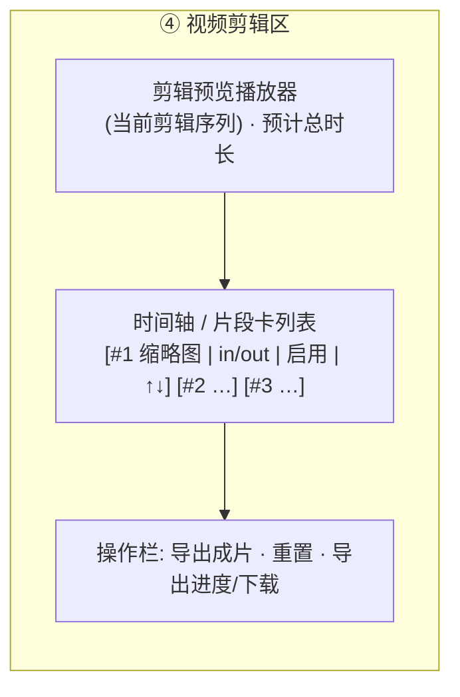

# 增量 PRD：剧情补全 与 视频剪辑区

> 文档类型：**增量 PRD**（只描述本次变更，不重复旧功能）
> 项目：StoryForge（Python 3.13 + FastAPI + 原生 HTML/CSS/JS，零 CDN）
> 版本：v0.2 增量　|　语言：简体中文　|　作者：许清楚（PM）

---

## 1. 变更目标与范围

### 1.1 一句话
在现有 4 阶段流水线**最前面新增 `story` 阶段**（粗糙对话 → 完整故事情节 → 分镜提示词），并把**④ 结果预览区改造为「视频剪辑区」**（可自由排序 / 裁剪 / 禁用 / 预览 / 导出）。

### 1.2 In-Scope（本次要做）
| 编号 | 变更点 | 影响面 |
|---|---|---|
| C1 | 新增流水线阶段 `story`，自动串联为 `story → script → director → concat → critic` | 后端阶段机、状态契约、进度区 UI |
| C2 | 新增 `StoryDocument` 契约，落盘 `outputs/<ts>/story.json` 并可在前端查看 | schemas、task_manager、API、前端 |
| C3 | ④ 结果预览区 → **视频剪辑区**：排序 / 裁剪 / 禁用 / 实时预览 / 导出为**新文件** | 前端主改造 + 1 个新导出 API |

### 1.3 Out-of-Scope（本次不做，明确挡掉）
| 编号 | 不做的事 | 理由 |
|---|---|---|
| N1 | 转场特效、字幕、配乐、多轨时间轴、变速变调、调色/滤镜、画中画 | 需引入时间轴引擎与 FFmpeg `filter_complex` 编排，成本高；Mock 产物为主，回报低 |
| N2 | 真实视频厂商适配器扩展（新增更多厂商） | 已内置 RunningHub 模型 API；更多厂商属可扩展项，与本次无关 |
| N3 | 剧情多轮对话式改写（像 ChatGPT 那样反复聊） | 交互与状态机成本高，v1 用"编辑后重跑"覆盖 |
| N4 | 重构既有 4 阶段逻辑、改动 `ScriptDocument` 契约 | 保持向后兼容，最小改动 |

---

## 2. 需求 1 方案：剧情补全（rough dialogue → story → script）

### 2.1 方案结论
**采纳**：新增独立阶段 `story`，与 `script` **自动串联**。
数据流：`粗糙对话 → StoryDocument(完整故事情节) → ScriptDocument(分镜/分镜提示词)`。
新增 `StoryAgent`；`ScriptAgent` 的输入从 `dialogue` 改为 `StoryDocument`（保留 `dialogue` 兜底入参以兼容旧调用）。

### 2.2 关键决策：是否需要「用户确认/编辑剧情后再生成分镜」？
**结论：v1 不引入阻塞式确认闸门（不做强制卡点）。** 依据：

| 维度 | 自动串联（采纳） | 阻塞确认（不采纳） |
|---|---|---|
| API 形态 | `POST /api/pipeline/run` 一次调用即出片，**形态不变** | 需拆成两段式，或给任务加"等待用户确认"新状态，破坏现有单向状态机 |
| 交互成本 | 零额外点击，符合"输入粗糙对话 → 出片"的初衷 | 每单必须多一次人工确认，批量试用时很累 |
| 用户改剧情诉求 | 用**事后可编辑重跑**覆盖（见 2.3，P1） | 覆盖同一诉求但代价更大 |

**落地方式**：
- **P0**：`story → script` 全自动，无人工卡点。
- **P1（可选增强，不改主流程）**：新增 `POST /api/pipeline/{task_id}/story` 提交编辑后的 `StoryDocument`，从 `script` 阶段**重跑**（复用现有 `retry_shot` 思路，不影响已完成的其他任务）；前端在剧情查看弹窗中提供「编辑并重新生成分镜」。
- 若产品/用户坚持要卡点，再启用**可选开关** `story_review=true`（默认 false）：命中时 `story` 完成后任务进入 `awaiting_story` 等待态，前端展示可编辑剧情 + 「确认并继续」。**默认不启用，避免污染默认体验。**

### 2.3 `StoryDocument` 建议字段（承载完整剧情，且下游可分镜消费）

| 字段名 | 类型 | 中文含义 | 必填 | 说明 |
|---|---|---|---|---|
| `title` | `str` | 故事标题 | 是 | 默认「未命名故事」 |
| `logline` | `str` | 一句话梗概 | 是 | 1 句话讲清"谁 + 想要什么 + 阻碍" |
| `synopsis` | `str` | **完整故事情节（多段正文）** | 是 | 补全的核心产物；分镜的叙事来源 |
| `setting` | `str` | 时空/场景总设定 | 是 | 供 `ScriptDocument.scene` 复用 |
| `characters` | `list[Character]` | 角色表 | 是 | **复用现有** `Character{name,desc}`，保证下游一致 |
| `beats` | `list[StoryBeat]` | 情节节点（起承转合） | 是 | 分镜拆解的最小依据 |
| `genre` | `str` | 题材/类型 | 否 | 可由 `style` 推导 |
| `theme` | `str` | 主题立意 | 否 | 增强剧本连贯性 |
| `source_dialogue` | `str` | 原始粗糙对话 | 否 | 溯源与调试 |
| `extra` | `dict` | 预留扩展位 | 否 | 兼容 LLM 多返回字段 |

**`StoryBeat`（`beats[]` 元素）**：

| 字段名 | 类型 | 中文含义 | 必填 |
|---|---|---|---|
| `index` | `int` | 节点序号（1 起） | 是 |
| `summary` | `str` | 该节点发生了什么 | 是 |
| `purpose` | `str` | 该节点的叙事作用（铺垫/冲突/转折/收尾） | 否 |
| `location` | `str` | 该节点发生地点 | 否 |

**契约约定**：`model_config = ConfigDict(extra="ignore")`，与现有 schema 一致；列表字段用 `default_factory=list`。
`ScriptDocument` **不变**；`ScriptAgent` 改用 `synopsis + beats + characters + setting` 作为输入，输出仍为 `ScriptDocument`，`shots[].prompt` 即"分镜提示词"。

### 2.4 其他落地点
- `StageName.ALL` 增加 `"story"` 并置于 `script` 之前；阶段名 `story`。
- 失败策略与现有一致：`story` 失败 → 任务 `failed`，错误信息明确（如「剧情补全失败：…」）。
- 前端新增「查看剧情」入口（复用现有脚本 JSON 弹窗样式），并可下载 `story.json`（复用 `download-artifact?name=story.json`）。

---

## 3. 需求 2 方案：视频剪辑区（结果预览区改造）

把"自由剪辑"拆解为**明确、可实现、可验收**的操作清单：

| 编号 | 剪辑能力 | 交互 | 优先级 | 说明 |
|---|---|---|---|---|
| E1 | 片段**排序** | 每个片段卡「↑ 上移 / ↓ 下移」按钮 | **P0** | 拖拽排序降级为 P1 |
| E2 | 单片段**起止裁剪** | 片段卡内 `in` / `out` 秒数输入（步长 0.1s，`0 ≤ in < out ≤ 原时长`） | **P0** | 显示"裁剪后时长" |
| E3 | 片段**启用/禁用** | 片段卡开关；禁用片段置灰、不参与预览与导出 | **P0** | 快速跳过废镜头 |
| E4 | 剪辑结果**实时预览** | 主播放器按 `启用片段 × 顺序 × in/out` 播放 | **P0** | 变更后需可即时回看 |
| E5 | **一键导出成片** | 「导出成片」按钮 → 落盘新文件 | **P0** | 输出 `outputs/<ts>/export_<时间戳>.mp4`，**绝不覆盖** `final_video.mp4` |
| E6 | 重置为原始剪辑 | 「重置」恢复顺序/裁剪/启用默认值 | **P1** | — |
| E7 | 剪辑方案持久化 | `outputs/<ts>/edit_plan.json` | **P2** | 刷新后可恢复 |
| E8 | 拖拽排序 | drag & drop | **P1** | E1 的增强 |

**数据契约（前端 → 后端导出请求）**：`EditPlan { clips: [{ shot_id, order:int, in:float, out:float, enabled:bool }] }`。
**导出实现建议（给架构师）**：新增 `POST /api/pipeline/{task_id}/export`，后端按 `enabled` 过滤 + 按 `order` 排序，逐片段 `ffmpeg -ss/-to` 裁到临时文件，再用现有 `concat_videos` 拼接为 `export_xxx.mp4`；复用 `app/utils/ffmpeg_utils.py`（`subprocess.run(list)` 不经 shell）。

### 3.1 v1 明确不做（与 §1.3 呼应）
转场特效 / 字幕 / 配乐 / 多轨 / 变速 / 调色 / 画中画 —— 见 N1。
原因：这些能力都需要引入时间轴与滤镜图编排引擎，投入产出比低；而"排序 + 裁剪 + 禁用 + 导出"已覆盖 90% 的"挑镜头、拼顺序、去废片"诉求。

---

## 4. 用户故事

| # | As a | I want | So that |
|---|---|---|---|
| US1 | 短剧创作者 | 输入一段粗糙对话后系统自动补全完整故事情节 | 我不必自己写完整剧本也能拿到可用脚本 |
| US2 | 短剧创作者 | 在前端查看（P1 可编辑）补全后的剧情 | 对剧情不满意时能低成本调整后重跑分镜 |
| US3 | 剪辑者 | 调整片段顺序并设置每段起止时间 | 成片节奏符合我的构想 |
| US4 | 剪辑者 | 禁用不想要的片段 | 一键导出即可跳过废镜头 |
| US5 | 剪辑者 | 实时预览剪辑效果并导出为新文件 | 保留原始成片的同时得到我的剪辑版本 |

---

## 5. 验收标准（Given / When / Then）

| 编号 | Given | When | Then |
|---|---|---|---|
| AC1 | 已提交一段粗糙对话 | 触发 `POST /api/pipeline/run` | 状态中 `story` 阶段先于 `script` 执行并 `success` |
| AC2 | `story` 阶段完成 | 检查产物目录 | 存在 `story.json`，且 `synopsis` 非空、`beats` ≥ 3 条 |
| AC3 | `story` 完成 | 检查 `script` 结果 | `script.json` 的 `shots[].prompt`（分镜提示词）非空，`shots` 非空 |
| AC4 | 前端已出片 | 点击「查看剧情」 | 弹窗展示 `story.json` 内容，可下载 |
| AC5 | LLM 在 `story` 阶段报错 | 观察任务状态 | 任务 `failed`，错误信息含"剧情补全失败"，且不影响旧接口可用性 |
| AC6 | 剪辑区有 3 个片段 | 对第 3 个片段点上移 | 预览顺序变为 2、3、1，导出视频顺序一致 |
| AC7 | 某片段原时长 4s | 设置 `in=1.0`、`out=3.0` 并导出 | 该片段在导出成片中时长 ≈ 2.0s（容差 ±0.3s） |
| AC8 | 某片段被禁用 | 预览并导出 | 该片段不出现在预览播放与导出成片中 |
| AC9 | 已完成一次导出 | 检查产物目录 | 新增 `export_<时间戳>.mp4`，且 `final_video.mp4` 内容/修改时间**未被改变** |
| AC10 | 已完成任一剪辑操作 | 打开浏览器开发者工具 Network/元素 | 无任何外部 CDN 请求；图标均为 Unicode 或内联 SVG |
| AC11 | 刷新剪辑区 | 观察默认状态 | 默认按 `final_video` 原始片段顺序、全启用、无裁剪 |

---

## 6. 需求池（P0 / P1 / P2）

**P0（Must have，本次交付）**
1. 新增 `story` 阶段 + `StoryAgent`，自动串联 `story → script`（C1）。
2. `StoryDocument` 契约 + 落盘 `story.json` + 前端可查看（C2）。
3. 剪辑区：E1 排序（按钮）、E2 裁剪、E3 禁用、E4 实时预览、E5 导出新文件。
4. 进度区新增第 5 个 stage 卡片，旧功能全部保持可用。

**P1（Should have）**
5. 「编辑剧情 → 重跑分镜」：`POST /api/pipeline/{task_id}/story`。
6. E6 重置、E8 拖拽排序。
7. 可选开关 `story_review`（默认 false）的阻塞式剧情确认。

**P2（Nice to have）**
8. E7 `edit_plan.json` 剪辑方案持久化。
9. 裁剪时间点用可拖拽的双滑块手柄替代纯输入框。
10. 导出进度条与预估剩余时间。

---

## 7. UI 设计稿：新的「视频剪辑区」（替换原 ④ 结果预览区）

**布局（自上而下）**
1. **顶部：剪辑预览播放器** —— 播放"当前剪辑序列"（启用片段 × 顺序 × in/out）；右侧显示预计总时长。
2. **中部：时间轴 / 片段卡横向列表** —— 每个片段卡含：序号徽标、末帧缩略图（复用 `frames/frame_00N.jpg`）、原时长、`in`/`out` 输入框、启用开关、「↑ / ↓」按钮；禁用卡置灰。
3. **底部：操作栏** —— 「导出成片（P0）」「重置（P1）」+ 导出进度/结果提示 + 导出文件播放/下载入口。

**交互要点**
- 任意剪辑操作后，预览播放器**立即**反映变更（前端本地重排，无需等待后端）。
- 导出中按钮禁用并显示进度；导出成功后出现「播放/下载导出成片」。
- 零 CDN：图标只用 Unicode（↑ ↓ ✓ ▷）或内联 SVG。

**③ 流水线进度区是否要改？→ 要改（小改）**：在 `ScriptAgent` 卡片**之前**插入第 5 张 `StoryAgent` 卡片（`data-stage="story"`，文案「剧情补全 / 对话 → 完整故事」），与现有 `.stage` 结构完全一致，只增不改。`StageName.ALL` 同步增加 `"story"`，前端按 `stages` 动态渲染即可。

---

## 8. 待确认问题（≤3）

1. **剧情确认闸门**：确认 v1 采用"自动串联 + P1 事后可编辑重跑"、**不**做阻塞式确认？（若坚持要卡点，启用 `story_review` 开关。）
2. **剪辑范围**：剪辑是否**仅限单个任务内**的片段重排/裁剪（不支持跨任务、跨片源合并）？
3. **剪辑持久化**：`edit_plan.json` 持久化是否需要进 P0？（当前定 P2，刷新默认回到原始顺序。）
