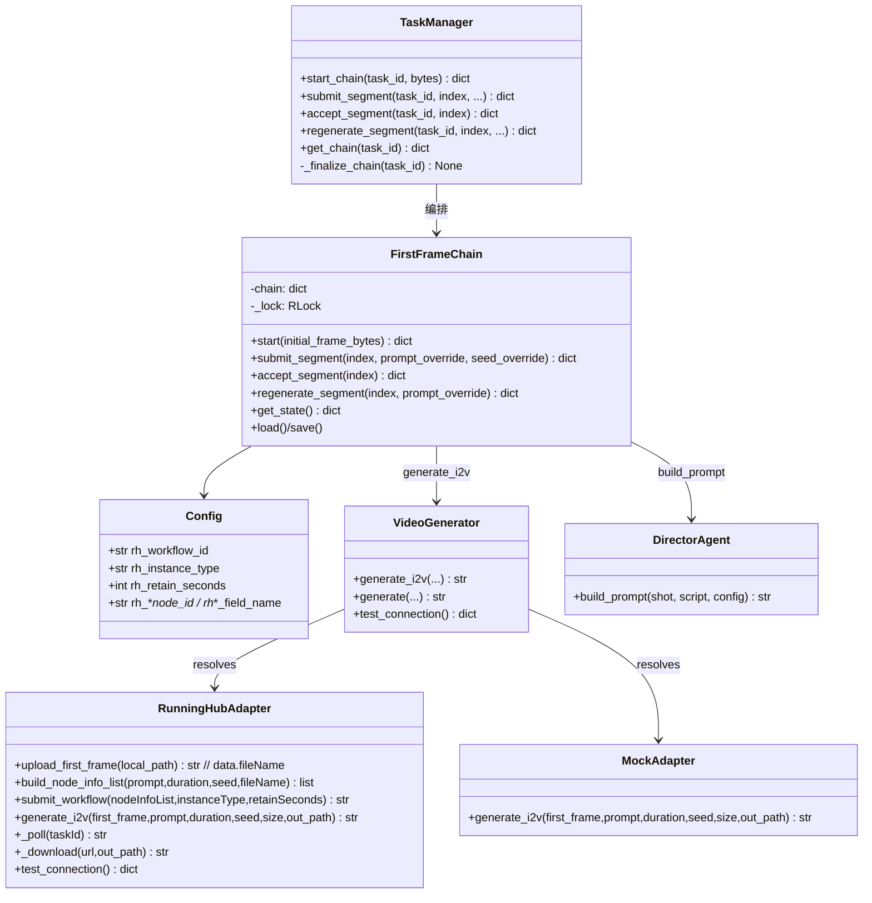
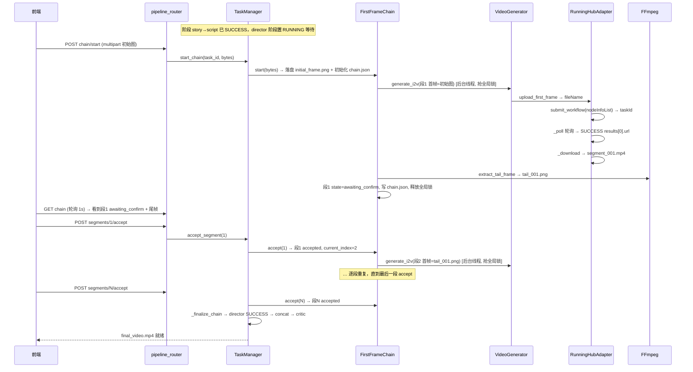
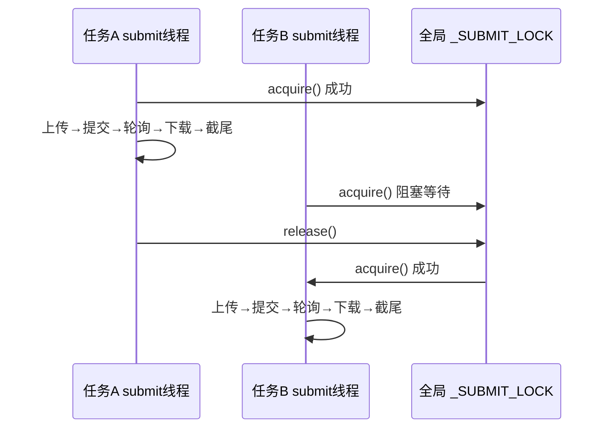

# 增量设计：RunningHub 工作流 i2v + 串行首帧链

> 文档类型：**增量设计 + 任务分解**（只描述本次变更）
> 项目：StoryForge（Python 3.13 + FastAPI + 原生 HTML/CSS/JS，零 CDN / 零新增 pip）
> 版本：v0.4 增量　|　语言：简体中文　|　作者：高见远（架构师）
> 输入：`docs/增量PRD-RunningHub工作流首帧链.md`、`docs/RunningHub工作流API接入方案.md`、现有源码（逐行核对）
> 前置：用户已拍板「整体推翻自建图像生成」，team-lead 已裁决技术选型，本设计直接采纳、不再提问。

---

## 一、实现方案与选型理由

### 1.1 核心难点
1. **逐段确认 ≠ 一次性流水线**：director 阶段要从「后台线程一次跑完所有镜头」改成「每段生成→`awaiting_confirm`→接受/重生成→下一段」，任务需要**暂停/恢复**能力。
2. **工作流 i2v 契约**：上传取 `data.fileName`（非 URL）、提交体为 `nodeInfoList` + `instanceType`、`fieldName` 必须是 `fieldValue`（不是 `value`），三处与旧模型 API 完全不同。
3. **严格串行 + 防 421**：跨任务全局互斥，同一时刻仅 1 个 RunningHub 提交在飞。
4. **架构做减法**：删自建图像生成 + 引擎切换全部组件，代码与配置收敛到单一工作流 i2v 路径，且删除后**无残留引用**（AC16）。

### 1.2 选型
| 决策点 | 结论 | 理由 |
|---|---|---|
| 视频引擎 | **改造 `RunningHubAdapter` 为工作流 i2v**，不新增适配器注册表 | team-lead 裁定 1；复用上传/轮询/下载骨架 |
| 串行链编排 | **新增 `app/services/first_frame_chain.py`**（编排器 + 状态机 + 全局锁 + `chain.json` 读写） | 独立服务层，与 `task_manager`/导演层解耦 |
| 暂停/恢复 | **状态机 + `chain.json` 断点续跑 + 每段独立后台线程**（非一个长线程） | 每段提交即起线程、完成即退；用户操作驱动推进 |
| 并发兜底 | 模块级 `threading.Lock`（跨任务互斥，非 asyncio） | 现有架构是 `threading.Thread` 后台线程 |
| 尾帧 | FFmpeg 截最后一帧输出 **PNG**（新增 `extract_tail_frame`） | 裁定 2 |
| 前端对齐 | **轮询 `GET /chain`**（1s），不引入 SSE/WebSocket | 零新增依赖；AC12 |
| mock 零成本 | `MockAdapter` 增加同构 `generate_i2v`（本地占位，忽略首帧/seed） | 统一接口，E2E 全离线 |

### 1.3 删除与新增（精确）
**删除组件**：`ImageGenerator`（`image_generator.py`）、`EngineSwitcher`（`engine_switch.py`）、`image_*` 四适配器 + `IMAGE_ADAPTER_REGISTRY`、`ImageProvider` 枚举、`Config` 中 Phase 2 十个 `image_*` 字段、导演层首帧阶梯 L1–L4（定妆照/场景锚图/逐镜首帧）、`build_anchor_prompt`、前端「图像生成」配置组、`deploy/image_server/`、`tests/test_image_service.py`。
**随阶梯删除而必然失效的 Phase 1 字段（一并删）**：`chain_continuity`、`anchor_image`、`video_image_endpoint`（`generate_image`/`build_anchor_prompt` 已删，字段无消费方）。`consistency_lock` **保留**（提示词锁定卡仍服务 `build_video_prompt`）。

---

## 二、文件清单

| 相对路径 | 增/改/删 | 职责 |
|---|---|---|
| `app/services/adapters/runninghub_adapter.py` | 改 | 工作流 i2v：`upload_first_frame` 取 `fileName`、`build_node_info_list`、`submit_workflow`、`generate_i2v`；删旧模型 API 分支 |
| `app/services/adapters/mock_adapter.py` | 改 | 新增同构 `generate_i2v`（本地占位视频 + 复用 `make_mock_video`），零成本路径 |
| `app/services/adapters/__init__.py` | 改 | 删 `IMAGE_ADAPTER_REGISTRY` 与 `image_*` 导入 |
| `app/services/adapters/base.py` | 改 | 删 `supports_first_frame`/`generate_image` 默认实现（保留 `generate`/`test_connection`/参数校验） |
| `app/services/video_generator.py` | 改 | 删 `generate_image`/`supports_first_frame`；新增 `generate_i2v` 透传 |
| `app/services/first_frame_chain.py` | **新增** | 链状态机 + `chain.json` 读写 + 全局串行锁 + 段提交/接受/重生成 + 805 重试 |
| `app/utils/ffmpeg_utils.py` | 改 | 新增 `extract_tail_frame`（截最后一帧输出 PNG） |
| `app/models/enums.py` | 改 | 删 `ImageProvider` |
| `app/models/schemas.py` | 改 | `Config` 删 13 字段、增 11 个 `rh_*` 字段；API Key 复用 `video_api_key`（不新增 `rh_api_key`） |
| `app/services/config_store.py` | 改 | 删图像归一化；增 `rh_*` 成本安全校验（`rh_instance_type`/`rh_retain_seconds`/`rh_workflow_id`） |
| `app/services/prompt_templates.py` | 改 | 删 `build_anchor_prompt`（保留 `build_video_prompt`） |
| `app/agents/director_agent.py` | 改 | 删首帧阶梯/定妆照/锚图；瘦身为「构建工作流提示词 + 单段生成入口」 |
| `app/services/task_manager.py` | 改 | 拆分 `_run_director_phase` 为「初始化 + 逐段确认 + 收尾 concat/critic」；接入链编排 |
| `app/routers/pipeline_router.py` | 改 | 新增 `chain/start`、`chain`、`segments/{i}/submit`、`/accept`、`/regenerate`、`/segments/{i}` |
| `app/routers/config_router.py` | 改 | 删 `test-image`；`test-video` 改为工作流探活（复用 `test_connection`） |
| `app/static/index.html` / `app/static/app.js` | 改 | 删图像配置组；改视频配置组（工作流 i2v）；新增初始图上传 + 逐段确认 UI |
| `app/services/image_generator.py`、`engine_switch.py` | **删** | — |
| `app/services/adapters/image_base.py` / `image_mock_adapter.py` / `image_local_adapter.py` / `image_runninghub_adapter.py` | **删** | — |
| `deploy/image_server/`（整目录） | **删** | 服务器部署件 |
| `tests/test_image_service.py` | **删** | — |
| `tests/test_first_frame_chain.py` | **新增** | 链状态机 + 串行锁 + 805 重试 + 断点续跑 |
| `tests/test_runninghub_adapter.py` / `test_runninghub_adversarial.py` / `test_consistency_increment.py` / `test_consistency_adversarial.py` / `test_director_resilience.py` / `test_config_store.py` / `test_frontend_consistency.py` / `run_e2e.sh` | 改 | 删旧断言、补工作流/串行链断言 |
| `docs/使用说明.md` | 改 | 更新「工作流 i2v + 逐段确认」章节 |

---

## 三、数据结构与接口

### 3.1 配置字段（`Config`）
```python
# 新增（全部带默认值 → 旧 JSON 兼容）
rh_workflow_id: str = "2084067455902765057"   # 提交端点 /openapi/v2/run/workflow/{id}
rh_instance_type: str = "default"             # default(24G)/plus(48G)/ultra(84G)
# API Key 复用既有 video_api_key（已在 _SECRET_FIELDS 遮罩），不新增 rh_api_key
rh_retain_seconds: int = 180                  # 10–180，钳制
rh_first_frame_node_id: str = "4";    rh_first_frame_field_name: str = "image"
rh_prompt_node_id: str = "7";         rh_prompt_field_name: str = "prompt"
rh_duration_node_id: str = "6";       rh_duration_field_name: str = "duration_seconds"
rh_seed_node_id: str = "9";           rh_seed_field_name: str = "seed"
# 删除：image_provider/image_endpoint/image_api_key/ip_scale/ip_face/image_seed/
#       shot_first_frame/auto_engine_switch/image_switch_start_cmd/image_switch_stop_cmd/
#       chain_continuity/anchor_image/video_image_endpoint
# 保留：consistency_lock（提示词锁定卡）
```

### 3.2 `chain.json` 结构（断点续跑）
```json
{
  "version": 1,
  "task_id": "a1b2c3d4e5f6",
  "workflow_id": "2084067455902765057",
  "current_index": 2,
  "initial_frame": "frames/initial_frame.png",
  "segments": [
    {
      "index": 1,
      "state": "accepted",
      "first_frame_source": "frames/initial_frame.png",
      "video_path": "shots/segment_001.mp4",
      "tail_frame_path": "frames/tail_001.png",
      "prompt": "one continuous shot, ...",
      "seed": 42,
      "runninghub_task_id": "20135...",
      "error": null
    }
  ]
}
```
段状态枚举 `ChainSegmentState`：`pending → uploading → submitting → polling → awaiting_confirm → accepted`（异常分支 `failed`，`regenerate` 回到 `submitting`）。

### 3.3 类图


### 3.4 API 契约
| 端点 | 方法 | 语义 |
|---|---|---|
| `POST /api/pipeline/{task_id}/chain/start` | multipart `file` | 落盘 `frames/initial_frame.png`，初始化链，**自动提交段 1**（后台线程），返回链状态 |
| `GET /api/pipeline/{task_id}/chain` | GET | 返回 `chain.json` 内容（当前段索引 + 各段 state/产物路径/错误） |
| `POST /api/pipeline/{task_id}/chain/segments/{i}/submit` | JSON `{prompt?, seed?}` | 显式提交（幂等：仅 `pending`/`failed` 段可提交；断点续跑用） |
| `GET /api/pipeline/{task_id}/chain/segments/{i}` | GET | 单段详情 + 视频/尾帧预览 URL |
| `POST /api/pipeline/{task_id}/chain/segments/{i}/accept` | JSON `{}` | 接受本段 → 锁定尾帧为下一段首帧 → 自动提交段 i+1；最后一段 → `concat` |
| `POST /api/pipeline/{task_id}/chain/segments/{i}/regenerate` | JSON `{prompt?}` | 重生成（自动换随机 seed），覆盖本段产物 |

---

## 四、调用流程

### 4.1 串行首帧链 + 逐段确认（含暂停/恢复）


### 4.2 全局串行锁（防 421）


---

## 五、任务列表（T01–T05，按实现顺序）

> 依赖：T01 → T02 → T03 → T04 → T05；每任务须通过全量单测 + `node --check app/static/app.js`（如涉及）。

### T01 配置层减法 + `rh_*` 字段　【P0】
- **目标**：删图像配置轴，落 `rh_*` 配置与成本安全校验。
- **涉及文件**：`enums.py`、`schemas.py`、`config_store.py`。
- **依赖**：无。
- **要点**：删 `ImageProvider`；`Config` 删 13 字段、增 11 个 `rh_*`（默认值见 §3.1）；API Key 复用既有 `video_api_key`（`_SECRET_FIELDS` 删 `image_api_key`、**保持** `video_api_key`，不新增 `rh_api_key`）；`config_store` 删 `_ALLOWED_IMAGE_PROVIDERS`/`_migrate_image_provider`/ip_scale/image_seed 处理；新增 `rh_instance_type` 非法→`default`、`rh_retain_seconds` 钳 10–180、`rh_workflow_id` 空/非 str→默认、node_id/field_name 非 str→默认；`_BOOL_FIELDS` 仅剩 `consistency_lock`，`_COST_BOOL_FIELDS` 清空。
- **验收**：AC13、AC14；AC16（图像字段无残留）。

### T02 `RunningHubAdapter` 工作流 i2v 改造　【P0】
- **目标**：删旧模型 API 分支，落地工作流四步。
- **涉及文件**：`runninghub_adapter.py`、`mock_adapter.py`、`adapters/__init__.py`、`base.py`、`video_generator.py`、`ffmpeg_utils.py`（`extract_tail_frame`）。
- **依赖**：T01。
- **要点**：`upload_first_frame` 返回 `data.fileName`（删 `_UPLOAD_CACHE`，每段重新上传）；`build_node_info_list` 组装 image/prompt/duration/seed 四类节点（image/prompt 传字符串、duration/seed 传整数）；`submit_workflow` 提交 `/openapi/v2/run/workflow/{rh_workflow_id}`；`generate_i2v` 串起上传→提交→轮询→下载→（截尾由编排器做）；删 `DEFAULT_ENDPOINT/_submit/_submit_i2v/generate_image/_map_image_resolution/_map_ratio/supports_first_frame/_i2v_endpoint` 与 H3 分支；`MockAdapter.generate_i2v` 本地占位（`make_mock_video`）；`VideoGenerator` 删图像透传、增 `generate_i2v`；`ffmpeg_utils.extract_tail_frame` 输出 PNG。
- **验收**：AC2、AC3、AC15；`nodeInfoList` 组装 + `fileName` 字段名断言。

### T03 串行首帧链编排器　【P0】
- **目标**：链状态机 + `chain.json` + 全局锁 + 805 重试 + 断点续跑。
- **涉及文件**：`first_frame_chain.py`（新增）、`director_agent.py`（瘦身）、`prompt_templates.py`（删 `build_anchor_prompt`）。
- **依赖**：T02。
- **要点**：模块级 `_SUBMIT_LOCK = threading.Lock()` 跨任务互斥；`start/submit_segment/accept_segment/regenerate_segment/get_state/load/save`；805 失败**自动重试 1 次（换 seed）**再交用户；每段完成 `awaiting_confirm` 并写盘；`DirectorAgent` 收敛为 `build_prompt`（真实走 `build_video_prompt`，mock 走中文占位分支）。
- **验收**：AC1、AC4、AC5、AC6、AC7、AC9。

### T04 任务暂停/恢复 + 路由　【P0】
- **目标**：director 阶段状态机化，接入 6 个 chain 端点与 concat 收尾。
- **涉及文件**：`task_manager.py`、`pipeline_router.py`、`config_router.py`。
- **依赖**：T03。
- **要点**：`_run_director_phase` 拆为 `_init_director_stage`（置 RUNNING、初始化 `record.shots` 为段列表）+ `_finalize_chain`（director SUCCESS → concat → critic，复用现有 concat/critic 逻辑）；`start_chain` 落盘初始图 + 起段 1 线程；`accept_segment` 锁内原子推进（最后一段触发 `_finalize_chain`）；`submit/regenerate` 起后台线程；`config_router` 删 `test-image`。
- **验收**：AC8、AC10；`StageName.ALL` 恒 5。

### T05 前端逐段确认 + 测试/E2E　【P0】
- **目标**：逐段确认 UI + 配置区改造 + 测试同步与零外网回归。
- **涉及文件**：`index.html`、`app.js`、`docs/使用说明.md`、`tests/*`（§二所列）、`tests/test_first_frame_chain.py`（新增）。
- **依赖**：T01–T04。
- **要点**：删图像配置组；改视频配置组（`rh_workflow_id`/`rh_instance_type`/`rh_retain_seconds`/节点参数，RunningHub 文案改为「工作流 i2v·按次计费」）；新增初始图上传区 + 逐段卡片（首帧缩略图/状态徽标/视频预览/尾帧预览/「接受并继续」「重生成本段」），全内联零外链；轮询 `GET /chain`；测试改写清单见下表；E2E 用 mock 全离线（零外网）+ 单测用 `httpx.MockTransport` 覆盖四步与 805 重试。
- **验收**：AC11、AC12、AC17、AC18；`node --check` 通过。

**需同步修改的既有测试（不降低覆盖强度）**：
| 测试 | 处置 |
|---|---|
| `test_image_service.py` | **删除** |
| `test_consistency_increment.py` | 删锚图/链式/定妆照用例；保留 `build_video_prompt`；补链状态机用例 |
| `test_consistency_adversarial.py` | 删图像/阶梯相关；保留 prompt 裁剪兜底 |
| `test_director_resilience.py` | 改为「段失败不阻断后续确认」的链语义，或删除由 `test_first_frame_chain.py` 取代 |
| `test_runninghub_adapter.py` / `test_runninghub_adversarial.py` | 删旧模型 API 断言；新增 `fileName`/`nodeInfoList`/`submit_workflow`/805 重试 |
| `test_config_store.py` | 增 `rh_*` 校验、删 `image_*` 断言 |
| `test_frontend_consistency.py` | 更新 `$()` id 集合（删图像 id、增链 UI id） |
| `run_e2e.sh` + `e2e_smoke.py` | mock 全离线；补串行链冒烟（start→accept→concat） |
| `test_frozen_compat.py` / `test_ffmpeg_utils.py` | 仅增 `extract_tail_frame` 用例 |

---

## 六、依赖包清单（应为空）
**无新增 pip 包。** HTTP 用既有 `httpx`；FFmpeg 用命令行子进程；并发用既有 `threading`；base64/JSON 用标准库。（AC12）

---

## 七、共享知识 / 跨文件约定
- **响应**：统一 `{ok,data,error}`，错误串 `CODE: 中文`，**只复用**既有 `ErrorCode` 前缀（`CFG_/LLM_/VID_/FFM_/TASK_/SYS_`），**不新增前缀**。RunningHub 业务码（412/421/433/434/435/803/805/810/813）统一以 `VID_API_ERROR` / `VID_GENERATE_FAILED` 包装。
- **路径规范**：对外一律**任务相对正斜杠路径**（`frames/initial_frame.png`、`frames/tail_001.png`、`shots/segment_001.mp4`），严禁 `E:\…`。
- **文件命名**：初始图 `frames/initial_frame.png`；段视频 `shots/segment_{i:03d}.mp4`；尾帧 `frames/tail_{i:03d}.png`；链状态 `chain.json`（任务目录根）。
- **nodeInfoList 字段类型**：image/prompt 节点 `fieldValue` 传字符串；duration_seconds/seed 节点传整数（对齐 §5.3 示例）。
- **API Key 语义**：复用既有 `video_api_key`（已在 `_SECRET_FIELDS` 遮罩）；空则明确报「未配置 RunningHub API Key」（AC15，不静默、不降级 mock）。
- **尾帧每段重新上传**：不缓存复用 `fileName`（规避 24h 过期 + 简化，裁定 3）。
- **805 重试**：自动换随机 seed 重试 1 次；仍失败置 `failed` + 错误原因，交用户 `regenerate`。
- **`StageName.ALL` 恒 5**（story→script→director→concat→critic），串行链是 director 内部逻辑，不新增阶段。

---

## 八、风险清单与回滚
| # | 风险 | 影响 | 缓解 / 回滚 |
|---|---|---|---|
| R1 | 逐段确认改造破坏既有一次性流水线 | director 逻辑回归 | `_finalize_chain` 复用既有 concat/critic 逐字逻辑；`mock` 下全流程可单测跑通 |
| R2 | 全局锁死锁/长阻塞 | 任务卡死 | 锁仅覆盖「单段四步」，不包 UI 读；`accept` 只做内存态推进 + 起线程；超时上限 `_POLL_TIMEOUT_SEC` |
| R3 | 断点续跑状态不一致 | 刷新后错段/重头 | `chain.json` 每状态迁移即写盘；`current_index` 单源；`submit` 幂等 |
| R4 | 上传取错字段（URL vs fileName） | 工作流 803 | `upload_first_frame` 强制校验 `data.fileName` 非空，缺失报 `VID_API_ERROR`（AC10） |
| R5 | 805/421 等业务错误未妥善处理 | 段失败或并发超限 | 805 自动重试；421 靠全局锁 + 指数退避；433/434/435/803/810 明确提示不重试 |
| R6 | E2E 被外网污染 | 结果不可信 | mock 全离线；runninghub 用 `httpx.MockTransport`；测试禁代理 |
| R7 | 删除不彻底（AC16） | 残留引用报错 | 删除后全局检索 `ImageGenerator/EngineSwitcher/image_*/IMAGE_ADAPTER_REGISTRY/ImageProvider` |

**总体回滚**：`video_provider=mock` 即零成本路径恒可跑通；最坏情况将 `video_provider` 设 `mock`、`video_api_key` 清空，走纯本地串行链（初始图→mock 视频→截尾帧）；代码级回滚 = 恢复被删文件（git）。

---

## 九、待明确事项（已由 team-lead 裁定，记录结论）
1. **接入形态**：工作流 API（`/openapi/v2/run/workflow/{id}`），`workflowId=2084067455902765057`；砍 `rh_app_id`（裁定 2）。
2. **尾帧**：FFmpeg 截最后一帧输出 PNG；每段重新上传，不缓存 `fileName`（裁定 3）。
3. **节点参数**：可配置但默认 = 实测值（首帧 `4/image`、提示词 `7/prompt`、时长 `6/duration_seconds`、种子 `9/seed`）。
4. **`chain_continuity`/`anchor_image`/`video_image_endpoint` 删除**：PRD §2.1 未逐字列出，但随 `build_anchor_prompt`/首帧阶梯删除而必然失效，本设计一并删除（如 team-lead 有异议请指出）。
5. **`rh_api_key` vs `video_api_key`**：**已裁决——不新增 `rh_api_key`，直接复用既有 `video_api_key`**（它本就是 RunningHub 的 Key，且已在 `_SECRET_FIELDS` 遮罩）；AC13/AC15 的字段名断言相应改为 `video_api_key`。

**无未决事项。**
