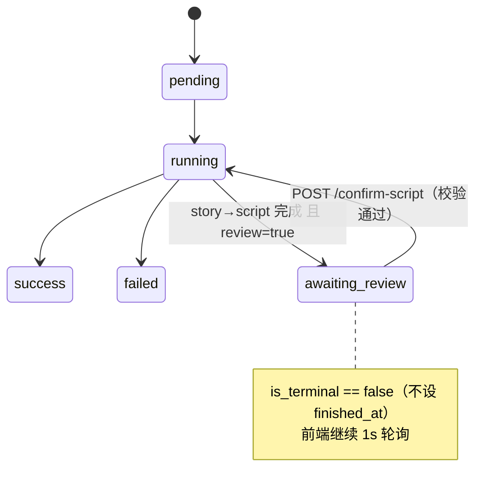
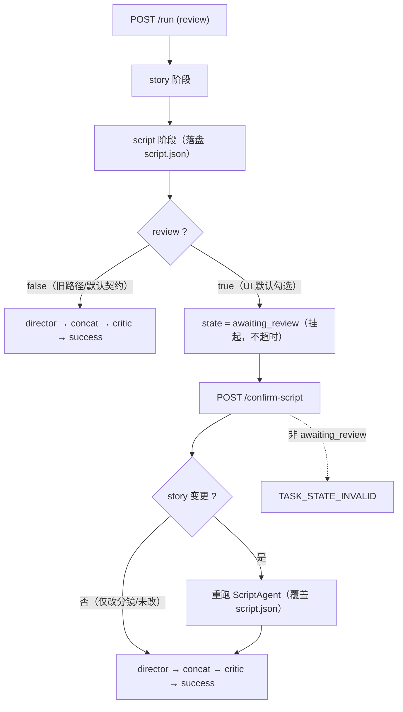
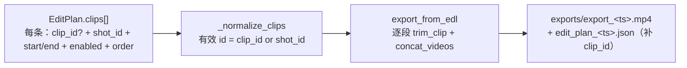

# StoryForge 增量系统设计：分镜确认区 与 专业剪辑区（第三批）

> 文档类型：**增量设计**（只描述本次变更，不重复前两批已交付功能）
> 依据：`docs/增量PRD-分镜确认区与专业剪辑区.md`（**v0.5 终版**，AC1–AC27）
> 撰写人：高见远（架构师）　|　项目根：`E:\ai\storyforge`　|　语言：简体中文
> 约束：Python 3.13 + FastAPI + 原生 HTML/CSS/JS；**零 CDN、零新增第三方依赖、不回归 185 条既有测试**；`StageName.ALL` **不变**
> 已拍板：**D1** API `review=false` + UI 开关默认勾选；**D2** split 升 P0（可选 `clip_id` + 有效 id 归一化）；**D3** 原地续跑同一 `task_id`

---

## 1. 状态机与流程图

### 1.1 任务级状态机（新增 `awaiting_review`，**非终态**）



- 新增 `TaskState.AWAITING_REVIEW = "awaiting_review"`；`is_terminal` **仍只认** `SUCCESS/FAILED`（`set_state` 不写 `finished_at`，前端 `pollStatus` 不会停止）。
- **不新增 `StageName`**；`ALL = (story, script, director, concat, critic)` 逐字不变。

### 1.2 两条路径（`review` 分流）



### 1.3 剪辑区 split 数据流（有效 id）



---

## 2. 字段级契约（`app/models/schemas.py` / `enums.py` / `responses.py`）

### 2.1 变更/新增模型

| 模型 | 字段 | 类型 | 默认 | 说明 |
| --- | --- | --- | --- | --- |
| `TaskState`(enum) | `AWAITING_REVIEW` | `str` | `"awaiting_review"` | **新增**；`is_terminal` 保持 False |
| `ClipEdit` | `clip_id` | `str \| None` | `None` | **新增（可选）**；有效 id = `clip_id or shot_id`；缺省=旧行为 |
| `PipelineRunRequest` | `review` | `bool` | `False` | **新增**；缺省 False → 旧路径逐字不变 |
| `ConfirmScriptRequest` | `story` | `StoryDocument \| None` | `None` | **新增**；携带则视为「剧情可能变更」 |
| `ConfirmScriptRequest` | `script` | `ScriptDocument \| None` | `None` | **新增**；仅当 story 未变时采用 |
| `NormalizedClip`(NamedTuple) | `(shot_id, video_path, start, end, clip_id)` | — | — | `_normalize_clips` 返回值；**前 4 位与现状一致**（护既有断言索引） |
| `ErrorCode` | `TASK_STATE_INVALID` | `str` | `"TASK_STATE_INVALID"` | **新增**错误码常量 |

> `StoryDocument` / `ScriptDocument` / `Shot` **字段不改**，仅新增可选字段后的**校验**（见 §2.3 AC10/AC11）。全模型维持 `extra="ignore"`、列表 `default_factory`。

### 2.2 新端点：`POST /api/pipeline/{task_id}/confirm-script`

**请求体（两字段均可选、可同时携带）**
```json
{
  "story": { "title": "T", "synopsis": "改后的完整剧情…", "characters": [], "beats": [], "extra": {} },
  "script": { "title": "T", "shots": [ { "shot_id":"shot_001", "prompt":"英文提示词", "action":"", "camera":"", "dialogue":"", "duration":4 } ] }
}
```
**成功响应**（`state` 恒为 `"running"`——续跑已在后台线程启动）
```json
{ "ok": true, "data": { "task_id": "abc123", "state": "running", "rerun_script": false }, "error": null }
```
**失败响应**
```json
{ "ok": false, "data": null, "error": "TASK_STATE_INVALID: 任务不在待确认状态" }
{ "ok": false, "data": null, "error": "TASK_NOT_FOUND: 任务 abc 不存在" }
{ "ok": false, "data": null, "error": "CFG_INVALID: shot_002 的时长须为 2–10 秒" }
{ "ok": false, "data": null, "error": "CFG_INVALID: shot_003 的分镜提示词不能为空" }
```
**判定（D3 / PRD §2.5）**：`story` 提供且与 `record.story` **不等** → `rerun_script=true`（忽略本次 `shots` 编辑，用新剧情重跑 `ScriptAgent`）；否则若 `script` 提供 → 采用该脚本、`rerun_script=false`；否则用现有脚本、`rerun_script=false`。

### 2.3 `/status` 中新增状态（示例片段）
```json
{ "state": "awaiting_review",
  "stages": { "story": {"state":"success"}, "script": {"state":"success"},
              "director": {"state":"pending"}, "concat": {"state":"pending"}, "critic": {"state":"pending"} },
  "shots": [] }
```

### 2.4 无新端点说明
- **split** 不新增端点：前端在时间轴上「一刀两段」后，仍走既有 `PUT /{id}/edit-plan`（存草稿）与 `POST /{id}/export`（导出），契约靠 `ClipEdit.clip_id` 承载（AC25–AC27）。
- `GET/PUT /{id}/edit-plan`、`POST /{id}/export`、`GET /{id}/script|story` **签名与响应不变**。

---

## 3. `_normalize_clips` 新规则伪码（有效 id 去重版）

**核心**：去重键由 `shot_id` → **有效 id = `clip_id or shot_id`**；「未覆盖片段宽容追加」的判据由「已见 shot_id」→ **「已被任一 clip（含禁用）引用的 shot_id」集合 `covered_shot_ids`**（按 shot 维度而非 clip 维度，故同一 shot 的多段 split 只标记一次）。

```text
def _normalize_clips(clips, shots) -> list[NormalizedClip]:
    available = {s.shot_id: s for s in shots if s.state == SUCCESS and s.video_path}

    ordered = list(clips)
    if any(c.order is not None for c in ordered):
        ordered.sort(key=lambda c: (c.order is None, c.order or 0))

    result, seen_clip_ids, covered_shot_ids = [], set(), set()
    for clip in ordered:
        eff_id = clip.clip_id or clip.shot_id        # 有效 id
        sid    = clip.shot_id
        if not sid or sid not in available:          # 引用缺失/失败镜头 → 丢弃
            continue
        if eff_id in seen_clip_ids:                  # 同一有效 id → 去重（保留首个）
            continue
        seen_clip_ids.add(eff_id)
        covered_shot_ids.add(sid)                    # 命中即「已覆盖」（含禁用）→ 不再被追加
        if not clip.enabled:
            continue

        shot = available[sid]
        duration = max(0.0, float(shot.duration or 0.0))
        if duration <= 0.0:                          # 探测失败 → 整段不裁剪
            result.append(NormalizedClip(sid, str(shot.video_path), 0.0, None, clip.clip_id))
            continue
        start = max(0.0, float(clip.start or 0.0))
        end   = duration if clip.end is None else min(float(clip.end), duration)
        if start >= duration or end <= start:        # 无效裁剪 → 回退整段
            start, end = 0.0, duration
        result.append(NormalizedClip(sid, str(shot.video_path), start, end, clip.clip_id))

    for shot in shots:                               # 未被任何 clip 引用的可用镜头 → 追加
        if shot.shot_id in covered_shot_ids or shot.state != SUCCESS or not shot.video_path:
            continue
        covered_shot_ids.add(shot.shot_id)
        duration = max(0.0, float(shot.duration or 0.0))
        result.append(NormalizedClip(shot.shot_id, str(shot.video_path), 0.0,
                                     duration if duration > 0 else None, None))
    return result
```

**兼容性论证（对照 `tests/test_clip_normalize.py` 21 条）**
- `clip_id` 缺省 ⇒ `eff_id ≡ shot_id`、`covered_shot_ids` 语义与旧 `seen` 完全一致 ⇒ 全部边界用例（越界钳制 / `end=None` / `end<=start` 回退 / `duration<=0` 不裁剪 / 未覆盖追加 / 重复去重 / 全禁用为空 / order 稳定排序）**逐字不变**。
- 多段 split：`shot_001#1`、`shot_001#2` 有效 id 互异 ⇒ 均保留；`covered_shot_ids` 只记 `shot_001` 一次 ⇒ 基础 shot **不会**被再次追加（不产生幽灵片段）。
- `export_edit_plan` 的解包由 4 元组改为 5 元组，`plan_clips[]` **新增** `clip_id` 键（旧解析方忽略即可）。

---

## 4. 前端组件与事件设计（零 CDN，仅原生 JS + Unicode/内联 SVG）

### 4.1 分镜确认区 DOM（插在 ③ 与 ④ 之间，`awaiting_review` 时显示）

```html
<section class="card hidden" id="section-review">
  <h2 class="card-title"><span class="step">③.5</span> 分镜确认区
    <span id="reviewStateChip" class="chip warn">⏸ 待确认</span></h2>
  <div class="review-grid">
    <div class="review-story">                 <!-- 左：完整剧情（可编辑） -->
      <input id="reviewTitle">    <input id="reviewGenre">
      <input id="reviewLogline">  <input id="reviewSetting">
      <textarea id="reviewSynopsis"></textarea>          <!-- synopsis 必填 -->
      <div id="reviewCharsView" class="readonly-box"></div>  <!-- 角色 只读 -->
      <div id="reviewBeatsView" class="readonly-box"></div>  <!-- 情节点 只读 -->
    </div>
    <div class="review-shots">                 <!-- 右：逐镜头可编辑（动态卡片） -->
      <div id="reviewShotList" class="review-shot-list"></div>
    </div>
  </div>
  <div class="actions-row right">
    <span id="reviewHint" class="hint"></span>
    <button id="reviewSkipBtn"    class="btn btn-ghost"  type="button">跳过确认</button>
    <button id="reviewConfirmBtn" class="btn btn-primary" type="button">✓ 确认并生成视频</button>
  </div>
</section>
```
- 输入区新增开关（② 内）：`<label class="check"><input id="reviewToggle" type="checkbox" checked> 生成前确认分镜</label>`（**UI 默认勾选**，D1）。
- 每张分镜卡由 JS 动态生成，字段用 `data-shot-id` + `data-field`（不占用全局 id）；`shot_id` 只读展示，`prompt/action/camera/dialogue/duration` 可编辑。
- **③ 的 `script` 卡片不打新 `data-stage`**（护 `test_frontend_consistency`）；`awaiting_review` 时仅给该卡 `classList.add("awaiting")` 并把 detail 文案置「待确认」。

### 4.2 时间轴编辑器 DOM（替换 ④ 原卡片列表；保留原 id）

```html
<div class="timeline-ruler" id="timelineRuler"></div>      <!-- 秒刻度（动态） -->
<div class="timeline-track" id="editList">                 <!-- 单轨；保留 id=editList -->
  <!-- 动态片段块： -->
  <div class="clip" data-index="0" data-clip-id="shot_001#1" style="width:__px">
    <span class="clip-handle" data-handle="left"></span>
    <span class="clip-label">#1a</span>
    <span class="clip-handle" data-handle="right"></span>
  </div>
  …
  <div class="timeline-playhead" id="timelinePlayhead"></div>  <!-- 绝对定位 -->
</div>
<div class="actions-row">
  <button id="playEditBtn">▶ 播放剪辑</button>
  <span id="editSummary"></span>
  <button id="splitClipBtn">✂ 分割</button>
</div>
```
- 保留既有 id：`previewPlayer`/`finalVideo`/`editList`/`editSummary`/`playEditBtn`/`exportBtn`/`resetEditBtn`/`editExportHint`/`exportResult`/`downloadFinalBtn`/`finalMeta`/`shotList`/`shotSummary`。
- **新增 id（app.js 会被 `$()` 引用，必须存在于 index.html）**：`section-review`、`reviewStateChip`、`reviewTitle`、`reviewGenre`、`reviewLogline`、`reviewSetting`、`reviewSynopsis`、`reviewCharsView`、`reviewBeatsView`、`reviewShotList`、`reviewHint`、`reviewSkipBtn`、`reviewConfirmBtn`、`reviewToggle`、`timelineRuler`、`timelinePlayhead`、`splitClipBtn`。

### 4.3 宽度 ∝ 时长换算

```
PX_PER_SEC_BASE = 40                       // 基准比例尺
pxPerSec        = PX_PER_SEC_BASE * zoom   // zoom 默认 1（P1 提供 0.5/1/1.5）
clipWidth(i)    = max(28, trimmedDuration(i) * pxPerSec)   // 保底可点选
rulerStep       = 使 相邻刻度像素间距 ≥ 48px 的最小 {0.5,1,2,5,10}s
playheadX(t)    = t * pxPerSec             // t 为「时间轴时间」= 启用片段裁剪时长前缀和
```

### 4.4 事件模型

| 能力 | 触发 | 处理 | 归一/落盘 |
| --- | --- | --- | --- |
| 拖拽排序 B2 | `.clip` `dragstart` 记 `dragIndex`；`#editList` `dragover/drop` 按指针 X 与各段中点求插入位 | `splice` 重排 `state.editClips` | `renderTimeline()+updateEditSummary()+scheduleDraftSave()` |
| 双臂裁剪 B3 | `.clip-handle[data-handle]` `pointerdown` → `document` `pointermove` 捕获 | `Δpx/pxPerSec` → 秒；`left: start=clamp(start+Δ)`；`right: end=clamp(end+Δ)`；`start<end` 否则回退该段上一有效值 | 拖动中轻量改宽；`pointerup` 全量重渲染 + 存草稿 + 数字输入框双向同步 |
| 播放头 B4 | `playClipAt()` 的 `ontimeupdate` | `t = 前序启用段时长和 + (currentTime - clip.start)` | `timelinePlayhead.style.left = playheadX(t)` |
| 点击定位 B5 | `#editList`/`#timelineRuler` `click` | `x→t`，遍历启用段定位 `(段, 本地时间)` | `previewPlayer.src=该段; currentTime=本地时间`（±0.2s） |
| 分割 B9 | `#splitClipBtn` `click` | 见下 | 重渲染 + 存草稿 |
| 启停/裁剪/排序变更 | 任意 | 即时更新预览与预计时长 | `scheduleDraftSave()`（400ms 防抖，沿用现状） |

**split 规则（播放头处一刀两段）**：`#splitClipBtn` 仅在「已选中某段 + 播放头落在该段内部（`段.start < 本地playhead < 段.end`）」时可用；点击后
`left = { clip_id: parentId+"#1", start: 段.start, end: 本地playhead }`、
`right = { clip_id: parentId+"#2", start: 本地playhead, end: 段.end }`（`parentId = 段.clip_id || 段.shot_id`），
复制 `shot_id/video_path/frame_path/orig_duration/trimmable` 到两段并紧随插入。再次分割 `#1` → `#1#1`/`#1#2`（后缀追加，永不撞 id）。端点处禁用；裁到 0 时长按「回退该段」处理，不产生空段。

### 4.5 草稿接入点（刷新恢复，沿用 `edit_plan_draft.json`）

- 前端 clip 对象**新增 `clip_id`**（`buildEditClips()` 置 `null`；split 赋唯一值）。
- `currentEdl()`：每条输出 `{ shot_id, clip_id, enabled, start, end, order }`（`clip_id` 缺省为 `null`）。
- `applyDraft()`：改为**按有效 id 重建**——以 `shot_id → 基础clip` 建表，逐条草稿 clip 生成副本（`clip_id = raw.clip_id ?? null`，`start/end/enabled` 取自草稿并钳制），未覆盖的基础 shot 追加。**旧草稿（无 `clip_id`）→ 每 shot 一段，与旧版逐字一致**（AC22/AC27）。
- `resetEditBtn`：快照 `state.editOriginal`（`clip_id=null`，每 shot 一段）不变。

---

## 5. 任务列表（T01–T05，按实现顺序；每项含 文件 → 函数 → 验收标准 → 依赖 → 预估改动量）

| 任务 | 标题 | 文件 | 依赖 | 预估 |
| --- | --- | --- | --- | --- |
| **T01** | 数据契约与状态机 | `app/models/enums.py`、`app/models/schemas.py`、`app/utils/responses.py` | — | ~30 行 |
| **T02** | 后端编排 + 归一化 + 新端点 | `app/services/task_manager.py`、`app/routers/pipeline_router.py`、`tests/test_confirm_script.py`(新) | T01 | ~160 行 |
| **T03** | 前端确认区 + 时间轴编辑器 | `app/static/index.html`、`app/static/app.js`、`app/static/style.css` | T01,T02 | ~600 行 |
| **T04** | 归一化/草稿/前端一致性 单测 | `tests/test_clip_normalize.py`、`tests/test_edit_draft_api.py`、`tests/test_frontend_consistency.py` | T02 | ~120 行 |
| **T05** | 端到端 + 文档 | `tests/e2e_smoke.py`、`docs/使用说明.md`、`README.md` | T01–T04 | ~90 行 |

**T01** — `enums.py::TaskState` 加 `AWAITING_REVIEW`（`is_terminal` 不改）；`schemas.py::ClipEdit.clip_id` / `PipelineRunRequest.review` / 新增 `ConfirmScriptRequest`；`responses.py::ErrorCode.TASK_STATE_INVALID`。
*验收*：`TaskState.AWAITING_REVIEW.is_terminal is False`；`ClipEdit(shot_id="s").clip_id is None`；`PipelineRunRequest(dialogue="d").review is False`；`ConfirmScriptRequest().story is None`；导入无误。

**T02** — `task_manager.py`：① 抽出 `_run_director_phase(task_id, llm)`（现 L354–430 的 director/concat/critic 三阶段）；② `run_pipeline` 在 `script` 落盘后按 `request.review` 决定「置 `AWAITING_REVIEW` 返回」或续跑；③ `_normalize_clips` 改有效 id 去重 + `NormalizedClip` 5 元组；④ `export_edit_plan` 解包 5 元组、`plan_clips[]` 补 `clip_id`；⑤ 新增 `confirm_script(task_id, req) -> (state, rerun_script)`（锁内原子校验状态 + 校验 shots + 持久化 + 起后台续跑线程）；⑥ 新增 `resume_after_review(...)`。`pipeline_router.py`：新增 `POST /{task_id}/confirm-script`（`KeyError→fail`，`CFG_INVALID` 校验收敛到 schemas 层）。
*验收*：`review=false` 时 `/run` 行为与旧版逐字一致（不出现 `awaiting_review`）；`review=true` 时 script 后 `state=="awaiting_review"`、`shots==[]`、无 `shots/*.mp4`；`confirm-script` 后同 `task_id` 续跑至 `success`；非 `awaiting_review` → `TASK_STATE_INVALID`；不存在 → `TASK_NOT_FOUND`；`duration=1/30` 或空 `prompt` → `CFG_INVALID` 且状态仍 `awaiting_review`；`test_clip_normalize.py` 全绿。

**T03** — `index.html` 加 `#section-review`、`#reviewToggle`、时间轴容器与播放头、`#splitClipBtn`；`app.js` 加 `renderReview()/enterReviewMode()/confirmReview()/skipReview()`、`renderTimeline()`（含刻度/播放头/手柄/宽度换算）、`splitClip()`、pointer 手柄事件、点击定位；`pollStatus`/`restoreSession` 识别 `awaiting_review`（继续轮询 + 展示确认区）；`startPipeline` payload 加 `review`；`stateLabel` 补 `awaiting_review:"待确认"`；`style.css` 加 `.review-*`/`.timeline-*`/`.clip`/`.timeline-playhead`。
*验收*：勾选开关→出确认区、确认后出片；取消勾选→直达出片；时间轴段宽∝时长、可拖拽/手柄裁剪/点击定位/播放头随播放走；split 后两段可各自拖拽/裁剪/启停；`test_frontend_consistency` 全绿；无任何外链、图标仅 Unicode/内联 SVG。

**T04** — `test_clip_normalize.py` 增 split 用例（同 shot 多 clip、有效 id 去重、禁用单段不影响另一段、`plan_clips[].clip_id`）；`test_edit_draft_api.py` 增「无 `clip_id` 旧草稿」回环；`test_frontend_consistency.py` 增新 id 存在性与零外链断言。
*验收*：新增用例通过；既有 16 条草稿用例不回归（旧草稿原样解析）。

**T05** — `e2e_smoke.py` 增 `review=true` 路径（轮询到 `awaiting_review`→`confirm-script`→`success`）与不传 `review` 的旧路径回归；`使用说明.md`/`README.md` 增补确认区与专业剪辑区。
*验收*：新旧两条 E2E 全绿。

---

## 6. 共享知识约定 与 回归风险清单

### 6.1 共享知识（沿用前两批体例）
- **统一响应** `{ok, data, error}`；错误串 `CODE: 中文`。新增错误码仅 `TASK_STATE_INVALID`。
- **路径规范**：对外一律**任务相对正斜杠路径**（`exports/export_<ts>.mp4`）；禁止 `E:\` 绝对路径；访问经 `Paths.safe_join`。
- **零 CDN**：不引任何外链/第三方库；图标仅 Unicode（▶ ⏸ ✂ ⠿ ◧ ◨ ✓）或内联 SVG。
- **枚举/阶段一致性**：`StageName.ALL` **不变**；前端 `STAGE_KEYS` 与 `data-stage` 卡片**恒为 5 且 story 最前**（护 `test_frontend_consistency`）。
- **契约兼容**：只**新增可选字段**（`ClipEdit.clip_id`、`PipelineRunRequest.review`）；缺省=旧行为；全模型 `extra="ignore"`。
- **落盘**：`_write_json` / `model_dump(mode="json")`（**不使用 `exclude_none`**，因 `end=None` 语义须保留）+ `ensure_ascii=False`、UTF-8。确认续跑**原地覆盖**同目录 `story.json`/`script.json`。
- **错误与降级**：草稿读取失败静默返回 `[]`（不回归）；导出永不覆盖 `final_video.mp4`。
- **`$()` id 约定**：app.js 内所有 `$("x")` 的 id 必须存在于 index.html（新增见 §4.2）。

### 6.2 回归风险清单（17 文件 / 185 条）

| # | 风险 | 影响面 | 对策（本设计已内置） |
| --- | --- | --- | --- |
| R1 | `_normalize_clips` 去重键改为有效 id | `test_clip_normalize.py`(21) | `clip_id` 缺省 ⇒ `eff_id≡shot_id`，语义逐字不变；返回值用 NamedTuple，**前 4 位索引不变** |
| R2 | `_normalize_clips` 返回值元组**元数变化**（4→5） | 内部解包点 | 仅 `export_edit_plan` 解包，任务在 T02 同步改为 5 元组；测试仅按位取 0–3，不受影响 |
| R3 | `ClipEdit` 加 `clip_id` 后 `model_dump` 多出 `"clip_id"` 键 | `test_edit_draft_api.py`(16) | 无测试断言键集合；旧草稿（无该键）解析后 `clip_id=None`，顺序/起止/启停逐字一致（AC27） |
| R4 | 旧草稿无 `clip_id` | `test_edit_draft_api.py`(16) | `applyDraft` 按有效 id 重建；缺省回退 `shot_id`（AC22/AC27） |
| R5 | 新增 `TaskState` 成员 / `review` 字段改变默认序列化 | `test_*` 中 dump/回环、e2e | `is_terminal` 对旧成员不变；`review` 默认 False；现有 dump→validate 回环仍成立 |
| R6 | 前端加 `data-stage` 或改卡片数 | `test_frontend_consistency.py`(4) | **确认区/时间轴均不打 `data-stage`**；卡片恒 5、story 最前；新增 `$()` id 全部落盘到 html |
| R7 | 契约冻结兼容（schema/enum 变更） | `test_frozen_compat.py`(8) | 仅**新增可选**字段与枚举成员，不改既有字段名/默认值/解析逻辑 |
| R8 | `run_pipeline` 重构（抽 `_run_director_phase`）导致 `review=false` 路径行为漂移 | e2e / 全量 | 抽取为**逐字搬移**，阶段状态与日志文案不变；`awaiting_review` 仅在 `review=true` 出现（AC3/AC24） |
| R9 | `awaiting_review` 被误判终态 → 前端停轮询 | 体验 + 验收 | `is_terminal` 保持 False、`set_state` 不写 `finished_at`；`pollStatus`/`restoreSession` 显式识别该状态继续轮询（AC2） |
| R10 | 并发重复确认 → 起两个 director 线程 | AC12 | 状态迁移在 `RLock` 内原子：`awaiting_review→running` 后再进入者见 `running`，返回 `TASK_STATE_INVALID` |
| R11 | split 段被裁到 0 时长 / 分镜引用缺失 | 导出正确性 | 归一化「`end<=start` 回退**该段**」；引用缺失 shot 的段直接丢弃；全部为空 → `SYS_BAD_REQUEST` |
| R12 | 前端导出/预览用 `video_path` 拼接被 split 影响 | AC21/AC25 | 多个 split 段共享同一 `video_path`，播放/缩略图/导出各自以 `(start,end)` 区分；导出文件名/下载 URL 逻辑不变 |

> **高风险点**：R1/R2（`_normalize_clips` 的返回契约与去重语义）与 R4/R3（旧草稿兼容）——它们同时触及既有 21 条归一化测试与 16 条草稿测试，必须在 T02 完成时以 `namedtuple` 保位、以「有效 id 缺省回退」保语义，方能零回归。
