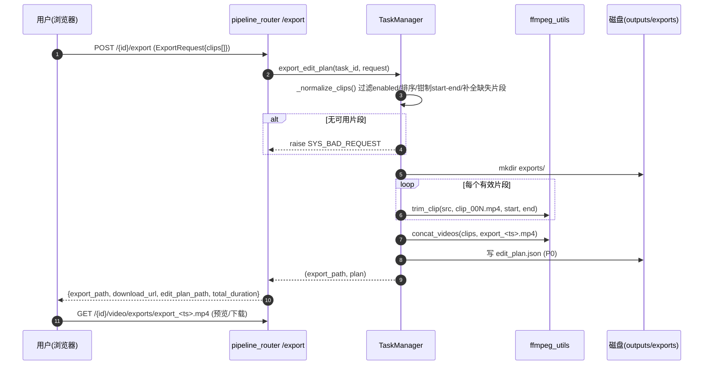
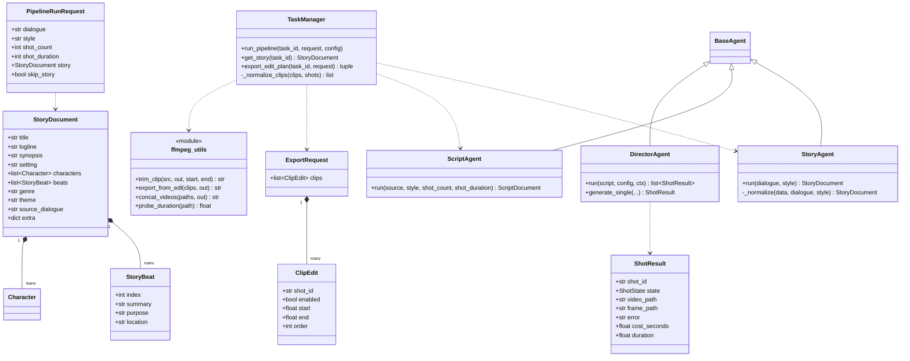

# StoryForge 增量系统设计：剧情补全 与 视频剪辑区

> 文档类型：**增量设计**（只描述本次变更，不重复旧架构）
> 依据：`docs/增量PRD-剧情补全与视频剪辑.md`（v0.2）
> 撰写人：高见远（架构师）　|　项目根：`E:\ai\storyforge`　|　语言：简体中文
> 约束：Python 3.13 + FastAPI + 原生 HTML/CSS/JS；**零 CDN、零新增第三方依赖**

---

## 1. 变更影响面总览

| 文件路径 | 变更类型 | 一句话变更说明 | 所属层次 |
| --- | --- | --- | --- |
| `app/models/schemas.py` | 修改 | 新增 `StoryDocument`/`StoryBeat`/`ClipEdit`/`ExportRequest`；`ShotResult` 增 `duration`；`PipelineRunRequest` 增 `story`/`skip_story` | 数据契约 |
| `app/services/prompt_templates.py` | 修改 | 新增 `_STORY_SCHEMA`/`story_system_prompt()`/`story_user_prompt()`/`script_user_prompt_from_story()` | 服务·提示词 |
| `app/agents/story_agent.py` | **新增** | `StoryAgent`：粗糙对话 → `StoryDocument` | 智能体 |
| `app/agents/script_agent.py` | 修改 | `run()` 首参放宽为 `StoryDocument \| str`（保留 str 兜底，旧调用不破） | 智能体 |
| `app/agents/director_agent.py` | 修改 | `generate_single()` 成功后 `probe_duration()` 回填 `ShotResult.duration` | 智能体 |
| `app/services/task_manager.py` | 修改 | `StageName.ALL` 前置 `story`；`run_pipeline` 新增 story 阶段；`record.story`+`get_story()`；`export_edit_plan()` | 服务·编排 |
| `app/utils/ffmpeg_utils.py` | 修改 | 新增 `trim_clip()`、`export_from_edl()`（裁剪+拼接+统一编码） | 工具 |
| `app/routers/pipeline_router.py` | 修改 | 新增 `GET /{id}/story`、`POST /{id}/export` | API |
| `app/static/index.html` | 修改 | 进度区加第 5 张 story 卡片；④ 改造为剪辑区；帮助弹窗同步；加「查看剧情」 | 前端 |
| `app/static/app.js` | 修改 | `STAGE_KEYS` 加 `story`；剪辑区渲染/排序/裁剪/启用/预览/导出；查看剧情 | 前端 |
| `app/static/style.css` | 修改 | 剪辑区样式（片段卡、置灰、导出进度、预计时长） | 前端 |
| `tests/stub_llm_server.py` | 修改 | `_classify()` 增 `story` 分支，返回 `STORY_JSON` | 测试支撑 |
| `tests/e2e_smoke.py` | 修改 | 阶段断言由「四阶段」扩为「五阶段」（含 `story`）+ 可选 `story.json` 断言 | 测试 |
| `docs/使用说明.md` | 修改 | 增补「剧情补全」「视频剪辑」两节 | 文档 |

**明确不改**：`ScriptDocument`、`Shot`、`Character`、既有 4 阶段逻辑、适配器层、`result_router`（`{name:path}` 已能服务 `exports/…`）。

### 1.1 现有测试受影响清单（阶段数 4→5）

| 测试文件 | 影响 | 结论 |
| --- | --- | --- |
| `tests/e2e_smoke.py` | L168–170 硬编码 `("script","director","concat","critic")`；且流水线新增 story 后，若桩不答 story 则任务直接 failed | **必改**：加 `story` 键断言；桩补 story 分支 |
| `tests/stub_llm_server.py` | `_classify()` 无 story 分支，会返回 `SCRIPT_JSON` → `StoryAgent` 规范化失败 → 整条任务失败 | **必改**：新增 story 分类 |
| `tests/test_script_agent.py` | 以 `run("对话","realistic",2,4)` 传 **str** | **保持绿**：靠 `ScriptAgent` str 兜底路径不变 |
| `tests/test_director_resilience.py` | 断言 `frame_path`/`video_path`，未断言字段全集 | **保持绿**：`duration` 默认值不影响 |
| `tests/test_ffmpeg_utils.py` / `test_llm_client.py` / `test_paths_security.py` | 不涉阶段枚举 | **保持绿** |
| `scripts/e2e_llamacpp.py` | 仅遍历 `stages` 打印，无硬编码 | 无需改（自动多打一行 story） |

---

## 2. 需求 1 设计：剧情补全（rough dialogue → story → script）

### 2.1 `StoryDocument` / `StoryBeat` 最终字段（`extra="ignore"`，列表用 `default_factory`）

| 字段 | 类型 | 默认 | 中文含义 |
| --- | --- | --- | --- |
| `title` | `str` | `"未命名故事"` | 故事标题 |
| `logline` | `str` | `""` | 一句话梗概 |
| `synopsis` | `str` | `""` | **完整故事情节（多段正文）** |
| `setting` | `str` | `""` | 时空/场景总设定（供 `ScriptDocument.scene` 复用） |
| `characters` | `list[Character]` | `[]` | 角色表（**复用** `Character{name,desc}`） |
| `beats` | `list[StoryBeat]` | `[]` | 情节节点（起承转合） |
| `genre` | `str` | `""` | 题材/类型（可由 style 推导） |
| `theme` | `str` | `""` | 主题立意 |
| `source_dialogue` | `str` | `""` | 原始粗糙对话（溯源） |
| `extra` | `dict` | `{}` | 预留扩展位 |

`StoryBeat`：`index:int=0`（节点序号，规范化时按 1..N 重排）、`summary:str=""`、`purpose:str=""`、`location:str=""`。

> **偏离说明**：PRD 将 `index/summary` 标为必填，此处给默认值以兼容小模型漏字段；`_normalize` 会按数组顺序重排 `index=1..N`。`beats` 仅要求 ≥1 即通过、不因 <3 硬失败（避免脆弱重试），**由提示词强约束 3–6 条**满足 AC2。

### 2.2 `StoryAgent`（`app/agents/story_agent.py`，新增）

```python
class StoryAgent(BaseAgent):
    def __init__(self, llm) -> None:                       # super().__init__(llm, name="story_agent")
    def run(self, dialogue: str, style: str) -> StoryDocument:
        # messages = [{"role":"system","content":story_system_prompt()},
        #             {"role":"user","content":story_user_prompt(dialogue, style)}]
        # data = self.chat_json(messages, temperature=0.85, timeout=180.0)   # 复用 BaseAgent 的容错+重试
        # return self._normalize(data, dialogue, style)
    def _normalize(self, data, dialogue: str, style: str) -> StoryDocument: ...
```

- **错误处理**：全部复用现有约定——`chat_json` 连续失败抛 `LLMError(ErrorCode.LLM_BAD_JSON, …)`；`_normalize` 对非 dict、`synopsis` 为空、`beats` 为空时同样抛 `LLMError(ErrorCode.LLM_BAD_JSON, "模型返回的剧情结构无效…")`，交由 `run_pipeline` 统一置 `failed`。**不新增错误码**。

### 2.3 `prompt_templates.py` 新增/修改签名

```python
_STORY_SCHEMA: str                                   # 模块常量，含全字段 JSON 示例
def story_system_prompt() -> str                     # 新增
def story_user_prompt(dialogue: str, style: str) -> str   # 新增
def script_user_prompt_from_story(story, style, shot_count, shot_duration) -> str   # 新增
# 既有 script_user_prompt(dialogue, style, shot_count, shot_duration) 保持不变（str 兜底路径）
```

**强约束要求（延续现有风格）**：system 提示词必须含「只输出一个 JSON 对象，不要任何解释、标题、Markdown 代码块标记或多余文字」+「字段必须完整不得缺失」+「`synopsis` 至少 2 段、`beats` 3–6 条覆盖起承转合」；user 提示词给出 `_STORY_SCHEMA` 全文并以「再次强调：只输出上述 JSON 对象本身」收尾。解析统一走 `parse_json_lenient` + `chat_json` 自动重试（最多 2 次）。

### 2.4 `run_pipeline()` 插入位置与失败短路

在**原阶段 1（ScriptAgent，L275）之前**插入新阶段，写法**照抄**现有阶段 1：

```
阶段 1：story（新增）
  update_stage(story, RUNNING, "调用 LLM 补全剧情")            # started = perf_counter()
  try:  story = request.story or StoryAgent(llm).run(request.dialogue, request.style)
        若 request.story 提供 → 跳过调用直接用；若 request.skip_story → 标记 success("已跳过") 并走 str 兜底
  except: update_stage(story, FAILED, str(exc), elapsed); self._fail(task_id, f"剧情补全失败：{exc}"); return
  record.story = story
  update_stage(story, SUCCESS, f"共 {len(story.beats)} 个情节点", elapsed)
  self._write_json(out_dir/"story.json", story.model_dump(mode="json"))
阶段 2：script（原阶段 1，改造）
  ScriptAgent(llm).run(record.story or request.dialogue, request.style, shot_count, shot_duration)
阶段 3~5：director / concat / critic（原样不变）
```

`StageName`：`STORY = "story"`，`ALL = ("story","script","director","concat","critic")`——**story 必须排在最前**，前端按此顺序渲染。

---

## 3. 需求 2 设计：视频剪辑区（EDL + 导出）

### 3.1 剪辑指令（EDL）契约

```python
class ClipEdit(BaseModel):
    shot_id: str = ""            # 片段标识（对应 ShotResult.shot_id）
    enabled: bool = True         # 是否参与预览与导出
    start: float = 0.0           # 裁剪起点（秒，>=0）
    end: float | None = None     # 裁剪终点（秒）；None = 到片段结尾
    order: int | None = None     # 可选显式顺序；缺省以 clips 数组顺序为准

class ExportRequest(BaseModel):
    clips: list[ClipEdit] = []   # 有序剪辑方案
```

**顺序语义**：以 `clips` **数组顺序**为准；若提供 `order`，先按 `(order is None, order)` 稳定排序再取数组序，二者兼容。

**边界语义与校验（`TaskManager._normalize_clips()` 纯函数，先归一后导出）**：

| 规则 | 策略 |
| --- | --- |
| `start < 0` | 钳制为 `0.0` |
| `end is None` | 取该片段真实时长 `duration` |
| `end <= start` | 视为无效裁剪 → 回退整段 `[0, duration]` |
| `end > duration` | 钳制为 `duration` |
| `start >= duration` | 视为无效 → 回退整段 `[0, duration]` |
| `duration <= 0`（探测失败） | 视为整段、**不裁剪**（探测失败不丢片、不阻断导出） |
| `clips` 未覆盖的片段 | 视为 `enabled=True`、不裁剪，按原始顺序**追加**到末尾（宽容） |
| `shot_id` 重复 | 去重（保留首个） |
| 全部 `enabled=False` 或结果为空 | 抛 `SYS_BAD_REQUEST`「没有可导出的片段」 |

### 3.2 FFmpeg 新函数（`app/utils/ffmpeg_utils.py`）

```python
def trim_clip(src_mp4: str, out_mp4: str, start: float = 0.0,
              end: float | None = None, *, timeout: int = 300) -> str
def export_from_edl(clips: "list[tuple[str, float, float|None]]", out_mp4: str,
                    *, timeout: int = 600) -> str
```

- `trim_clip`：`start<=0 且 end is None` → `shutil.copy2` 直拷；否则**统一重编码**裁剪：
  `ffmpeg -y -ss {start} -to {end} -i src -c:v libx264 -preset veryfast -pix_fmt yuv420p -an -movflags +faststart out`，经 `_run([...])` 调用（**不走 shell**、Windows 加 `_CREATE_NO_WINDOW`）。缺失二进制经 `_require_ffmpeg()` 抛 `FFM_NOT_FOUND`；执行失败抛 `FFM_EXEC_FAILED`。
- `export_from_edl`：临时目录逐个 `trim_clip` → `clip_000.mp4…`，再调用**现有** `concat_videos(trimmed, out_mp4)`；`finally` 清理临时目录。无输入抛 `FFM_CONCAT_FAILED`。
- **降级策略**：裁剪失败时该片段回退为「整段复制」；`concat_videos` 已内置「`-c copy` 失败 → `-c:v libx264 -pix_fmt yuv420p` 重编码」回退，直接复用。

**为什么必须考虑「裁剪后各片段编码参数不一致导致 concat 失败」**：若部分片段用 `-c copy`（沿用原编码/时基）而部分重编码，`concat demuxer` 对 `codec/timebase/pix_fmt/分辨率/帧率` 不一致的输入会失败或花屏。因此**所有裁剪片段统一用同一组编码参数重编码**（同分辨率=任务配置、`libx264/yuv420p`），从根本上消除不一致；`concat_videos` 的 copy→重编码回退作为第二道保险。

### 3.3 产物命名与落盘位置

- 目录：`outputs/<ts>/exports/`（`Paths.new_output_dir()` 未预建，**lazy `mkdir(parents=True, exist_ok=True)`**）。
- 成片：`exports/export_<YYYYMMDD_HHMMSS>.mp4`（同名追加序号），**绝不覆盖** `final_video.mp4`。
- 方案：`outputs/<ts>/edit_plan.json`（**P0**，导出时同步落盘，保证可复现/可审计）。
- 对前端返回**任务相对正斜杠路径**（如 `exports/export_20260210_153000.mp4`），**禁止暴露 `E:\` 绝对路径**；播放走既有 `GET /{id}/video/{name:path}`（`safe_join` 支持嵌套），下载走 `GET /{id}/download-artifact?name=exports/export_…mp4`。**无需新增加载端点**。

### 3.4 新增 API 端点

| 方法 | 路径 | 请求体 | 响应 `data` | 主要错误码 |
| --- | --- | --- | --- | --- |
| GET | `/api/pipeline/{task_id}/story` | — | `StoryDocument` | `TASK_NOT_FOUND`（未生成/任务不存在） |
| POST | `/api/pipeline/{task_id}/export` | `ExportRequest` | `{task_id, export_path, download_url, edit_plan_path, clip_count, total_duration}` | `TASK_NOT_FOUND`、`TASK_FAILED`（脚本/成功镜头缺失）、`SYS_BAD_REQUEST`（无可导出片段）、`FFM_EXEC_FAILED`/`FFM_CONCAT_FAILED` |

- `POST /export` **同步执行**（单任务内片段数有限、用户主动触发），前端禁用按钮并显示「导出中…」；统一响应 `{ok,data,error}`。
- `export_path`/`edit_plan_path` 为任务相对正斜杠路径；`download_url` 直接给 `download-artifact` 相对 URL，前端零拼装。
- **P1（本次不实现）**：`POST /{task_id}/story`（编辑剧情→重跑 script）、`story_review` 阻塞闸门、`edit_plan.json` 刷新自动恢复——按主理人决策本期不做。

---

## 4. 数据流与时序（Mermaid sequenceDiagram）

### 4.1 主流水线：story → script → director → concat → critic

```mermaid
sequenceDiagram
    autonumber
    participant U as 用户(浏览器)
    participant API as pipeline_router
    participant TM as TaskManager
    participant BG as 后台线程
    participant SE as StoryAgent
    participant SA as ScriptAgent
    participant DA as DirectorAgent
    participant FF as ffmpeg_utils
    participant CA as CriticAgent
    participant FS as 磁盘(outputs)

    U->>API: POST /api/pipeline/run (dialogue,story?,skip_story?)
    API->>TM: create_task()/set_request() → task_id
    API-->>U: {task_id, output_dir} 立即返回
    BG->>TM: update_stage(story, RUNNING)
    alt 未提供外部 story 且未跳过
        BG->>SE: run(dialogue, style)
        SE-->>BG: StoryDocument
    end
    BG->>FS: 写 story.json
    BG->>TM: update_stage(story, SUCCESS)
    BG->>SA: run(StoryDocument|str, style, shot_count, shot_duration)
    SA-->>BG: ScriptDocument
    BG->>FS: 写 script.json ; update_stage(script, SUCCESS)
    loop 每个 shot
        BG->>DA: generate_single(...)
        DA->>FF: generate → extract_last_frame → probe_duration
        DA->>TM: update_shot(..., duration=真实时长)
    end
    BG->>FF: concat_videos(shots) → final_video.mp4
    BG->>TM: update_stage(concat, SUCCESS)
    BG->>CA: run(script, shots, skip_video_eval)
    BG->>FS: 写 evaluation_report.json ; state=SUCCESS
    U->>API: GET /{id}/story | /script | /status
    API-->>U: 对应 JSON
```

### 4.2 剪辑导出链路



---

## 5. 类图（Mermaid classDiagram，仅新增/修改）



---

## 6. 任务列表（有序、带依赖，共 5 个）

> 分组原则：按实现顺序 + 功能模块（契约/智能体/编排+导出/前端/测试+文档）；每个任务 ≥3 文件；依赖尽量收敛。

| 任务 | 标题 | 涉及文件（精确路径） | 依赖 | 优先级 |
| --- | --- | --- | --- | --- |
| **T01** | 数据契约与提示词层 | `app/models/schemas.py`、`app/services/prompt_templates.py`、`tests/stub_llm_server.py` | — | P0 |
| **T02** | 智能体层（Story + Script 改造 + 时长探测） | `app/agents/story_agent.py`(新)、`app/agents/script_agent.py`、`app/agents/director_agent.py` | T01 | P0 |
| **T03** | 编排与导出后端（流水线 + Story/Export API） | `app/services/task_manager.py`、`app/routers/pipeline_router.py`、`app/utils/ffmpeg_utils.py` | T01, T02 | P0 |
| **T04** | 前端剪辑区 + 剧情入口（零 CDN） | `app/static/index.html`、`app/static/app.js`、`app/static/style.css` | T01, T03 | P0 |
| **T05** | 测试同步 + 文档 | `tests/e2e_smoke.py`、`tests/stub_llm_server.py`(复核)、`docs/使用说明.md` | T01–T04 | P0 |

### 完成标准（可验证）

**T01**
- `from app.models.schemas import StoryDocument, StoryBeat, ClipEdit, ExportRequest` 成功；`StoryDocument().beats == []`。
- `ShotResult().duration == 0.0`；`PipelineRunRequest(dialogue="x").skip_story is False` 且 `story is None`。
- `story_system_prompt()`/`story_user_prompt("d","realistic")` 返回非空且 system 含「只输出」与「JSON」字样。
- 桩 `_classify()`：请求含 `synopsis`/`beats` 关键字时返回 `STORY_JSON`（`beats` 3 条）。

**T02**
- `StoryAgent(FakeLLM).run("对话","realistic")` 返回 `StoryDocument`（`synopsis` 非空、`beats≥1`）；非法 JSON → `LLMError(LLM_BAD_JSON)`。
- `ScriptAgent(FakeLLM).run(VALID_SCRIPT_STR, "realistic", 2, 4)` 仍绿（str 兜底）；`run(StoryDocument)` 走 `script_user_prompt_from_story` 分支并返回 `ScriptDocument`。
- `DirectorAgent.generate_single()` 成功时 `ShotResult.duration > 0`（Mock 经 `probe_duration`）。

**T03**
- `StageName.ALL == ("story","script","director","concat","critic")`。
- `run_pipeline` 先执行 story；story 抛错 → 任务 `failed` 且 `error` 含「剧情补全失败」；成功则落盘 `story.json`。
- `GET /{id}/story` 返回 `StoryDocument`；未生成返回 `TASK_NOT_FOUND`。
- `POST /{id}/export`（含 `enabled/start/end/乱序`）→ 落盘 `exports/export_*.mp4` + `edit_plan.json`，`final_video.mp4` 的 mtime/内容**不变**；禁用片段不出现在成片；全禁用返回 `SYS_BAD_REQUEST`。

**T04**
- 进度区渲染 **5** 张卡片（story 在最前）；④ 区可排序/裁剪/启用/实时预览/导出新文件；「查看剧情」弹窗展示并可下载 `story.json`。
- `index.html` 无任何 `http(s)://` 外链；图标仅 Unicode（↑↓✓▷）/内联 SVG。
- 导出成功后出现导出文件播放/下载入口；刷新后默认回到 `final_video` 原始顺序、全启用、无裁剪（AC11）。

**T05**
- `tests/e2e_smoke.py` 断言改为「五阶段全部 success」并新增 `GET /{id}/story`、`story.json` 存在性断言，全通过。
- `docs/使用说明.md` 覆盖「剧情补全」「视频剪辑（排序/裁剪/禁用/导出）」。
- `python -m unittest` 既有单测全绿。

---

## 7. 共享知识（跨文件约定）

- **统一响应**：所有 JSON 为 `{ "ok": bool, "data": any, "error": str|null }`；错误串格式 `CODE: 中文`。
- **错误码选择**：story 失败复用 `LLM_BAD_JSON`，外层文案统一 `剧情补全失败：…`；导出用 `TASK_NOT_FOUND`/`TASK_FAILED`/`SYS_BAD_REQUEST`/`FFM_EXEC_FAILED`/`FFM_CONCAT_FAILED`。**不新增错误码常量**。
- **路径安全**：对外一律**任务相对正斜杠路径**（如 `exports/export_….mp4`）；禁止 `E:\` 绝对路径；访问一律经 `Paths.safe_join`（已支持嵌套）。
- **零 CDN 硬约束**：不得引入任何外链 CSS/JS/字体/图标；图标只用 Unicode 或内联 SVG。
- **阶段枚举一致性**：`StageName.ALL` 与前端 `STAGE_KEYS` **同值同序**（`story` 最前）；前端按 `status.stages` 动态渲染。
- **Mock 与真实适配器分支**：`DirectorAgent._build_prompt()` 的 Mock 分支不变；`duration` 探测对两类适配器**统一**执行，探测失败返回 `0.0`（剪辑端视为「不裁剪」）。
- **落盘**：`_write_json()` / `model_dump(mode="json")` + `ensure_ascii=False`、UTF-8；`edit_plan.json` 与导出成片同批落盘。
- **前端 DOM 约定**：`$()` 取元素、`toast()` 提示、`apiGet/apiPost` 封装、`.hidden` 控制显隐；剪辑区新增 id 统一以 `edit` 前缀（`editList`/`exportBtn`/`exportResult`/`previewPlayer`）。
- **`extra="ignore"`**：所有 Pydantic 模型保持一致，容忍 LLM 多返回字段。

---

## 8. 依赖包

**结论：零新增第三方依赖。**

- 剧情补全：纯 LLM 调用，复用 `LLMClient` + `chat_json` + `parse_json_lenient`。
- 视频剪辑/导出：纯 **FFmpeg 命令行**，新增 `trim_clip`/`export_from_edl` 复用 `_run`/`concat_videos`/`probe_duration`。
- 前端：原生 HTML/CSS/JS，无构建链、无时间轴引擎。
- **明确不引入**：`moviepy`（改用 ffmpeg 命令行）、任何滑块/拖拽/时间轴库（v1 用输入框 + Unicode 按钮；拖拽为 P1）。

---

## 9. 风险与待明确事项（≤5）

1. **阶段数 4→5 的破坏面**：`StageName.ALL`、前端 `STAGE_KEYS`/卡片、`tests/e2e_smoke.py` 断言、`tests/stub_llm_server.py` 分类、`docs/使用说明.md`「四阶段」措辞须同步；漏改任一都会导致 e2e 失败。对策：T01 先改桩、T03 改枚举、T04 改前端、T05 统一回归。
2. **裁剪精度 vs 关键帧对齐**：`-c copy` 会吸附关键帧导致起点偏移。对策：裁剪**统一重编码**，AC7 容差 ±0.3s 可达帧级精度。
3. **concat 编码不一致**：copy 拼接异构片段会失败/花屏。对策：所有裁剪片段统一 `libx264/yuv420p/同分辨率帧率`，并保留 `concat_videos` 的 copy→重编码回退。
4. **导出端点同步阻塞**：大任务导出耗时可占住 HTTP 请求。对策：v1 同步（用户主动、单任务内片段有限），前端禁用按钮 + 提示；P2 再后台化（复用任务表）。
5. **时长探测失败（`duration==0`）**：剪辑 UI 无法裁剪该片段。对策：归一为「整段、不裁剪」，UI 禁用其裁剪输入并提示；探测失败**不阻断**导出。
