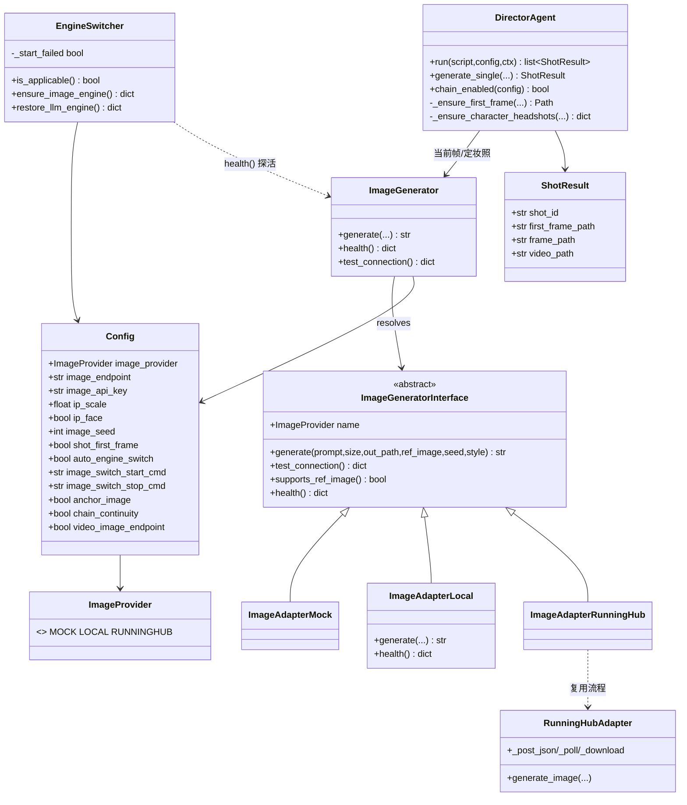
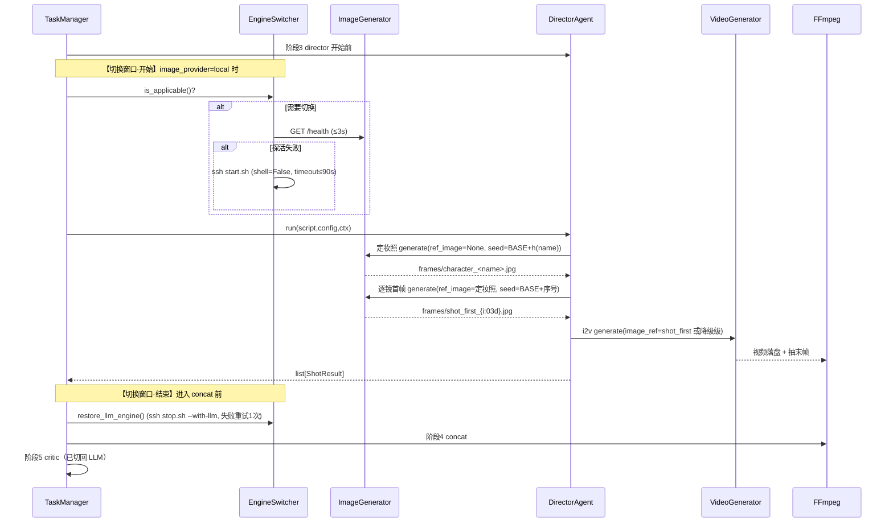

# 增量设计：本地图像服务接入（Phase 2）

> 文档类型：**增量设计 + 任务分解**（只描述本次变更）
> 项目：StoryForge（Python 3.13 + FastAPI + 原生 HTML/CSS/JS，零 CDN / 零新增 pip）
> 版本：v0.3 增量　|　语言：简体中文　|　作者：高见远（架构师）
> 输入：`docs/增量PRD-本地图像服务接入.md`、`deploy/image_server/README.md`、现有源码（逐行核对）
> 事实来源：本文件不臆造数据，全部来自上述 PRD / README / 源码；裁定记录见 §九。

---

## 一、实现方案与选型理由

### 1.1 核心难点
1. **两把引擎解耦**：必须允许 `video_provider=mock` 而 `image_provider=local`（PRD §3.1 R1、AC2）。现有 `VideoGenerator` 只有一条 `video_provider` 路由，无法表达「视频引擎 ≠ 图像引擎」。
2. **参考图入参**：本地服务要 `ref_image/ip_scale/ip_face/seed`（README §5），而现有 `VideoGeneratorInterface.generate_image` 无这些参数。
3. **引擎切换编排**：服务器 GPU 与 LLM 硬互斥（README §4），须在 `director` 阶段前后自动 `ssh start.sh/stop.sh`（裁定 1）。
4. **成本安全**：任何非法配置**绝不能**落到 `runninghub` 付费项（PRD §7 红线）。

### 1.2 为什么独立 `ImageGenerator` 而非扩展 `VideoGenerator`
| 维度 | 独立 `ImageGenerator`（采纳） | 扩展 `VideoGenerator`（否决） |
|---|---|---|
| 解耦 | 图像/视频两条独立路由轴，`mock`+`local` 可自由组合 | 单路由被迫捆绑，无法组合 |
| 接口 | `generate(ref_image, ip_scale, ip_face, seed)` 贴合 8090 契约 | 需给视频适配器强塞图像专用参数，污染视频语义 |
| Back-compat | `base.generate_image/supports_first_frame` **原样保留**（裁定 B），护既有测试 | 改签名会破坏既有适配器/替身 |
| 风险面 | 改动隔离在新增文件，回归面小 | 触碰运行中的视频主链，回归面大 |

选型：`app/services/image_generator.py`（服务层）+ `app/services/adapters/image_*.py`（适配器族，三 provider：`mock`/`local`/`runninghub`）。`runninghub` 图像适配器**复用** `RunningHubAdapter` 的 `_post_json/_poll/_download` 流程，端点留空用 `DEFAULT_IMAGE_ENDPOINT` + `video_base_url` 主机，非空 `image_endpoint` 显式覆盖。

### 1.3 引擎切换窗口（裁定 1）
- **只在 `image_provider==local` 且 `auto_engine_switch==true` 且 start 命令非空**时才有意义；`mock`/`runninghub` 不触发。
- 窗口：`story → script →` 【**进入 director 前** `ensure_image_engine()`】`→ director(定妆照→逐镜首帧→i2v) →`【**director 结束、concat 前** `restore_llm_engine()`】`→ concat → critic`。
- 依据：`DirectorAgent.llm` 参数当前**未被使用**，director 不需要 LLM；`critic` 在切回之后才跑。
- **先探活 `GET /health`（≤3s）**，仅当探活失败才执行 start（幂等，避免每次白等）；start 硬超时 **≤90s**；**任务级熔断**（一次失败本任务内不再尝试）；stop 失败**重试 1 次**，仍失败前端**显式**提示手工命令。两处均 `try/finally` 保证切回；`retry_shot` 同样独立一次窗口。

### 1.4 首帧优先级阶梯（裁定 D）
| 级别 | 来源 | 门禁开关 | 说明 |
|---|---|---|---|
| L1 | 本镜 `shot_first`（`ImageGenerator` 出图） | `shot_first_frame` | 主路径；产物 `frames/shot_first_{i:03d}.jpg` |
| L2 | 场景锚图 `anchor_image`（`ImageGenerator` 出图） | `anchor_image` | 兼容回退位；产物 `frames/scene_{idx:02d}.jpg` |
| L3 | 上一镜末帧（`chain_continuity`） | `chain_continuity` | 语义降为**兜底** |
| L4 | `None` | — | 无首帧文生视频 |

**每一级失败都降级到下一级，绝不中断**；对同一镜**最多新增一张图**（L1 成功即止，绝不双份出图）。
**与 PRD §9 裁定 5 的关系（已定稿）**：`shot_first_frame=false` 时 L1 关闭 → L2 成为主路径，可**完全复现旧行为**；两者同真时绝大多数镜头走 L1，`anchor_image` 仅在「L1 关闭」或「L1 失败降级」时被读取（非"双份"）。
**关键口径（已定稿）**：所有静态图（定妆照 / 逐镜首帧 / 场景锚图）**一律经 `ImageGenerator`**，由 `image_provider` 决定来源；`VideoGeneratorInterface.generate_image` 与 `video_image_endpoint` 仅 **back-compat 保留**，新路径不再调用（杜绝图像服务故障时静默回退 RunningHub 收费文生图，守住 PRD §7 成本红线）。

---

## 二、文件清单

| 相对路径 | 新增/修改 | 职责 |
|---|---|---|
| `app/models/enums.py` | 修改 | 新增 `ImageProvider`（`mock`/`local`/`runninghub`）+ 中文 label |
| `app/models/schemas.py` | 修改 | `Config` 增 10 字段；`to_public` 脱敏 `image_api_key`；`ShotResult` 增 `first_frame_path` |
| `app/services/config_store.py` | 修改 | `_ALLOWED_IMAGE_PROVIDERS`；`_SECRET_FIELDS` 加 `image_api_key`；布尔矩阵扩容；`ip_scale/seed` 钳制；字符串字段校验 |
| `app/services/prompt_templates.py` | 修改 | 新增 `build_character_prompt`（定妆照）/ `build_shot_first_prompt`（逐镜首帧） |
| `app/services/adapters/image_base.py` | **新增** | `ImageError` + `ImageGeneratorInterface`（含 `generate/health/supports_ref_image`） |
| `app/services/adapters/image_mock_adapter.py` | **新增** | Mock 图像适配器，复用 `make_mock_image`（零成本、纯本地） |
| `app/services/adapters/image_local_adapter.py` | **新增** | 8090 本地服务适配器：`POST image_endpoint`（ref_image/ip_scale/ip_face/seed）+ `GET /health` |
| `app/services/adapters/image_runninghub_adapter.py` | **新增** | RunningHub 文生图适配器，复用既有 post/poll/download（付费项） |
| `app/services/adapters/__init__.py` | 修改 | 追加 `IMAGE_ADAPTER_REGISTRY`（不改动既有 `ADAPTER_REGISTRY`） |
| `app/services/image_generator.py` | **新增** | 图像服务层统一入口，按 `image_provider` 路由；`health()` 供切换探活与按钮 |
| `app/services/engine_switch.py` | **新增** | `EngineSwitcher`：探活→start→stop 编排、超时、重试、任务级熔断 |
| `app/agents/director_agent.py` | 修改 | 注入 `image_generator`；实现首帧阶梯与定妆照缓存复用；回填 `first_frame_path` |
| `app/services/task_manager.py` | 修改 | `_run_director_phase`/`retry_shot` 包裹切换窗口（`try/finally`） |
| `app/routers/config_router.py` | 修改 | 照 `test-video` 增 `POST /api/config/test-image`（探活，失败不阻塞） |
| `app/static/index.html` | 修改 | 新增「图像生成」配置分组（radio/端点/开关/ip 控件），**零外链** |
| `app/static/app.js` | 修改 | `collectConfig/applyConfig` 同步新字段；新增「测试图像服务」按钮逻辑 |
| `tests/stub_llm_server.py` | 修改 | 增 `POST /v1/images/generations` 返回小 PNG base64（E2E 零外网） |
| `tests/run_e2e.sh` | 修改 | 桩配置增图像字段并指向 stub；跑完校验 `config.json` md5 不变 |
| `docs/使用说明.md` | 修改 | 增「本地图像服务（省钱/换机/失败降级）」章节 |

---

## 三、数据结构与接口

### 3.1 新增枚举与字段
```python
class ImageProvider(str, Enum):
    MOCK = "mock"; LOCAL = "local"; RUNNINGHUB = "runninghub"   # label: 模拟(不出图)/本地图像服务(零成本)/RunningHub出图(会产生费用)
```
`Config` 新增（全部带默认值 → 旧 JSON 兼容）：`image_provider=LOCAL`、`image_endpoint=""`（**留空 = 各 provider 用自家默认**；`local` 内建默认常量 `http://127.0.0.1:8090/v1/images/generations`，`runninghub` 内建默认 `DEFAULT_IMAGE_ENDPOINT` + `video_base_url`）、`image_api_key=""`、`ip_scale:float=0.4 (ge=0.0,le=0.6)`、`ip_face:bool=True`、`image_seed:int=20261007`、`shot_first_frame:bool=True`、`auto_engine_switch:bool=True`、`image_switch_start_cmd=""`、`image_switch_stop_cmd=""`。`ShotResult` 新增 `first_frame_path: str | None = None`（任务相对正斜杠）。

> **AC19 口径修正（已定稿，不改 PRD 文件）**：`image_endpoint` 字段**默认值为空串 `""`**；"留空时 local 使用默认 8090 端点"等价成立，开箱即用不变。非空 `image_endpoint` 一律按用户所填**显式覆盖**（以 `http(s)://` 开头=完整 URL，否则拼到 `video_base_url`），UI 文案写清「留空用默认；填了即覆盖」。

### 3.2 关键签名（仅结构，不含实现）
```python
# image_base.py
class ImageError(Exception):  # 携带 VID_* 错误码（复用既有前缀）
    def __init__(self, code: str, message: str) -> None: ...

class ImageGeneratorInterface(ABC):
    name: ImageProvider
    def __init__(self, cfg: Config) -> None: ...
    @abstractmethod
    def generate(self, prompt: str, size: str, out_path: str, *,
                 ref_image: str | None = None, seed: int | None = None,
                 style: str = "realistic") -> str: ...
    @abstractmethod
    def test_connection(self) -> dict: ...           # {ok,provider,message}
    def supports_ref_image(self) -> bool: return False
    def health(self) -> dict: return {"ok": False, "message": "不支持探活"}

# image_generator.py
class ImageGenerator:
    def __init__(self, cfg: Config) -> None: ...
    def _resolve_adapter(self) -> ImageGeneratorInterface: ...
    def generate(self, prompt, size, out_path, *, ref_image=None, seed=None, style="realistic") -> str: ...
    def test_connection(self) -> dict: ...
    def health(self) -> dict: ...                     # 绝不抛异常（供探活/按钮）
    def supports_ref_image(self) -> bool: ...

# engine_switch.py
class EngineSwitcher:
    def __init__(self, cfg: Config) -> None: ...
    def is_applicable(self) -> bool: ...              # local 且 auto_engine_switch 且 start 非空
    def ensure_image_engine(self) -> dict: ...        # {switched,degraded,message}
    def restore_llm_engine(self) -> dict: ...         # {restored,manual_required,message}
```

### 3.3 类图


---

## 四、调用流程

### 4.1 引擎切换窗口（含起止位置）


> **单镜首帧降级链**（详见 §1.4 阶梯）：L1 `shot_first`（ref=定妆照）→[失败/关闭]→ L2 场景锚图 `generate_image` →[失败/关闭]→ L3 上一镜末帧 →[失败]→ L4 `None`（无首帧文生视频，记 `ShotResult.error`）；每级独立 `try/except`，绝不中断。

---

## 五、有序任务列表（T01–T05）

> 依赖关系：T01 → T02 → T03 → T05；T01、T02 → T04 → T05。每任务均须通过 `node --check app/static/app.js`（如涉及）与全量单测。

### T01 数据模型与配置层（基础设施）　【P0】
- **目标**：打通配置入口与落地，保证非法值成本安全。
- **涉及文件**：`app/models/enums.py`、`app/models/schemas.py`、`app/services/config_store.py`、`tests/stub_llm_server.py`。
- **依赖**：无。
- **要点**：`_ALLOWED_IMAGE_PROVIDERS`；非法/垃圾值 → **回退 `local`**（绝不到 `runninghub`）；`image_api_key` 入 `_SECRET_FIELDS` 且 `to_public` 脱敏；`_BOOL_FIELDS` 加 `ip_face/auto_engine_switch`，`shot_first_frame` 与 `anchor_image` 同入 `_COST_BOOL_FIELDS`（无法解析时**显式写回 `False`**，付费 provider 下写错值绝不被默认 `True` 静默开启）；`ip_scale` 钳制 `[0.0,0.6]`（非数值删键走默认）；`image_seed` 非 `int` **或负值**删键走默认（不引入「-1=随机」隐语义）；`image_endpoint` 默认空串、非 `str` 删键记 warn；字符串字段（切换命令）非 `str` 删键；stub 增 `POST /v1/images/generations`（返回小 PNG base64）+ `GET /health`。
- **验收**：AC1、AC2、AC19、AC21（后端侧）；AC13/AC16 不受影响。

### T02 图像服务层（适配器族 + ImageGenerator + 切换器）　【P0】
- **目标**：三 provider 图像能力 + SSH 切换编排，与视频引擎彻底解耦。
- **涉及文件**：`app/services/adapters/image_base.py`、`image_mock_adapter.py`、`image_local_adapter.py`、`image_runninghub_adapter.py`、`adapters/__init__.py`、`app/services/image_generator.py`、`app/services/engine_switch.py`、`app/services/prompt_templates.py`。
- **依赖**：T01。
- **要点**：本地适配器按 README §5 透传 `prompt/size/seed/ref_image/ip_scale/ip_face/gen_long_side/negative_prompt`，`negative_prompt` 由 local 适配器**内建模块常量**提供（不新增配置字段）；解 `data[0].b64_json` 落盘 JPG（`base64` 标准库）；`image_endpoint` 留空时 `local` 用内建默认常量、`runninghub` 用 `DEFAULT_IMAGE_ENDPOINT`+`video_base_url`（沿用既有 `_split_url`），非空即显式覆盖；`health()` `GET /health` ≤3s（`/health` 由**实际解析出的生成端点**的 `scheme://netloc` 派生）；`EngineSwitcher` 用 `shlex.split(cmd, posix=True)` → `subprocess.run(argv, shell=False, timeout=90, creationflags=_CREATE_NO_WINDOW)`（**非 Windows 按平台条件化**）；任务级熔断；`build_character_prompt`/`build_shot_first_prompt`。
- **验收**：AC3、AC8、AC9、AC12、AC14；裁定 A/B/C/D/E/F/G。

### T03 导演层与流水线集成　【P0】
- **目标**：定妆照 + 逐镜首帧阶梯接入 director，切换窗口接入任务/battle重试。
- **涉及文件**：`app/agents/director_agent.py`、`app/services/task_manager.py`。
- **依赖**：T02。
- **要点**：`DirectorAgent(llm, video_generator, image_generator=None)`（默认 None → 内部按 config 构造）；定妆照 `frames/character_<name>.jpg` 固定 seed 复用（`<name>` 经**安全化函数**：剥离 `\/:*?"<>|` 等非法字符 + 截断 ≤24 字符 + 空名回退 `char_{序号}`）；逐镜 `shot_first_{i:03d}.jpg` 连续编号；L1→L2→L3→L4 降级（L2 锚图亦经 `ImageGenerator`，`anchor_image` 门禁）；`ShotResult.first_frame_path` 回填（任务相对正斜杠）；`_run_director_phase` 用 `try/finally` 包裹切换窗口（进入前 `ensure_image_engine`、director 结束 `restore_llm_engine`，**在 concat 之前**）；`retry_shot` 独立窗口。
- **验收**：AC4、AC5、AC6、AC7、AC10、AC11、AC15、AC18。

### T04 前端与路由　【P1-1】
- **目标**：配置区「图像生成」分组 + 「测试图像服务」按钮。
- **涉及文件**：`app/static/index.html`、`app/static/app.js`、`app/routers/config_router.py`、`docs/使用说明.md`。
- **依赖**：T01、T02。
- **要点**：radio `name="image_provider"`（**不得与 `video_provider` 冲突**）；**零外链**（图标用 Unicode/内联 SVG）；`collectConfig/applyConfig` 同步；`POST /api/config/test-image` 探活返回 `ready/busy/gpu/ip_adapter`，失败仅提示不阻塞；使用说明增章节。
- **验收**：AC9（前端显式提示）、AC13、AC17（本轮不新增 .bat）、AC20、AC21。

### T05 测试同步与 E2E 回归　【P0】
- **目标**：既有测试反映新架构（**不降低覆盖强度**）+ 新增覆盖 + E2E 零外网。
- **涉及文件**：`tests/test_consistency_increment.py`、`tests/test_director_resilience.py`、`tests/test_consistency_adversarial.py`（如需）、`tests/run_e2e.sh`、`tests/stub_llm_server.py`（复用 T01 改动）、**新增** `tests/test_image_service.py`。
- **依赖**：T01–T04。
- **要点**：见 §需同步修改清单；新增图像适配器/切换器/首帧阶梯单测；E2E 桩配置 `image_provider=local`+`image_endpoint` 指向 18080+`auto_engine_switch=false`；跑完 `config.json` md5 仍为 `3a23fc3d09a0c8dce57066d6ec501bfb`。
- **验收**：全量单测（基线 385 OK，新增用例只增不减）、E2E 56/56 exit 0。

**需同步修改的既有测试（不降低覆盖强度）**：
| 测试 | 影响 | 处理 |
|---|---|---|
| `tests/test_consistency_increment.py`（`TestDirectorAnchorChaining`） | director 图像调用点迁至 `ImageGenerator`，默认 `shot_first_frame=True`；锚图断言（`image_calls==2`、`image_ref=scene_00`）走新阶梯 | 注入假 `ImageGenerator` 或 `Config(shot_first_frame=False)` 复现旧行为；**新增** L1→L4 阶梯用例 |
| `tests/test_director_resilience.py` | 默认走 L1 会对真 8090 探活 → 噪声 | `_run` 传 `Config(shot_first_frame=False)` 或注入空 `ImageGenerator`；保留既有「首镜无帧/后续承接末帧」断言 |
| `tests/test_consistency_adversarial.py` | `DirectorAgent(None, vg)` 仍可用（第三参可选） | 预计不变；若失败则仅补 `image_generator` 替身 |
| `tests/test_frontend_consistency.py` | app.js 新增 `$()` 引用必须落 `index.html` | 补 id；`data-stage` 恒 5 不变 |
| `tests/test_runninghub_adapter.py` | `RunningHubAdapter.generate_image` **保留**（裁定 B） | 预计不变；若端点解析改动需回归 |
| `tests/e2e_smoke.py` + `run_e2e.sh` | 默认 `image_provider=local` 会连 8090 | 桩配置指向 stub + 关自动切换 + md5 校验 |
| `tests/test_frozen_compat.py` | 无 | 不变 |

---

## 六、零新增依赖说明
| 能力 | 复用既有手段 | 说明 |
|---|---|---|
| HTTP（本地/ RH 图像） | `httpx`（已装） | 沿用 `runninghub_adapter` 的 `httpx.post` 模式；`GET /health` 用 `httpx.get` |
| 子进程（SSH 切换） | `subprocess.run(list)` + `shell=False` | `shlex.split` 拆命令；Windows 加 `_CREATE_NO_WINDOW`（条件化） |
| base64 解码 / JSON | 标准库 `base64` / `json` | 解 8090 `b64_json` 落盘 |
| 图像落盘 | 原生 `Path.write_bytes` | 无 PIL；Mock 图像复用 `ffmpeg_utils.make_mock_image` |
| 视频/抽帧/拼接 | `ffmpeg_utils`（命令行子进程） | 不变 |

**结论**：未引入任何 pip 包；HTTP 全走 `httpx`；FFmpeg 全走命令行子进程（AC14）。

---

## 七、共享知识 / 跨文件约定
- **响应格式**：统一 `{ok,data,error}`，错误串 `CODE: 中文`，报错**只复用**既有 `ErrorCode`（`CFG_/LLM_/VID_/FFM_/TASK_/SYS_`），**不新增前缀**。
- **路径规范**：对外一律**任务相对正斜杠路径**（如 `frames/shot_first_001.jpg`、`frames/character_小明.jpg`），严禁 `E:\…`。
- **角色名文件名安全化**：`frames/character_<name>.jpg` 的 `<name>` 经安全化函数处理——剥离 `\/:*?"<>|` 等非法字符 + 截断 ≤24 字符 + 空名回退 `char_{序号}`；同一安全化函数同时用于 seed 哈希键（保证文件名与 seed 稳定一致）。
- **常量**：`BASE_SEED=20261007`；定妆照 seed = `BASE_SEED + 稳定哈希(角色名)`（用 `hashlib` 稳定哈希，非内置 `hash`）；逐镜首帧 seed = `BASE_SEED + 镜头序号`。`negative_prompt` 由 local 适配器**内建模块常量**提供（不新增配置字段）。
- **缓存/幂等键**：定妆照 `frames/character_<name>.jpg`、首帧 `frames/shot_first_{i:03d}.jpg`、锚图 `frames/scene_{idx:02d}.jpg`、末帧 `frames/frame_{i:03d}.jpg`；**已存在且非空即复用**，不重算。
- **图像端点解析**：`image_endpoint` **默认空串 `""`**（留空 = 各 provider 用自家默认）；非空时以 `http(s)://` 开头 = 完整 URL，否则拼到 `video_base_url`；`/health` 由**实际解析出的生成端点**的 scheme+netloc + `/health` 派生（本轮不新增字段）。
- **成本安全**：非法 `image_provider` → `local`；`anchor_image`/`shot_first_frame`/`ip_face` 等布尔无法解析 → 写回安全值（前两者属付费开关，兜底 `False`）；`image_seed` 非 int 或负值删键；绝不静默切付费。
- **`StageName.ALL` 恒 5**，前端 `data-stage` 锁死，**不新增阶段**。

---

## 八、风险清单与回滚
| # | 风险 | 影响 | 缓解 / 回滚 |
|---|---|---|---|
| R1 | SSH 切换阻塞/失败 | 流水线卡死 | 硬超时 ≤90s + 任务级熔断 + 探活幂等；失败按 AC7/AC8 降级；回滚 = 关 `auto_engine_switch` 或清空切换命令 |
| R2 | E2E 被外网污染 | 结果不可信 / config 被改 | stub 提供 images+health；`auto_engine_switch=false`；跑完校验 md5 `3a23fc…` 不变；失败即还原 |
| R3 | 既有测试大批改动 | 回归风险 | 仅改必要的 6 个测试文件，且**只换测试替身/开关**、不删断言；新增用例补覆盖 |
| R4 | `anchor_image` 语义变更 | 旧行为兼容 | 阶梯口径见 §1.4；`shot_first_frame=false` 可复现旧行为；**L2 锚图经 `ImageGenerator`**（`anchor_image` 门禁），`VideoGeneratorInterface.generate_image`/`video_image_endpoint` 仅 back-compat 保留、新路径不调用 |
| R5 | `ShotResult` 增字段 | 序列化/前端断言 | 默认 `None`，仅**增**字段；检查并更新任何断言字段集的用例 |
| R6 | 默认 `image_provider=local` 使无隧道时连 8090 | 延迟/日志噪声 | 连接拒绝快速失败 + 降级；文档说明「未开隧道即降级」 |
| R7 | 非法配置落到付费项 | 意外花费 | `_ALLOWED_IMAGE_PROVIDERS` 回退 `local`；付费布尔兜底；单测正向断言 |

**总体回滚**：本轮全部为**新增文件 + 可关开关**；最坏情况将 `image_provider` 设 `mock`、`auto_engine_switch=false`、`shot_first_frame=false`、`anchor_image=false` 即回到纯旧路径；代码级回滚 = 移除 `image_*` 新文件与 director/task_manager 挂接点。

---

## 九、待明确事项（已全部裁定）
1. **首帧阶梯口径**：已定稿——L1 `shot_first` → L2 场景锚图（`ImageGenerator`，`anchor_image` 门禁）→ L3 上一镜末帧 → L4 `None`；L1 成功即止绝不双份；`shot_first_frame=false` 完全回旧行为。
2. **`image_endpoint` 默认值**：已定稿——默认**空串 `""`**；`local` 留空用内建默认 `http://127.0.0.1:8090/v1/images/generations`，`runninghub` 留空用 `DEFAULT_IMAGE_ENDPOINT` + `video_base_url`；非空即显式覆盖。AC19 口径同步修正（见 §三 3.1）。
3. **`/health` 派生**：已定稿——按**实际解析出的生成端点**的 `scheme://netloc` + `/health`；本轮不新增字段。
4. **追加小修**：已定稿——角色名文件名安全化（剥离非法字符 + 截断 ≤24 + 空名回退 `char_{序号}`）；`negative_prompt` 由 local 适配器内建常量提供；`shot_first_frame` 纳入 `_COST_BOOL_FIELDS`（兜底 `False`）；`image_seed` 非 int 或负值删键。

**无未决事项。**
